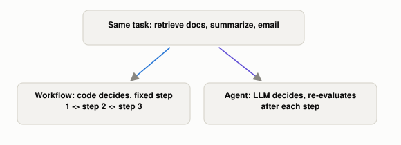

# What's Actually Different Between an "AI Agent" and "Agentic AI"?

*~3 min read*

**One-line answer:** both terms describe systems built from the same pieces (an [LLM](what-is-an-llm.md), some tools it can call, some instructions). Anthropic's own framing groups all of these under one umbrella, "agentic systems," then splits them by how much the LLM itself is steering: a **workflow** follows a path a human wrote in code, while an **agent** decides its own next step at run time [1].

*Same building blocks, same task. The only difference is who picks the next step.*

| Term | Who decides what happens next | Example |
|---|---|---|
| Workflow | The code, step by step, written in advance | "Always: retrieve docs, then summarize, then email" |
| Agent | The LLM itself, turn by turn, based on what it just saw | "Figure out what's needed, use whatever tools get there" |

*Same building blocks (LLM + tools + instructions) in both rows. The difference is who's holding the steering wheel.*

## The problem

"AI agent" and "agentic AI" get used almost interchangeably in marketing and casual conversation, which makes them sound like two different technologies when they usually aren't. They describe the same system at different levels of description (one specific component vs. the overall design approach). Sometimes they describe the exact same thing with different words, depending on who's talking.

## How it works

1. Anthropic's engineering team, who build agent systems for a living, "categorize all these variations as **agentic systems**". That is the broad umbrella term for anything where an LLM has some autonomy over what happens next [1].
2. Within that umbrella: "**Workflows** are systems where LLMs and tools are orchestrated through predefined code paths". The sequence of steps is fixed by a human in advance, even if an LLM does the actual work at each step [1].
3. "**Agents**, on the other hand, are systems where LLMs dynamically direct their own processes and tool usage," meaning the LLM itself decides, at each turn, what to do next, rather than following a path someone already wrote [1].
4. In casual use: "an AI agent" usually points at one concrete thing: a specific bot, assistant, or component with a job. "Agentic AI" usually points at the broader *approach*: building a system that sets its own subgoals and adapts, rather than following a fixed script. The underlying pieces (a model, tools, instructions) are identical either way; the words differ by scope, not by technology.
5. Definitions here aren't fully standardized across the industry. Different companies and papers draw this line slightly differently, but "how much of the control flow is decided by the LLM at run time, versus fixed in code ahead of time" is the distinction nearly all of them are actually pointing at.

## When this picture isn't enough

This spectrum isn't binary. Most real systems mix the two, using a fixed workflow for parts that genuinely don't need judgment (always fetch the user's account first) and agent-style autonomy for the part that does (then decide how to resolve their actual complaint). Whether to give a system more autonomy is also not purely a capability question: more autonomy means less predictability and a bigger blast radius if the model picks a bad action, which is a real engineering tradeoff, not just a matter of "agentic is more advanced than agent."

The loop that makes an agent an agent is in [the agent loop](what-the-agent-loop-is.md); the security side is in [tools raise the stakes](why-an-agent-with-tools-raises-the-stakes.md).

## Takeaway

Don't ask "is this an agent or agentic AI" as if they're competing categories. Ask "how much of what happens next is this LLM actually deciding for itself, versus just executing a path a human already wrote."

## Sources

[1] Building Effective Agents, Anthropic (2024), https://www.anthropic.com/engineering/building-effective-agents
