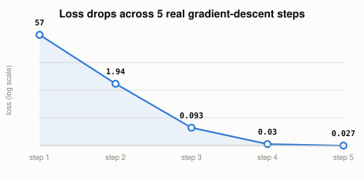

# How Can a Program "Learn" a Rule Nobody Programmed?

*~4 min read*

**One-line answer:** machine learning is trial-and-error, automated: the program guesses, checks how wrong the guess was against real examples, and nudges itself a little less wrong. It repeats that thousands of times until it lands on a rule nobody ever typed in [1].

**The shape of it, in plain terms:** it's the same motion as guessing a number while someone tells you "too high" or "too low" after each try. You don't know the answer up front, but each hint narrows where you guess next. A learning algorithm does exactly that, just with numbers instead of words for the hint, and thousands of tries instead of a handful.



*"Loss" is just a number for "how wrong." Nobody set it. Five rounds of guess-and-correct brought it from very wrong (57) to barely wrong (0.027).*

## The problem

Open a traditional program's source and the rule is right there: `if temp < 68, turn on heat`. Open a learning algorithm's source and that rule isn't written anywhere. Only the *procedure* for finding it is. The actual numbers that drive its behavior exist only as values the program arrived at by trial and error, not a line of code you can point to and say "there's the rule."

## How it works

Picture a vending machine receipt-checker trying to work out the machine's pricing (a price per snack, plus a one-time card fee) just by watching old receipts (number of snacks bought, and the total charged). Nobody tells it the price or the fee. It has to work both numbers out purely from examples.

1. **Start with a wild guess.** Assume price-per-snack is $0 and the fee is $0. That is obviously wrong, but it has to start somewhere.
2. **Check the guess against real receipts.** Using today's guess, predict what each receipt's total *should* have been, and compare that to what it actually was. The size of that gap is the "loss", a single number for "how wrong am I right now."
3. **Figure out which way to nudge.** If guessing too low makes totals too small, raise the guess a little; if too high, lower it. Nudge both numbers a small step in whichever direction shrinks the gap.
4. **Repeat, on the same receipts.** Look at the exact same examples again, not new ones. That means more passes over the same evidence, not more evidence, and each pass the guess gets a bit less wrong [1].

## Real example

I generated receipts from a rule I kept secret from the program: **$2 per snack, plus a $1 flat fee** (`y = 2x + 1`, with `x` = snacks bought and `y` = total charged). Then I ran five rounds of guess-check-nudge (`uv run examples/how-a-program-learns/gradient_descent_demo.py`) and watched it close in on that rule from nothing:

```
step 1: price guess=$0.000  fee guess=$0.000  how wrong=57.000
step 2: price guess=$2.500  fee guess=$0.700  how wrong=1.940
step 3: price guess=$2.040  fee guess=$0.580  how wrong=0.093
step 4: price guess=$2.122  fee guess=$0.610  how wrong=0.030
step 5: price guess=$2.105  fee guess=$0.612  how wrong=0.027
```

By step 5 it's at $2.11-per-snack and a $0.61 fee, closing in on the real $2 and $1, from five looks at the same handful of receipts and nothing else. Nobody told it those numbers; it backed into them by seeing how wrong each guess was and correcting.

Underneath that plain-language "guess, check, nudge" loop is real arithmetic. You don't need to follow the formula to get the idea, but here it is for precision:

```python
w, b = 0.0, 0.0   # w = price-per-snack guess, b = fee guess
for step in range(1, 6):
    preds = [w * x + b for x in xs]
    errors = [p - y for p, y in zip(preds, ys)]
    grad_w = 2 * sum(e * x for e, x in zip(errors, xs)) / len(xs)
    grad_b = 2 * sum(errors) / len(xs)
    w -= 0.05 * grad_w
    b -= 0.05 * grad_b
```

## When this breaks down

This converged cleanly because the rule really was that simple ($2 × snacks + $1, no exceptions) and the receipts had no messiness in them. Real data rarely does, and "how wrong" then settles near a small floor instead of hitting zero. The nudge size (`0.05` here) matters more than it looks: too large and the guesses overshoot and swing wildly; too small and it takes far more rounds to get anywhere close. And this is the simplest possible case: one input, one output, one straight-line rule. The same guess-check-nudge procedure is what trains a neural network, just with millions of numbers being nudged at once instead of two.

## Takeaway

Machine learning replaces a hand-written rule with a procedure that *searches* for one: guess, check against real examples, nudge toward less wrong, repeat. It uses nothing but the size of its own mistakes as feedback.

## Sources

[1] Machine Learning, Tom M. Mitchell, McGraw Hill (1997), author's page, http://www.cs.cmu.edu/afs/cs.cmu.edu/user/mitchell/ftp/mlbook.html
