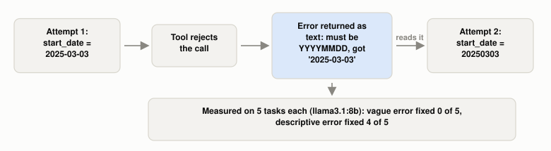

# How Does an Agent Recover From Its Own Mistakes?

*~3 min read*

**One-line answer:** an [agent](ai-agents-vs-agentic-ai.md) loop can hand a failure back to the model as an observation it reads on the next turn. In one small run of this demo only, a descriptive error fixed 4 of 5 tasks and a vague one fixed 0 of 5.

*The blue box is the whole mechanism: the failure becomes text the model reads before its next move.*

## The problem

Picture two GPS units. Take a wrong turn and the first says "wrong turn, recalculating" and shows a new route. The second goes silent and keeps driving you away. Both made the same mistake, but only one told you what happened.

An agent's [loop](what-the-agent-loop-is.md) has the same two cases: the failure comes back as readable text or as a bare "error". A loop that keeps failing is what a [stop condition](why-agent-loops-need-stop-conditions.md) cuts off.

## How it works

1. The model calls a tool. The tool checks the call and fails.
2. The harness puts the failure into the conversation as a tool result. Anthropic's tool-writing guide says you can prompt-engineer error responses to "clearly communicate specific and actionable improvements, rather than opaque error codes or tracebacks" [1].
3. The model reads that text on its next turn.
4. Other work also feeds feedback back to a model. In Self-Refine, "the same LLMs provides feedback for its output and uses it to refine itself, iteratively" [2]. Reflexion agents "verbally reflect on task feedback signals" and keep that text as memory for later trials [3].
5. In the demo below, the vague message is the single word `error`.

## Real example

The script gives a local model a strict tool, `days_between(start_date, end_date)`, that only accepts dates like `20250303`. The tool description never mentions the format. The model gets five date questions, up to 3 attempts each, with either a vague `error` or a descriptive message on failure.

| Error style | Tasks fixed within 3 attempts |
|---|---|
| Vague (`error`) | 0 of 5 |
| Descriptive (names the expected format) | 4 of 5 |

Run it with `uv run examples/how-an-agent-recovers-from-its-own-mistakes/error_feedback_demo.py`.

In this run, with the vague error, two tasks repeated the same bad dates on every retry and three produced no tool call on the retry. With the descriptive error, the four successful retries switched to the correct `YYYYMMDD` format on attempt 2, and the one failure produced no tool call on its retry. This is one small run: 5 tasks per condition, one model (`llama3.1:8b`), temperature 0 and seed 1. It does not show how often this happens in general.

## When this picture isn't enough

The demo tests one tool, one format rule and one kind of error message. It says nothing about other tools, other models, or the Self-Refine and Reflexion setups, which the cited abstracts report separately. For bad information staying in the context, see [context poisoning](what-is-context-poisoning.md).

The loop itself is in [the agent loop](what-the-agent-loop-is.md), and the limits that stop a failing loop are in [stop conditions](why-agent-loops-need-stop-conditions.md).

## Takeaway

In one small run of this demo, 4 of 5 tasks recovered with a descriptive error and 0 of 5 with a vague one.

## Sources

[1] Writing effective tools for agents, Anthropic Engineering, https://www.anthropic.com/engineering/writing-tools-for-agents
[2] Self-Refine: Iterative Refinement with Self-Feedback, Madaan et al., https://arxiv.org/abs/2303.17651
[3] Reflexion: Language Agents with Verbal Reinforcement Learning, Shinn et al., https://arxiv.org/abs/2303.11366
