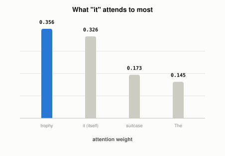

# How Does a Transformer Decide Which Earlier Words Matter?

*~3 min read*

**One-line answer:** attention computes a relevance score between a token and every other token in the input, turns those scores into weights that sum to 1, then blends the other tokens' information using those weights. So a model can connect "it" to a noun several words back just as easily as to the word right before it [1].

*"it" distributes its attention across every token at once. Trophy gets the biggest share.*

| Token "it" attends to | Weight |
|---|---|
| trophy | 0.356 |
| it (itself) | 0.326 |
| suitcase | 0.173 |
| The | 0.145 |

*"It" pays almost two and a half times more attention to "trophy" than to "The". The weights are what let the model connect a pronoun to the right earlier word.*

## The problem

Older architectures read text strictly in order, one token at a time, carrying everything they'd seen so far into a single running summary. By the time that summary reached word 20, information from word 2 had often been diluted or overwritten, which is a real bottleneck. The paper that introduced the transformer removed the recurrence (reading in strict order) entirely and built an architecture "based solely on attention mechanisms," letting every token connect directly to every other token regardless of distance [1].

## How it works

1. Every token already has [a vector of numbers attached to it](what-is-an-embedding.md) (built up from training).
2. For the token you're currently processing (the "query"), compute a relevance score against every other token's vector (the "keys"), including itself, using a dot product (a direction-and-magnitude comparison that's higher when two vectors point the same way).
3. Turn those raw scores into weights that sum to 1 (a softmax), so they behave like percentages of attention paid to each token.
4. Blend every token's information together, weighted by those percentages, to produce a new, context-aware vector for the query token.
5. Every token does this against every other token at the same time. That's "self-attention", which is why distance between related words stops mattering the way it did for older, strictly sequential architectures [1].

## Real example

The table above comes from code I ran myself (`uv run examples/how-attention-weighs-words/attention_demo.py`), on the sentence "The trophy didn't fit in the suitcase because it was too big." The four vectors (`The`, `trophy`, `suitcase`, `it`) are hand-picked illustrative numbers, not weights from a real trained model, but the three-step calculation (dot product, softmax, weighted blend) is the real mechanism a transformer runs. With a query vector for "it" chosen close in direction to "trophy," the math gives "trophy" the highest weight, same shape of result a real model produces when it correctly resolves what "it" refers to.

## When this picture isn't enough

A real transformer runs many of these attention calculations in parallel per token ("multi-head attention"), each potentially picking up on a different kind of relationship, not just the one score shown here. Real token vectors also have hundreds of dimensions, not two, and come from training, not a hand-set value. And attention weights are easy to over-read as "the model's explanation for its answer". They show what the token's calculation keyed on, which isn't the same claim as a reliable explanation of why the model produced its final output.

## Takeaway

Attention replaces "read in order, remember everything" with "directly compare every token to every other token and weigh accordingly". That is why relevance, not distance, decides what a model connects.

## Sources

[1] Attention Is All You Need, Vaswani et al., Google Brain/Research & University of Toronto (2017), https://arxiv.org/abs/1706.03762
