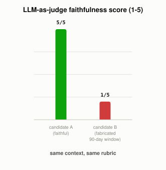

# How Do You Know If a RAG Answer Is Actually Any Good?

*~3 min read*

**One-line answer:** "LLM-as-a-judge" means using a second LLM call to grade the first one's answer against the retrieved context on a rubric. The rubric is usually faithfulness (does it contradict the context), relevance (does it address the question), and completeness. This is used because checking thousands of open-ended answers by hand doesn't scale, and a strong LLM judge is "a scalable and explainable way to approximate human preferences," which are otherwise expensive to collect at scale [1].


*Same judge, same rubric, same context. It scores the faithful answer high and the fabrication low.*

```
context: "Our return policy allows refunds within 30 days of purchase,
          no questions asked."

candidate A: "You can return the item within 30 days of purchase for a refund."
  judge score: 5 -- "accurately summarizes the return policy"

candidate B: "You can return the item within 90 days of purchase for a
              refund, plus we will cover return shipping."
  judge score: 1 -- "extends the return period from 30 to 90 days...
                     which contradicts the original context"
```
*Same judge, same rubric, same context. It correctly separated a faithful summary from a confident fabrication.*

## The problem

A [RAG](what-problem-does-rag-actually-solve.md) pipeline can fail quietly: the answer reads fine, sounds confident, and is still wrong, either because retrieval returned the wrong chunk or because the LLM [hallucinated](why-llms-state-fake-facts-with-total-confidence.md) something not actually in the context it was given. There's no automatic pass/fail signal for "did this answer actually stick to the source material". Nothing crashes, and nothing throws an error. Someone (or something) has to actually read the answer against the context and judge it.

## How it works

1. Pick what you're actually grading. The common dimensions: **faithfulness** (does the answer contradict or go beyond what the retrieved context actually says), **relevance** (does it address what was asked), **completeness** (does it cover what the context could have answered).
2. Give a second LLM call the original question, the retrieved context, the answer to evaluate, and an explicit scoring rubric. The judge never sees anything the first model didn't also have access to. The approach was formalized specifically for cases like this: "we explore using strong LLMs as judges to evaluate these models on more open-ended questions" that don't have one single correct string to check against [1].
3. The judge returns a score and, usually, a short reason. That matters, because a bare number with no justification is much harder to sanity-check or trust.
4. This scales a human review process that otherwise can't keep up. Grading a handful of answers by hand is normal, but grading thousands or millions of them is only practical with an automated judge, even though that judge is itself an LLM with its own blind spots.

## Real example

I gave a local model (`llama3.1:8b`) one real context sentence and two candidate answers. One sticks to it, and one I deliberately wrote to contradict it (longer return window, an extra benefit never mentioned). Then I asked the same model to score both for faithfulness (`uv run examples/how-do-you-know-if-a-rag-answer-is-any-good/llm_judge_demo.py`):

```
faithful answer   -> judge score: 5
unfaithful answer -> judge score: 1, reason: "extends the return period
                      from 30 to 90 days... which contradicts the context"
```

The judge didn't just pattern-match on length or tone. It specifically named the two things the unfaithful answer added that weren't in the context (the extended window and the shipping offer), which is exactly what a faithfulness check is supposed to catch.

## When this picture isn't enough

An LLM judge is still an LLM: it can be fooled by confident-sounding but wrong answers, and it inherits whatever biases or blind spots its own training gives it. A common mitigation is using a stronger model as the judge than the one being evaluated, and periodically checking the judge's scores against actual human judgment rather than trusting it indefinitely. A judge score is also only as good as its rubric. A vague rubric ("is this good?") produces vague, inconsistent grading, while specific, narrow criteria ("does this contradict the context?") produce much more reliable results.

## Takeaway

LLM-as-a-judge doesn't replace checking whether a RAG system actually works. It's how you check it at a scale a human reviewer never could, by turning "is this answer faithful" into a second, narrowly-scoped LLM call instead of a manual read-through.

## Sources

[1] Judging LLM-as-a-Judge with MT-Bench and Chatbot Arena, Zheng et al., UC Berkeley (2023), https://arxiv.org/abs/2306.05685

