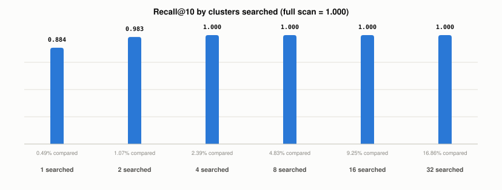

# How Does an IVF Index Trade Accuracy for Speed?

*~3 min read*

**One-line answer:** an IVF index sorts vectors into clusters ahead of time, then searches only the few clusters nearest to the query. Faiss describes the two settings: `nlist`, "the number of cells", and `nprobe`, "the number of cells (out of `nlist`) that are visited to perform a search" [1]. Search fewer cells and it is faster, but a true neighbour in an unsearched cell is missed.


*Recall@10 and share of vectors compared, from the saved run below (synthetic data).*

## The problem

Picture a library sorted into sections. You want one book, so you browse the two or three sections most likely to hold it, not every shelf. You finish fast. But if the book was shelved in a section you skipped, you never see it.

An IVF index works the same way. [The earlier index post](what-different-vector-index-strategies-trade-off.md) introduced it. This post is about the two knobs, and what each one costs. Each vector is an [embedding](what-is-an-embedding.md), a point in space, and "nearest" means closest point.

## How it works

1. Ahead of time, k-means groups the vectors into `nlist` clusters. Each cluster has a centre, and each vector is filed under its nearest centre.
2. At query time, the query is compared with the cluster centres only. The `nprobe` closest clusters are picked.
3. Only the vectors in those clusters are compared with the query. Faiss says the search time "roughly increases linearly with the number of probes plus some constant due to the quantization" [1].
4. The best matches among those vectors are returned. A true neighbour filed in any other cluster is never looked at.
5. The Jegou, Douze and Schmid paper says the same of its inverted file: "This allows rapid access to a small fraction of image indices" [2].

The first knob, `nlist`, sets how many clusters exist. The second, `nprobe`, sets how many are searched per query. Faiss notes that setting "nprobe = nlist gives the same result as the brute-force search (but slower)" [1].

## Real example

Synthetic data, fixed seed. The script builds 100,000 vectors of dimension 64 from 200 Gaussian blobs, runs 10 rounds of k-means with 256 clusters, then runs 200 queries. The exact top 10 for each query comes from a full scan of all 100,000 vectors. That full scan is the 100 percent recall baseline. Run it with `uv run examples/how-ivf-trades-recall-for-speed/ivf_recall_demo.py`.

```
searched  recall@10  compared  ms/query
       1      0.884     0.49%      0.08
       2      0.983     1.07%      0.13
       4      1.000     2.39%      0.27
       8      1.000     4.83%      0.54
      16      1.000     9.25%      1.09
      32      1.000    16.86%      2.05
full scan      1.000   100.00%      7.98
```

Recall@10 is the share of the exact top 10 that the search also returned. In this run, searching 1 cluster compared 0.49 percent of the vectors and found 88.4 percent of the true top 10. Searching 2 clusters raised that to 98.3 percent. From 4 clusters up, the printed recall was 1.000, which means it rounds to 1.000 at three decimals.

The median time per query rose from 0.08 ms with 1 cluster to 2.05 ms with 32 clusters. The full scan took 7.98 ms. Those timings come from one run on one machine; rerunning the script gives different milliseconds each time, while the recall and compared figures stay identical.

## When this picture isn't enough

This demo uses 200 well-separated Gaussian blobs, which makes the clusters easy to search. It does not show that real embeddings behave the same way, and real data was not tested. Other values of `nlist` were not tested either. Faiss itself says its own perfect result in one example "is merely an artifact of the data distribution" [1].

The baseline it is measured against is in [flat search](what-flat-vector-search-costs.md); a different approach to fast search is in [ScaNN](what-scann-does-differently.md).

## Takeaway

In this run, searching 2 of 256 clusters compared about 1 percent of the vectors and returned 98.3 percent of the exact top 10. Each cluster added raised the share of vectors compared and the time per query. The setting varied was `nprobe`, and the exact full scan is the baseline it is measured against.

## Sources

[1] Faster search (IVF), Faiss wiki, facebookresearch/faiss, https://github.com/facebookresearch/faiss/wiki/Faster-search
[2] Product quantization for nearest neighbor search, Jegou, Douze, Schmid, IEEE TPAMI 2011, https://inria.hal.science/inria-00514462v2/document
