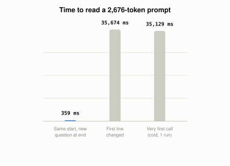

# How Does Prompt Caching Make Long Prompts Cheaper?

*~3 min read*

**One-line answer:** when many requests start with the same long text, the provider can keep the model's already-processed "working notes" for that opening and reuse them, so only the new tail is read fresh. Anthropic describes this as "resuming from specific prefixes in your prompts," with cache read tokens at 0.1 times the base input tokens price, except for some models listed in a table footnote [1]. OpenAI says it lets you "avoid recalculating a prompt prefix that the model has already processed" [2].


*Same handout every time; the only difference is where the change lands.*

## The problem

Picture a teacher who has just read your 50-page handout. If you walk up with a second question, she answers straight away, because she already knows the handout. If someone swaps the cover page first, she has to start over, since she can't be sure the rest still matches. An LLM app is in the same spot. If an app re-sends the same long [system prompt](what-context-engineering-is.md), tool definitions and documents with every request, and nothing is cached, the model re-reads all of it each time. That is [tokens](what-is-a-token.md) to pay for and time spent before the answer starts.

## How it works

1. The model reads the prompt and can keep internal working notes for it (OpenAI says the prompt cache stores "key-value (KV) tensors") [2].
2. If a later request begins with exactly the same text, the provider reuses those notes instead of recomputing them. OpenAI's wording: "Prompt caching reuses work when requests share the same prompt prefix" [2].
3. Only the new part is read fresh. In the demo below, that is the question. On cost, Anthropic lists cache read tokens at 0.1 times the base input tokens price, with per-model exceptions [1]. OpenAI says reused tokens are "discounted up to 95%" [2].
4. It only works from the start of the prompt. Anthropic's docs say to place static content (tool definitions, system instructions, context, examples) at the beginning, and that changes "invalidate that level and all subsequent levels" [1].
5. So the layout for [context engineering](what-context-engineering-is.md) that Anthropic's docs describe is: static content first. The demo below changes the first line to show what that costs.

## Real example

The script sends `llama3.1:8b` on Ollama a "handout" of 120 made-up locker rules (about 2,670 tokens) plus a question. It compares changing only the question against changing the first line on every call. Medians over 6 runs each:

```
cold first call (handout never seen): prompt_eval=35129.2 ms
(a) same first line, different question at the end:  median prompt_eval=358.7 ms
(b) first line changed every call, same handout:      median prompt_eval=35674.3 ms
```

Run it with `uv run examples/how-prompt-caching-works/prefix_cache_demo.py`. In this demo, changing only the question left prompt reading time at about 0.4 seconds. Changing the first line took about 35.7 seconds, close to the cold call's 35.1 seconds.

## When this picture isn't enough

This is a local timing demo, not a billing test. Hosted providers add rules. Anthropic's cache lifetime is 5 minutes by default [1]. Anthropic sets a minimum cacheable prompt length per model, from 512 tokens for several models to 4,096 for others [1]. OpenAI's is 1,024 tokens for GPT-5.6 and later, and varies by request settings for earlier models [2]. OpenAI also says a shared prefix does not guarantee a cache hit [2].

Related: [just-in-time context](what-just-in-time-context-is.md) and [compaction](what-context-compaction-is.md).

## Takeaway

In this demo, a prompt with the unchanging handout first and the changing question last was read in about 0.4 seconds, while a changed first line took about 35.7 seconds.

## Sources

[1] Prompt caching, Anthropic docs, https://platform.claude.com/docs/en/build-with-claude/prompt-caching
[2] Prompt caching, OpenAI API docs, https://platform.openai.com/docs/guides/prompt-caching
