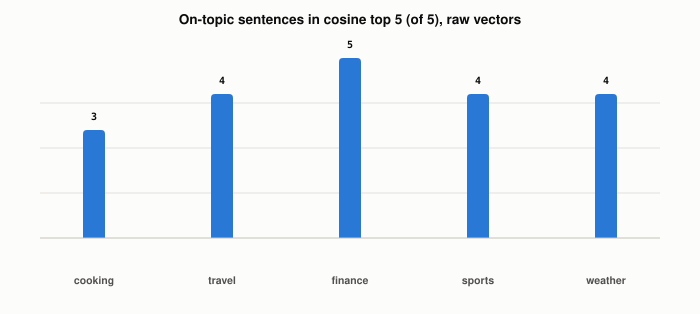

# How Does Vector Search Decide Two Vectors Are Similar?

*~4 min read*

**One-line answer:** vector search scores each pair of [embeddings](what-is-an-embedding.md) with one of a few measures: cosine similarity (do the arrows point the same way), dot product (direction and length together) or Euclidean distance (how far apart the arrow tips are).


*Printed by the run below: on-topic sentences among the cosine top 5, out of 5. Dot product and Euclidean distance returned the same five sentences in every case.*

## The problem

[Keyword search](why-you-cant-just-grep-your-way-to-semantic-search.md) asks whether the same words appear. Vector search asks which stored vectors sit closest to the query's vector. "Closest" needs a rule, and there is more than one.

## How it works

Picture two arrows drawn from the same starting point.

1. Cosine similarity ignores how long the arrows are. It only asks whether they point the same way.
2. Dot product uses both. Two arrows pointing the same way score higher when they are also long.
3. Euclidean distance does not ask about direction. It measures the straight-line gap between the two tips.
4. Now give every arrow the same length, 1. The length part is then identical for every pair, so only the angle is left to separate the pairs. For such vectors the three measures give the same ranking.
5. When lengths differ, a long arrow can beat a better-aimed short one on dot product, and the three rankings can disagree. The synthetic section below shows this with numbers.

Tools reflect this. The Faiss wiki's summary of methods lists exact inner product search as "also for cosine (normalize vectors beforehand)" [1]. The pgvector README says: "If vectors are normalized to length 1" "use inner product for best performance" [2]. It also notes that "`<#>` returns the negative inner product since Postgres only supports `ASC` order index scans on operators" [2], and for cosine similarity it says to "use 1 - cosine distance" [2].

## Real example, measured on embeddings

`uv run examples/how-vector-search-measures-similarity/metrics_demo.py` embeds 40 short sentences (8 each on cooking, travel, finance, sports, weather) with `nomic-embed-text` in one call. It then ranks them for 5 queries, one per topic, by cosine, dot product and negative Euclidean distance, on the raw vectors and on the same vectors scaled to length 1.

```
raw sentence vector length: min 0.999999, mean 1.000000, max 1.000000
```

In this run the raw vectors already had length 1, so scaling changed nothing. For all 5 queries, on both raw and scaled vectors, all three measures returned the same top 5 sentences (0 of 5 differ). So on real `nomic-embed-text` vectors the measures agreed, and this part of the run did not produce a case where they disagree. The cosine top 5 held 3, 4, 5, 4 and 4 sentences on the query's topic for cooking, travel, finance, sports and weather.

## Synthetic example, vectors of unequal length

The same script then builds 8 made-up candidate vectors in 4 dimensions with numpy (fixed seed 0, no embedding model involved), each with a different length. The query is `[1, 0, 0, 0]`. These are random numbers, not sentences. The printed output:

```
id  length  cosine     dot  distance
 0    0.93   0.955   0.893     0.298
 1    3.69   0.663   2.449     3.119
 2    2.77   0.676   1.873     2.218
 3    1.76  -0.217  -0.382     2.203
 4    2.58   0.781   2.017     1.908
 5    4.48   0.768   3.442     3.767
 6    4.69   0.926   4.341     3.783
 7    1.98   0.826   1.636     1.286
top 3 by cosine    : [0, 6, 7]
top 3 by dot       : [6, 5, 1]
top 3 by neg_euclid: [0, 7, 4]
```

The three measures ranked the same candidates differently. Cosine's top 3 was 0, 6, 7. Dot product's top 3 was 6, 5, 1, and Euclidean distance's top 3 was 0, 7, 4. No two of the three lists were the same. Candidate 5 has a lower cosine than candidate 7 (0.768 against 0.826), but a higher dot product (3.442 against 1.636). Its length is 4.48 against 1.98. This shows that the measures can disagree when lengths differ. It does not show how often that happens on real embeddings.

## When this picture isn't enough

The real-embedding part used one model and 40 sentences, and its vectors all had length 1, so it says nothing about real vectors of unequal length. The synthetic part uses 8 random vectors in 4 dimensions, so it shows that disagreement is possible, not how common it is. The post does not cover other measures such as L1 distance, which pgvector also lists [2].

The cost of scoring every stored vector is in [flat search](what-flat-vector-search-costs.md).

## Takeaway

Cosine looks at direction, dot product at direction and length, Euclidean distance at the gap between tips. With every vector at length 1 they rank alike, which is what this run's `nomic-embed-text` vectors did. With unequal lengths, the synthetic vectors produced three different top 3 lists.

## Sources

[1] Faiss wiki, Summary of methods, https://github.com/facebookresearch/faiss/wiki/Faiss-indexes
[2] pgvector README, https://github.com/pgvector/pgvector
