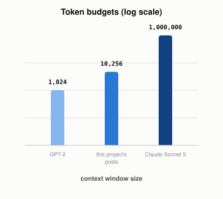

# What Is a "Context Window," and Why Does It Run Out?

*~2 min read*

**One-line answer:** a context window is every [token](what-is-a-token.md) a model can see at once (the whole conversation so far plus its own reply, all counted together), and once that total hits the model's fixed limit, nothing older fits anymore [1].


*The exact same real token count either overflows a window ten times over, or barely registers, depending only on the model.*

```
all current posts in this project, tokenized: 10,256 tokens

GPT-2 (2019), 1,024-token window:        1001.56% of it used already
GPT-3.5 (original), 4,096-token window:   250.39% of it used already
Claude Sonnet 4.5, 200,000-token window:    5.13% of it used
Claude Sonnet 5, 1,000,000-token window:    1.03% of it used
```
*The exact same real text (all of this project's posts) would have overflowed a 2019-era model's entire context window ten times over.*

## The problem

An [LLM](what-is-an-llm.md) has no separate, persistent memory between sessions. Nothing it has ever said sticks around unless it's physically present as tokens in the current request. A direct definition of this, from Anthropic's own documentation: "the 'context window' refers to all the text a language model can reference when generating a response, including the response itself. This is different from the large corpus of data the language model was trained on, and instead represents a 'working memory' for the model" [1].

## How it works

1. Every message you send, every reply the model gives, every tool result, every system prompt: all of it gets [tokenized](what-is-a-token.md) and counted against one shared budget.
2. That budget is fixed per model. It hasn't always been large: 1,024 tokens for GPT-2, a few thousand for early GPT-3.5, up to a million tokens for the largest current models.
3. Once a conversation's total token count approaches that limit, something has to give: either the request is rejected outright, or older turns get dropped or summarized to make room.
4. "A larger context window allows the model to handle more complex and lengthy prompts, but more context isn't automatically better. As token count grows, accuracy and recall degrade, a phenomenon known as *context rot*" [1] So the window isn't just a hard wall. It's also a quality gradient well before it's actually full.

## Real example

I ran the same tokenizer from [the tokenization post](what-is-a-token.md) over every post currently in this project and compared the total against a few real models' published context window sizes (`uv run examples/what-a-context-window-actually-limits/context_window_demo.py`):

```
all current posts: 10,256 tokens
GPT-2 (1,024 tokens):            1001.56% -- wouldn't have fit, by 10x
Claude Sonnet 5 (1,000,000):         1.03% -- barely a dent
```

A body of text this project has actually produced would have been physically impossible to hand to a 2019-era model as a single input. The limit isn't abstract. It's a real token count the real text either fits inside of, or doesn't.

## When this picture isn't enough

A bigger window isn't a free upgrade. Beyond raw capacity, what you put in the window and how it's organized matters, since [recall degrades with length even inside the stated limit](why-more-context-can-make-an-llm-worse.md) ("context rot"). Separately, a bigger window doesn't fix [hallucination](why-llms-state-fake-facts-with-total-confidence.md) or make retrieval better. It's purely about how much text can be present at once, not about whether the model uses that text well. Deciding what actually earns a place in that finite window, rather than dumping everything in, is its own discipline: [context engineering](what-context-engineering-is.md).

## Takeaway

A context window is a token budget, not a concept of memory. Everything the model "knows" about the current conversation has to physically be sitting inside that budget, every single turn.

## Sources

[1] Context windows, Anthropic, https://platform.claude.com/docs/en/build-with-claude/context-windows
