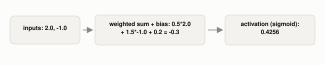

# What Does a Single Neuron In a Neural Network Actually Compute?

*~2 min read*

**One-line answer:** a neuron multiplies each input by a weight, adds a bias, and passes that single number through a nonlinear function. There is nothing biological about it, just arithmetic [1].



*Two numbers go in, one number comes out. Everything in between is the "neuron."*

## The problem

"Neuron" and "layer" sound like they're borrowed from biology, which makes it tempting to imagine something complicated happening inside a neural network, some loose analogy to how a brain cell fires. There isn't one. IBM describes a neural network as a model that "stacks simple 'neurons' in layers," and each neuron's job is two arithmetic operations: a weighted sum, then an activation function [1]. If you can't picture what's inside that box, everything built on top of it (layers, training, "deep" learning) stays abstract.

## How it works

1. Each input gets multiplied by its own weight. This is a learned number, same idea as the `w` from the last post, one per input [1].
2. All of those products get added together, plus one more learned number called the bias [1].
3. That single sum (`z`) passes through a nonlinear activation function. Here it is sigmoid, which squashes any number into the range (0, 1).
4. The result is the neuron's output: one number, ready to be an input to the next neuron.

## Real example

I ran this myself (`uv run examples/what-a-neuron-computes/neuron_demo.py`) with inputs `[2.0, -1.0]`, weights `[0.5, 1.5]`, and bias `0.2`:

```python
z = (0.5 * 2.0) + (1.5 * -1.0) + 0.2   # = -0.3
output = sigmoid(z)                     # = 0.4256
```

`z = -0.3`, and sigmoid turns that into `0.4256`. Change any single weight and this number changes, which is exactly what the learning procedure from the last post is nudging, just across many more neurons at once than one.

## When this picture isn't enough

A single neuron here only does what logistic regression already does: a weighted sum plus a squashing function. What makes a *network* different is stacking many of these, layer after layer, so later neurons combine the outputs of earlier ones into representations no single neuron could express on its own. One neuron alone isn't learning anything interesting yet. It's the depth and the stacking that start to matter, which is a separate idea from what one neuron computes.

## Takeaway

A neuron is two operations, weighted sum then nonlinearity, repeated at scale. That's the entire building block.


## Sources

[1] What Is a Neural Network?, IBM, https://www.ibm.com/think/topics/neural-networks
