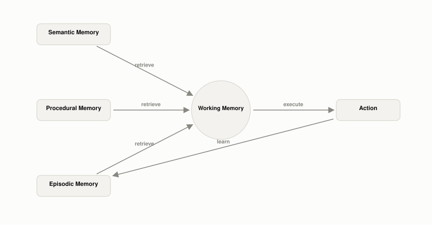

# What Is CoALA, and Why Does It Split Agent Memory This Way?

*~7 min read*

**One-line answer:** CoALA (Cognitive Architectures for Language Agents) treats a language agent as a production system where working memory is "the central hub connecting different components of a language agent" [1], and a repeating decision cycle is what actually ties the long-term memory stores, episodic, semantic, and procedural, into one agent.



*Working memory is the hub: every long-term store connects through it, not to each other directly.*

## The problem

Picture that same new teammate, but zoom out past any single day to their whole first month. At any moment they're focused on exactly one thing: the task in front of them right now, whatever's live in their head. What they reach for to handle it varies. Sometimes it's a fact they just know, like the design lead's city. Sometimes it's a specific thing that happened, like last Tuesday's outage. Sometimes it's a routine they've internalized, like the Friday release checklist. And sometimes, partway through, they decide something is worth writing down for next time.

That's not four separate abilities worth listing. It's one person running one loop: notice the task, pull in whatever's relevant, act, maybe write something down, then do it again. The posts on [semantic](what-semantic-memory-is-in-an-agent.md), [episodic](what-episodic-memory-is-in-an-agent.md), [procedural](what-procedural-memory-is-in-an-agent.md), and [prospective](what-prospective-memory-is-in-an-agent.md) memory in this series each describe one store on its own. This post is about the architecture that connects them, what plays the role of "what's live in their head right now," and the cycle that pulls the right store in at the right moment instead of the agent just having four disconnected filing cabinets.

That architecture has a name: CoALA, Cognitive Architectures for Language Agents, from a 2023 paper by Sumers, Yao, Narasimhan, and Griffiths [1]. It isn't a new memory type. It's the wiring diagram for the ones that already exist.

## How it works

1. **The core move is an analogy.** "We suggest a meaningful analogy between production systems and LLMs: just as productions indicate possible ways to modify strings, LLMs define a distribution over changes or additions to text" [1]. A production system is a classic AI idea: "Production systems generate a set of outcomes by iteratively applying rules" [1]. CoALA's claim: an LLM call is that same kind of rule, so the old machinery for controlling *which* rule fires next can be reused to control an LLM-based agent.
2. **That gives the agent three moving parts.** "CoALA organizes agents along three key dimensions: their information storage (divided into working and long-term memories); their action space (divided into internal and external actions); and their decision-making procedure (which is structured as an interactive loop with planning and execution)" [1]. This series' other posts cover "information storage"; this one covers the other two.
3. **Working memory makes "storage" into an architecture, not a list.** It "maintains active and readily available information as symbolic variables for the current decision cycle" [1], and doesn't belong to any one long-term store: it "serves as the central hub connecting different components of a language agent" [1]. Semantic, episodic, and procedural memory never talk to each other directly; everything one contributes to a decision passes through working memory first.
4. **The decision cycle moves information through that hub, repeatedly.** It "follows a repeated cycle" [1] in two stages: "program code defines a sequence of reasoning and retrieval actions to propose and evaluate alternatives (planning stage), then executes the selected action (execution stage) – then the cycle loops again" [1]. Execution means "the selected action is applied by executing the relevant procedures from the agent's source code" [1], and "an observation can be made from the environment, providing feedback from the agent's action, and the cycle loops again" [1]. This is a stricter, named version of [the agent loop](what-the-agent-loop-is.md): the paper calls it "analogous to a program's 'main' procedure... that runs in loops continuously, accepting new perceptual input and calling various action procedures in response" [1].
5. **The action space is four moves, each a direction of data flow through working memory.** Retrieval reads a store in: "a retrieval procedure... reads information from long-term memories into working memory" [1]. Reasoning "allows language agents to process the contents of working memory to generate new information," and, unlike retrieval, "reads from and writes to working memory" [1]. Learning writes back out: "Learning occurs by writing information to long-term memory" [1]. Grounding reaches outside the agent entirely: "Grounding procedures execute external actions and process environmental feedback into working memory as text" [1]. Four verbs; every one of them reads from or writes to working memory.

## Real example

The script below runs one CoALA-style decision cycle for a venue-booking task, with `llama3.1:8b` on Ollama (temperature 0). Semantic memory holds one fact (team size), episodic memory holds a note about a past problem at one venue. Procedural memory holds the filter-and-sort recipe, applied directly as code rather than as a string fed to the model, the "explicit knowledge written in the agent's code" form of procedural memory [1] (see the [procedural memory post](what-procedural-memory-is-in-an-agent.md) for the other form, implicit knowledge in the model's weights). The one LLM call is the reasoning action: given the shortlist and the episodic note, does the past problem change the pick.

Cycle 1, planning. Three retrieval actions pull one fact from each store:

```
[retrieval -> semantic memory]
{'team_size': 7}

[retrieval -> procedural memory]
filter venues by capacity >= team size, then by availability, then sort what's left by price ascending

[retrieval -> episodic memory]
 - Last booking at Downtown Studio had a Wi-Fi outage during the event.
```

The semantic fact and procedural recipe get applied in code first, producing a shortlist:

```
[semantic + procedural memory applied -> shortlist pulled into working memory]
 - Downtown Studio ($18)
 - Lakeside Room ($20)
 - City Center Hall ($22)
```

That shortlist, plus the raw episodic note, go into one assembled working-memory prompt, with a rule tying the note to the decision, worded so it doesn't assume a note is present: "if working memory above includes an episodic note reporting a past problem at a venue, treat that venue as disqualified, no matter how cheap it is." The reasoning action runs on that prompt three times for stability:

```
Since Downtown Studio had a Wi-Fi outage during the last event, I will pick Lakeside Room as it
is the cheapest venue on the shortlist that is not disqualified.

ANSWER: Lakeside Room
model picked: Lakeside Room   ground truth: Lakeside Room ($20)   correct: True
```

All three runs picked Lakeside Room, correctly skipping the cheapest option ($18 Downtown Studio) because of the episodic note, matching a ground truth computed independently in Python.

Cycle 1, execution: a grounding action carries the pick out, a stub observation closes the loop.

```
[grounding action -> recommend 'Lakeside Room' to the user]
[observation from environment -> user confirms the booking]
```

Cycle 2: a learning action writes the outcome back to episodic memory, informing the *next* cycle:

```
episodic memory before: ['Last booking at Downtown Studio had a Wi-Fi outage during the event.']
episodic memory after: ['Last booking at Downtown Studio had a Wi-Fi outage during the event.',
'Booking at Lakeside Room for 7 people confirmed, no issues reported.']
```

As a check on whether the note is actually doing anything, the same reasoning action re-runs with the episodic bullet left out of working memory entirely:

```
There is no episodic note reporting a past problem at any of the venues on the shortlist, so I
will recommend the cheapest venue, Downtown Studio, as it is the only option available.

ANSWER: Downtown Studio
model picked: Downtown Studio   ground truth: Downtown Studio ($18)   correct: True
```

Leaving the note out flips the pick back to Downtown Studio, the cheapest option, and the model correctly reports that no episodic note was present rather than inventing one, confirming the earlier pick was actually driven by what was in working memory, not by the model independently distrusting the cheapest venue. Run it with `uv run examples/what-coala-is-and-why-agent-memory-splits-this-way/coala_decision_cycle.py`.

## When this picture isn't enough

CoALA is explicit about what kind of document it is: the authors "propose a theoretical framework and use it to organize diverse empirical work" [1], a "conceptual framework to characterize and design general purpose language agents" [1]. It's a lens for comparing agents that already exist, not a spec any given agent must follow. A real system can skip stages, merge them, or implement "retrieval" as a database query instead of anything resembling reasoning, and still be a language agent.

It also doesn't cover everything this series does. [Prospective memory](what-prospective-memory-is-in-an-agent.md), a stored commitment tied to a future trigger, isn't one of CoALA's named long-term stores; the paper's four pieces are working, episodic, semantic, and procedural.

This post is part of a series on [the different kinds of memory an agent can have](what-kinds-of-memory-an-agent-has.md). For the short-term/long-term split working memory sits inside, see [why agents need memory beyond the context window](why-agents-need-memory-beyond-the-context-window.md).

## Takeaway

CoALA's contribution isn't naming semantic, episodic, and procedural memory, it's explaining why an agent needs a working memory hub and a decision cycle connecting them into one loop [1]. Without that hub, "four memory types" is just four separate lists; with it, each cycle pulls exactly the stores a task needs into one place, acts, and optionally writes the result back out.

## Sources

[1] Cognitive Architectures for Language Agents, Sumers et al., https://arxiv.org/abs/2309.02427
