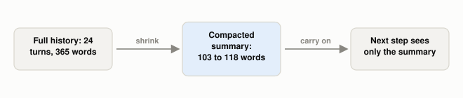

# What Is Context Compaction?

*~3 min read*

**One-line answer:** context compaction is what an [agent](ai-agents-vs-agentic-ai.md) does when its conversation nears the [context window](what-a-context-window-actually-limits.md) limit: it replaces the long history with a short summary and carries on from there. Anthropic defines it as "taking a conversation nearing the context window limit, summarizing its contents, and reinitiating a new context window with the summary" [1].

*Everything after the middle box is built on the summary alone; whatever it left out is gone.*

## The problem

Picture a nurse finishing a 12-hour shift. The log runs 40 pages, but the colleague taking over gets one page: who is stable, who needs a check at 3 a.m., which allergy matters. That handover note is what makes the next shift possible. It is also a risk: if the nurse forgets to write down one allergy, the next shift has no way to know it was ever there.

An agent's [context window](what-a-context-window-actually-limits.md) is finite, and every message and tool result is added to it. Compaction is the handover note for a window that is nearly full.

## How it works

1. The agent notices the history is close to the limit.
2. It asks a model to summarise the history. Anthropic says that in Claude Code this means "passing the message history to the model to summarize and compress the most critical details" [1].
3. A new window starts with the summary. In Claude Code, the agent then continues "with this compressed context plus the five most recently accessed files" [1].
4. The hard part is choosing what to keep. Anthropic puts it this way: "overly aggressive compaction can result in the loss of subtle but critical context whose importance only becomes apparent later" [1].
5. The lightest form is just clearing old tool results. Anthropic writes: "One of the safest lightest touch forms of compaction is tool result clearing" [1]. Its API docs say the feature "automatically clears the oldest tool results in chronological order" and "replaces each cleared result with placeholder text" [2].
6. The summary is model-written text. If it records a wrong fact, the new window contains only that wrong version. That is [context poisoning](what-is-context-poisoning.md) again.

## Real example

The script builds a 24-turn planning chat (365 words) about a company offsite with three planted facts: a budget of $48,500, a hard deadline of 14 March, and a rule that vendors must be EU-based. It asks `llama3.1:8b` (via Ollama, temperature 0) for a roughly 100-word summary in three different wordings. Then it asks for each fact back, once from the full history and once from the summary only.

| Context given | Facts answered correctly |
|---|---|
| Full history | 3 of 3 |
| Summary (three wordings) | 1, 3 and 1 of 3 |

Run it with `uv run examples/what-context-compaction-is/compaction_demo.py`. In this demo, the same conversation gave different results depending on how the summary was worded. This is a small demo: one conversation, one model, three summary wordings.

## When this picture isn't enough

Anthropic recommends "carefully tuning your prompt on complex agent traces": start by maximizing recall, then iterate to improve precision by eliminating superfluous content [1]. A cleared tool result is replaced with placeholder text [2], so the raw output is no longer in the window.

For notes that live outside the window instead, see [agent memory](why-agents-need-memory-beyond-the-context-window.md); for clearing big tool outputs first, see [tool-result bloat](why-tool-results-bloat-context.md).

## Takeaway

Compaction trades detail for room. Whatever the summary leaves out is no longer in the window.

## Sources

[1] Effective context engineering for AI agents, Anthropic Engineering, https://www.anthropic.com/engineering/effective-context-engineering-for-ai-agents
[2] Context editing, Claude API docs, https://platform.claude.com/docs/en/build-with-claude/context-editing
