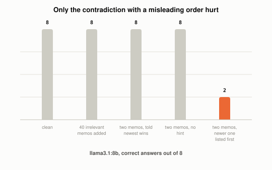

# What Are Context Distraction, Confusion, and Clash?

*~3 min read*

**One-line answer:** they are three more ways a long context can hurt an LLM, alongside [context poisoning](what-is-context-poisoning.md). In Drew Breunig's taxonomy, distraction is when "a context grows so long that the model over-focuses on the context, neglecting what it learned during training," confusion is when "superfluous content in the context is used by the model to generate a low-quality response," and clash is "when you accrue new information and tools in your context that conflicts with other information in the context" [1].

*One run: the irrelevant filler scored the same as the clean prompt, and the newer memo listed first scored 2 of 8.*

## The problem

Picture your desk. You need one document, and it is buried under 40 unrelated ones. That is confusion. Now picture two memos from your boss that contradict each other: Monday says the deadline is the 6th, Friday says the 9th. That is clash. And if you have been shuffling papers all day and start repeating yesterday's routine instead of thinking fresh, that is distraction.

Breunig describes [poisoning](what-is-context-poisoning.md) as an error that makes it into the context, where it is repeatedly referenced [1]. These three are about the [context window](what-a-context-window-actually-limits.md) as a whole. (For a related post, see [why-more-context-can-make-an-llm-worse.md](why-more-context-can-make-an-llm-worse.md).)

## How it works

1. **Distraction.** Breunig writes that as an agent builds up history, "this accumulated context can become distracting rather than helpful" [1]. He describes a Pokémon-playing Gemini agent that "became fixated on repeating past actions from its extensive context history" [1]. He also cites a Databricks study where correctness began to fall around 32k for Llama 3.1 405b, and earlier for smaller models [1].
2. **Confusion.** Breunig puts it bluntly: "if you put something in the context the model has to pay attention to it" [1]. His example is tool definitions: a quantized Llama 3.1 8b failed a query given all 46 tools of the GeoEngine benchmark, yet succeeded with only 19 [1].
3. **Clash.** Breunig calls this "a more problematic version of Context Confusion: the bad context here isn't irrelevant, it directly conflicts" [1]. A multi-turn study reports "an average drop of 39% across six generation tasks" in multi-turn versus single-turn conversations [2]. The same paper says: "when LLMs take a wrong turn in a conversation, they get lost and do not recover" [1][2].

## Real example

The script tests confusion and clash on `llama3.1:8b` at temperature 0. It uses 8 invented facts (so training cannot help), such as "the Brelwick printer has a print speed of 31 pages per minute." Each fact is asked in several prompt styles: just the fact (clean), the fact hidden among 40 unrelated memos (padded), and two contradicting boss memos (a Monday value and a Friday correction) in three variants.

Correct out of 8:

| Condition | Correct |
|---|---|
| clean | 8 |
| padded with 40 irrelevant memos | 8 |
| clash, told newest wins | 8 |
| clash, no hint | 8 |
| clash, newer memo listed first | 2 |

Run it with `uv run examples/what-context-distraction-confusion-and-clash-are/confusion_clash_demo.py`. In this run, padding scored the same as the clean prompt, and the clash score dropped only when the newer memo was listed first. This is a small demo (8 facts, one model).

## When this picture isn't enough

The demo does not test distraction. Its padding was 40 short memos about unrelated things, and it has no tool list.

Related: [compaction](what-context-compaction-is.md) and [just-in-time context](what-just-in-time-context-is.md).

## Takeaway

In this demo, 40 irrelevant memos changed nothing (8 of 8), while two contradicting memos with the newer one listed first dropped the score to 2 of 8.

## Sources

[1] How Long Contexts Fail, Drew Breunig, https://www.dbreunig.com/2025/06/22/how-contexts-fail-and-how-to-fix-them.html
[2] LLMs Get Lost In Multi-Turn Conversation, arXiv:2505.06120, https://arxiv.org/abs/2505.06120
