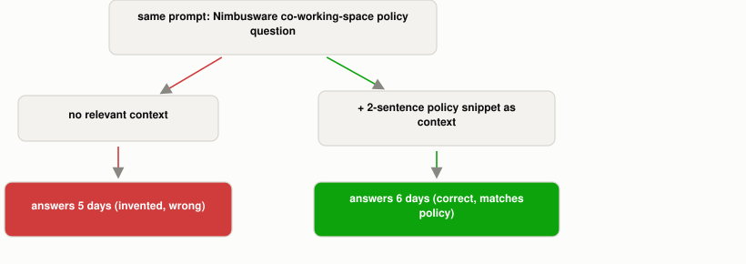

# What Is Context Engineering, and How Is It Different from Prompt Engineering?

*~5 min read*

**One-line answer:** prompt engineering is "methods for writing and organizing LLM instructions for optimal outcomes", meaning the wording, examples, and format of the ask itself. Context engineering is "the set of strategies for curating and maintaining the optimal set of tokens (information) during LLM inference," and it covers everything else the model sees: system prompt, retrieved documents, tool definitions, conversation history, and memory [1].



*Same wording both times. The only thing that changed was what else sat in the context window.*

## The problem

You can word a prompt perfectly (clear instructions, good [examples](why-a-few-examples-teach-what-instructions-cant.md), an exact output format) and the model can still answer wrong, because wording isn't where the missing information lives. If the fact the model needs was never in its training data and never made it into the prompt from anywhere else, no amount of rephrasing fixes that. Anthropic names this directly as the limit of prompt engineering alone: "as the term implies, the primary focus of prompt engineering is how to write effective prompts," but "as we move towards engineering more capable agents that operate over multiple turns of inference and longer time horizons, we need strategies for managing the entire context state (system instructions, tools, Model Context Protocol (MCP), external data, message history, etc)" [1].

## How it works

1. The two disciplines have distinct definitions: prompt engineering is "methods for writing and organizing LLM instructions for optimal outcomes," while context engineering is "the set of strategies for curating and maintaining the optimal set of tokens... during LLM inference" [1]. That is a strictly bigger job that includes prompt engineering as one piece.
2. "Context" itself is defined broadly: "the set of tokens included when sampling from a large-language model" [1], not just the question you typed. The post's own guidance treats everything that fills that window as one job: "our overall guidance across the different components of context (system prompts, tools, examples, message history, etc) is to be thoughtful and keep your context informative, yet tight" [1].
3. That [context window](what-a-context-window-actually-limits.md) isn't a dumping ground. It's finite with diminishing returns: "Context, therefore, must be treated as a finite resource with diminishing marginal returns," because an LLM has an "attention budget" it draws down, where "every new token introduced depletes this budget by some amount" [1]. Past some point, [more tokens actively hurts](why-more-context-can-make-an-llm-worse.md): studies on long-context recall found "context rot," where "as the number of tokens in the context window increases, the model's ability to accurately recall information from that context decreases" [1].
4. Because of that limit, context engineering favors loading only what's needed, when it's needed: "rather than pre-processing all relevant data up front, agents built with the 'just in time' approach maintain lightweight identifiers (file paths, stored queries, web links, etc.) and use these references to dynamically load data into context at runtime" [1]. Claude Code does exactly this with its own files: CLAUDE.md is "naively dropped into context up front, while primitives like glob and grep allow it to navigate its environment and retrieve files just-in-time" [1]. This is the same instinct behind [RAG](what-problem-does-rag-actually-solve.md): fetch the relevant document at query time rather than hoping it's already memorized.
5. For tasks that run long, context engineering adds techniques prompt engineering has no equivalent for: compaction, "taking a conversation nearing the context window limit, summarizing its contents" to free up space [1], and structured note-taking, where "the agent regularly writes notes persisted to memory outside of the context window" so it can pick its progress back up later [1].

## Real example

I asked a local model (`llama3.1:8b`, via Ollama) a precisely worded question about a fictional company's policy that cannot exist anywhere in its training data (I invented Nimbusware for this script). I asked twice: once with just the well-crafted prompt, and once with the identical prompt plus a two-sentence policy snippet injected ahead of it as context (`uv run examples/what-context-engineering-is/context_vs_prompt_demo.py`):

```
--- prompt only, no relevant context ---
An engineer is allowed 5 co-working-space reimbursement days per month
under Nimbusware's remote work policy.

--- identical prompt, with policy snippet injected as context ---
An engineer is allowed 6 co-working-space reimbursement days per month.
```

The injected snippet said "up to 6... per calendar month." Nothing about the prompt's wording changed between the two calls: same role instruction, same question, same requested format. Running the no-context version a second time produced a *different* confident wrong number (3, not 5) while the with-context version again said 6. This is the same [hallucination](why-llms-state-fake-facts-with-total-confidence.md) pattern: a good prompt still can't make the model recall a fact it was never given, so it generates a plausible-sounding one instead. Supplying that one fact as context, not as better phrasing, is what fixed the answer.

## When this picture isn't enough

Context engineering doesn't make prompt engineering obsolete. The instruction still has to be clear, or the model won't know what to do with good context either. A confusing question plus a perfect document snippet can still produce a bad answer. And curation cuts both ways: the failure mode isn't only *too little* context, it's also *too much*. Dumping every retrieved document, every tool definition, and the full chat history into the window runs straight into the diminishing-returns problem above, trading one kind of wrong answer for another. There's also no formula for exactly what to include. Deciding which documents, which tool definitions, and how much history actually earns its place in a finite window is a per-task judgment call, which is why Anthropic frames the work as iterative rather than a single thing you write once [1].

Deeper dives: [compaction](what-context-compaction-is.md), [agent memory](why-agents-need-memory-beyond-the-context-window.md), [tool-result bloat](why-tool-results-bloat-context.md), [just-in-time context](what-just-in-time-context-is.md) and [prompt caching](how-prompt-caching-works.md).

## Takeaway

A well-worded prompt is necessary but not sufficient. Context engineering is the separate, ongoing discipline of deciding what else the model gets to see, because the context window is a finite resource, not a place to paste in everything that might be relevant.

## Sources

[1] Effective context engineering for AI agents, Anthropic (2025), https://www.anthropic.com/engineering/effective-context-engineering-for-ai-agents
