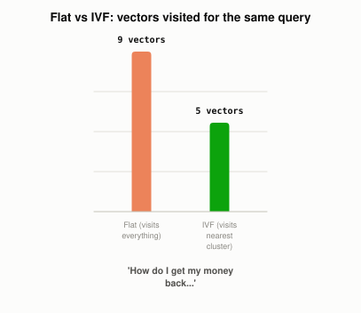

# What Are the Different Ways a Vector Database Can Index Your Data?

*~4 min read*

**One-line answer:** a [vector database](why-you-cant-just-grep-your-way-to-semantic-search.md) can organize its stored vectors a few different ways before you ever ask it a question. It can compare against everything (flat), cluster first and only search the nearest cluster (IVF), or build a graph of nearby neighbors and hop through it (HNSW). Whichever you pick, "there is always a trade-off between search-speed and search-quality (accuracy)" [1].


*Same 9 real documents, same query. Flat visits all of them; IVF-style visits only the nearest cluster.*

## The problem

[Comparing a query's embedding against every stored vector](why-you-cant-just-grep-your-way-to-semantic-search.md) with cosine similarity works, but it's a flat loop. At a handful of documents that's instant, but at millions of them it's a full pass over all of them on every single query. The index is the data structure the database builds ahead of time specifically to avoid that full pass, and different index types make a different bet about how to avoid it.

## How it works

1. **Flat index**: no indexing at all, really: "we do not modify the vectors that we feed into them... because there is no approximation or clustering of our vectors — these indexes produce the most accurate results" [1]. It's the ground truth every other index is measured against, and it's exactly what [the vector search post](why-you-cant-just-grep-your-way-to-semantic-search.md) demonstrated.
2. **IVF (Inverted File Index)** reduces the search scope through clustering: the database groups vectors into clusters ahead of time ("every datapoint will be contained within a cell — and be assigned to that respective centroid" [1]), and at query time it only compares the query against the handful of clusters whose centroid it's closest to, skipping every vector in every other cluster entirely.
3. **HNSW (Hierarchical Navigable Small World)** builds a graph instead of clusters: a "multi-layer structure consisting from hierarchical set of proximity graphs," where the top, sparse layer gets you roughly to the right neighborhood fast, and each layer below it is denser, so "starting search from the upper layer... boosts the performance" compared to a flat graph with no layers [2]. A query walks this graph hopping toward closer and closer neighbors instead of comparing against clusters or everything.
4. The common thread: every non-flat index is trading a small, usually acceptable chance of missing the true best match ("approximate" nearest neighbor) for not having to touch every vector. That is the only way similarity search stays fast once a collection grows past what a flat loop can comfortably chew through.

## Real example

I took the same nine short documents from [the vector search post](why-you-cant-just-grep-your-way-to-semantic-search.md)'s idea (three about refunds, three about coffee, three about account passwords), ran real k-means clustering on their real embeddings to build an IVF-style index, and compared it against a flat search on the same query (`uv run examples/what-different-vector-index-strategies-trade-off/ivf_vs_flat_demo.py`):

```
FLAT search -- visited all 9 vectors:
  0.6411  You can send back an unopened item for a full refund within a month.
  0.6301  Our return policy allows refunds within 30 days of purchase.
  0.5754  Exchanges and refunds are processed at any store location.

IVF-style search -- visited only 5 vectors (nearest cluster):
  0.6411  You can send back an unopened item for a full refund within a month.
  0.6301  Our return policy allows refunds within 30 days of purchase.
  0.5754  Exchanges and refunds are processed at any store location.

top match same for both: True
```

The clustering step grouped the refund-related documents together on its own, from the real embeddings, with no labels telling it which documents were "about" what. Querying only that one cluster instead of all nine vectors found the exact same top three matches. At nine documents the saved work is trivial, but the same mechanism is what lets a real index skip over millions of irrelevant vectors instead of comparing against every one.

**[Try it live: Vector Index Explorer →](https://claude.ai/artifact/CYt4ohYDYCVGwtTdLvnhdG)** Pick one of the three real queries above, flip between Flat and IVF, and watch the visited-vector count and the ranking change on the same real embeddings used here.

## When this picture isn't enough

This script hand-rolls a simplified IVF for one query against nine documents. It skips what makes IVF genuinely hard at scale: choosing how many clusters to build, how many clusters to check per query (checking only one risks missing a match that landed in a neighboring cluster near the boundary), and keeping clusters balanced as data keeps getting added. HNSW solves a different part of this problem and comes with its own cost: "HNSW indexes take up a significant amount of memory" [1], since it has to store the graph's edges alongside the vectors themselves. None of these indexes replace [picking the right chunk size](why-chunking-strategy-matters-more-than-your-database.md) or [combining vector search with keyword search](why-rag-systems-combine-keyword-and-vector-search.md). An index just decides how fast you can search whatever you already chose to store.

## Takeaway

There's no single best index. Pinecone's own framing of this is that there are "four indexes, with equally potent pros and cons — depending on the use-case" [1]. Flat is exact but doesn't scale, IVF and HNSW both scale by skipping most of the data on purpose, and which one a vector database should pick depends on how much memory you have and how much accuracy you're willing to trade for speed.

## Sources

[1] Nearest Neighbor Indexes for Similarity Search, Pinecone, https://www.pinecone.io/learn/vector-indexes/
[2] Efficient and Robust Approximate Nearest Neighbor Search Using Hierarchical Navigable Small World Graphs, Malkov & Yashunin (2016-2018), https://arxiv.org/abs/1603.09320
