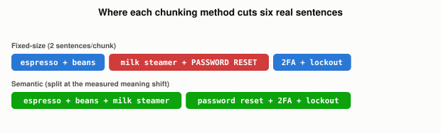

# What Are the Different Ways to Chunk a Document?

*~4 min read*

**One-line answer:** beyond plain [fixed-size chunking](why-chunking-strategy-matters-more-than-your-database.md), there are a few genuinely different rules for deciding where to cut a document. One is recursive splitting that falls back through separators ("paragraphs, sentences and words" [1]). Another is semantic chunking, which cuts where the *meaning* shifts rather than where the token count runs out. The third is structure-aware chunking, which cuts along a document's own headings, sections, or code boundaries instead of ignoring them.


*Fixed-size chunking doesn't know a new topic started mid-chunk. Semantic chunking found the real boundary.*

## The problem

[Fixed-size chunking](why-chunking-strategy-matters-more-than-your-database.md) ("we simply decide the number of tokens in our chunk" [1]) is simple and cheap, but it's blind to what the text is actually about. A chunk boundary that lands wherever the token counter happens to hit its limit can just as easily land in the middle of a sentence, or merge the tail of one topic with the head of a completely unrelated one. The different chunking strategies that exist are all attempts to make that boundary respect something real about the document, instead of an arbitrary count.

## How it works

1. **Recursive (separator-based) chunking** tries a ranked list of separators instead of a flat count: "LangChain implements a RecursiveCharacterTextSplitter that tries to split text using separators in a given order" [1], falling back from paragraph breaks, to sentence breaks, to word breaks, until a chunk fits the target size. It still ends at a fixed size. It's just smarter about *where*, preferring a paragraph or sentence edge over a mid-word cut.
2. **Semantic chunking** ignores size targets almost entirely and chunks by meaning: it works by "breaking a document into sentences" [1] first, embedding them, then "comparing the semantic distance between each group and its predecessor" [1] to find where the topic actually shifts, and cutting there. The chunk boundary is wherever the content stops being about the same thing, whatever size that turns out to be.
3. **Structure-aware chunking** uses structure the document already has instead of inferring one: markdown headings, HTML tags, or a LaTeX document's own sections, since "specialized chunking methods can help preserve the original structure of the content" [1]. A markdown doc gets chunked along its own `##` headings, code gets chunked along function or class boundaries, and neither needs size heuristics or embeddings to know where the real divisions are.
4. None of these are "better" in some absolute sense. They're different bets about what's most likely to keep a chunk coherent: a fixed size bets on consistency, recursive bets on natural-language boundaries, semantic bets on actual topic shifts (at the cost of embedding every sentence up front), and structure-aware bets on the author's own organization, when there is one to use.

## Real example

I took six sentences that cover two unrelated topics back to back (coffee machine maintenance, then password/account help), embedded each one for real, and measured the cosine similarity between every pair of consecutive sentences to find where meaning actually shifts (`uv run examples/what-different-ways-to-chunk-a-document-exist/semantic_chunking_demo.py`):

```
consecutive-sentence similarity:
  [0]-[1]  0.4712
  [1]-[2]  0.4364
  [2]-[3]  0.4341   <- biggest drop
  [3]-[4]  0.5748
  [4]-[5]  0.6081

fixed-size chunking (2 sentences per chunk):
  chunk 2: ['The milk steamer should be cleaned after every use.',
            'To reset your password, click the link we emailed you.']

semantic chunking (split at the similarity drop):
  chunk 1: [espresso machine, coffee beans, milk steamer]
  chunk 2: [password reset, 2FA, account lockout]
```

Fixed-size chunking at two sentences per chunk had no way to know sentence 3 started a new topic. It mechanically paired the milk-steamer sentence with the password-reset sentence into one chunk, because that's just where the count landed. The real similarity scores show the actual drop happening exactly between sentences 2 and 3, and splitting there instead gives two chunks that are each coherently about one thing.

**[Try it live: Chunking Playground →](https://claude.ai/artifact/LEDeufTCUbNbtRVPPBA47F)** The second panel plots these exact six sentences and these exact similarity scores, with the real topic boundary marked. The first panel lets you test fixed-size chunking on any text of your own.

## When this picture isn't enough

Semantic chunking isn't free: it means embedding every sentence (or small group of sentences) just to decide where to cut, before you've even stored anything, which is meaningfully more compute than counting tokens. It can also produce wildly uneven chunk sizes. A long, focused topic becomes one large chunk, and a document that jumps quickly between short unrelated points becomes many tiny ones. This can itself hurt retrieval if a chunk ends up too small or too large [1]. And none of these strategies fix [a bad vector index](what-different-vector-index-strategies-trade-off.md) or replace [combining the result with keyword search](why-rag-systems-combine-keyword-and-vector-search.md). Chunking only controls what a retrievable unit *contains*, not how fast or how reliably it gets found.

## Takeaway

Fixed-size chunking is the default because it's cheap and predictable, but it's not the only option. Recursive chunking respects natural-language boundaries, structure-aware chunking respects a document's own organization, and semantic chunking respects the actual topic, at the cost of embedding everything up front just to decide where to cut.

## Sources

[1] Chunking Strategies for LLM Applications, Pinecone, https://www.pinecone.io/learn/chunking-strategies/
