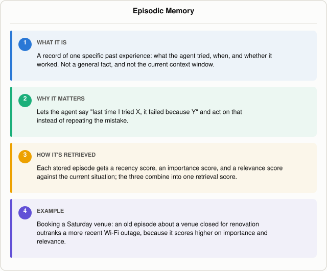

# What Is Episodic Memory in an AI Agent?

*~5 min read*

**One-line answer:** episodic memory is a record of one specific past experience: what the agent tried, when, and whether it worked, stored separately from working memory and from durable facts, and it is "experience from earlier decision cycles" that an [agent](ai-agents-vs-agentic-ai.md) can retrieve to inform what it does next [1].



*Episodic memory in one card: a dated experience, not a fact.*

## The problem

Picture that same teammate ordering lunch for the team. As soon as the delivery app opens, they're reminded of the last time they ordered from this particular restaurant: it showed up over an hour late and half the order was wrong. They're not stating something true of restaurants in general, they're recalling one particular event: what happened, when it happened, and how badly it went. That's the shape of episodic memory: a record tied to a specific experience, outcome included.

For an AI agent, episodic memory is what lets it say "last time I tried X, it failed because Y" and act on that the next time a similar situation comes up. That's different from the other kinds of memory it might have. A durable fact with no "when" attached, such as "the venue requires a deposit," is [semantic memory](what-semantic-memory-is-in-an-agent.md), not episodic. The agent's current context window, which is wiped at the end of the session, is working memory, covered in [why-agents-need-memory-beyond-the-context-window.md](why-agents-need-memory-beyond-the-context-window.md). Episodic memory is neither: it's a dated attempt with an outcome, pulled back in later when it's relevant.

## How it works

1. **The agent logs an episode after it happens.** CoALA's framework describes this as a learning action: "An agent can also write new experiences from working to episodic memory as a form of learning" [1]. The thing being stored isn't a fact extracted from the experience, it's the experience itself, including how it turned out.
2. **Each episode sits in long-term storage until it's needed.** CoALA frames this plainly: "Episodic memory stores experience from earlier decision cycles" [1]. Park et al.'s Generative Agents paper describes the same idea as a "memory stream": "a long-term memory module that records, in natural language, a comprehensive list of the agent's experiences" [2].
3. **Retrieval combines three signals, not just text similarity.** CoALA summarizes how Generative Agents does it: the system "retrieves relevant events from episodic memory via a combination of recency (rule-based), importance (reasoning-based), and relevance (embedding-based) scores" [1]. In plain terms: how recently did this happen, how big a deal was it, and how related is it to the situation right now. Park et al. explain importance this way: "Importance distinguishes mundane from core memories by assigning a higher score to memory objects that the agent believes to be important" [2]: asking the model to rate a memory the way you'd rate how much a moment mattered, not just whether it's topically close.
4. **Relevance is the one signal that looks like ordinary retrieval.** Park et al. compute it with [embeddings](what-is-an-embedding.md): "we calculate relevance as the cosine similarity between the memory's embedding vector and the query memory's embedding vector" [2]. The other two signals, recency and importance, are what make episodic retrieval different from a plain similarity search: a recent, high-stakes episode can outrank an older but more literally similar one, and vice versa.

## Real example

The script logs three past venue-booking episodes, each a specific attempt with an outcome and how long ago it happened:

```
- (30d ago) Tried booking Riverside Hall for the Saturday team offsite. It turned out
  to be closed for renovation that weekend, and finding a backup venue on short notice
  ate up a full hour.
- (10d ago) Booked the Garden Room at Oakwood Inn for a client dinner. There was no
  parking nearby, so three guests arrived 20 minutes late.
- (2d ago) Reserved the Hotel Meridian conference room for the quarterly review. The
  Wi-Fi dropped twice during the video call and the meeting had to be rescheduled.
```

Each one gets a recency score (exponential decay on days since it happened), an importance score (`llama3.1:8b` rating 1-10 how costly the mistake was, the model's raw replies were 6, 3, and 5), and a relevance score ([cosine similarity](how-vector-search-measures-similarity.md) between the episode's embedding and the new situation's embedding, via `nomic-embed-text`). The three scores are rescaled to 0-1 within this set of three episodes and averaged:

```
episode      recency  importance  relevance  combined
#1              0.00        1.00       1.00      0.67
#2              0.65        0.00       0.17      0.27
#3              1.00        0.67       0.00      0.56
```

For the new situation, "I need to book a venue for this Saturday's team offsite," the combined score picks episode #1 (the closed-for-renovation one), even though it's the oldest of the three. Recency alone would have picked episode #3 (the most recent, the Wi-Fi outage); relevance alone already preferred #1. What the combined score changes is the order of the other two: factoring in importance pushes the costly-but-older Wi-Fi episode above the more recent but lower-stakes parking episode. That's the point of combining signals: the single most recent episode isn't necessarily the one worth surfacing.

Asked to book without that episode, the model gave a generic checklist:

```
Before booking a venue for your team offsite, check the availability for this Saturday
and confirm the venue's capacity to accommodate your team size. Also, ensure that the
venue offers the necessary amenities, such as food and beverage options, audio-visual
equipment, and parking. Additionally, review the venue's policies on noise levels,
smoking, and any other potential restrictions.
```

Given the retrieved episode, it named the specific failure and why to check for it:

```
Before booking a venue for this Saturday's team offsite, I should check if the venue is
currently closed for renovation or any other reason that might affect its availability.
This is because the past experience showed that finding a backup venue on short notice
was time-consuming, so it's essential to verify the venue's status beforehand. Checking
the venue's availability and status will help avoid last-minute complications and
ensure a smooth booking process.
```

Run it with `uv run examples/what-episodic-memory-is-in-an-agent/episodic_memory_demo.py`. This demo deviates from Park et al. in a few ways worth naming: their recency decays from the memory's last *access* time, not from when the episode happened; the episodes here are hand-written rather than written by the agent itself; and this is one run of three episodes at temperature 0, not a reproduction of their system.

## When this picture isn't enough

An episode is only as good as how it was logged. If the agent wrote down the wrong cause, blaming the parking when the real problem was the time of day, later retrieval surfaces a lesson that doesn't apply, which is a form of [context poisoning](what-is-context-poisoning.md). An episode can also outlive its relevance: a venue's renovation finishes, but if the episode still scores high on importance, it keeps getting retrieved for situations where it no longer matters. Episodic memory is also only part of how an agent avoids repeating a mistake: the retrieved episode still has to make it into a loop that reads and acts on it, which [how-an-agent-recovers-from-its-own-mistakes.md](how-an-agent-recovers-from-its-own-mistakes.md) covers.

This post is part of a series on the different kinds of memory an agent can have: see [what-kinds-of-memory-an-agent-has.md](what-kinds-of-memory-an-agent-has.md) for the overview.

## Takeaway

Episodic memory is a dated, specific experience with an outcome, retrieved by weighing how recent, how important, and how relevant it is, not just the most similar-sounding note in storage [1][2].

## Sources

[1] Cognitive Architectures for Language Agents, Sumers et al., https://arxiv.org/abs/2309.02427
[2] Generative Agents: Interactive Simulacra of Human Behavior, Park et al., https://arxiv.org/abs/2304.03442
