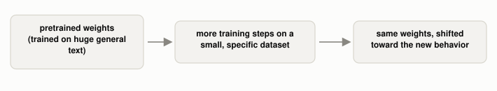

# What Does "Fine-Tuning" Actually Change in an Already-Trained Model?

*~2 min read*

**One-line answer:** fine-tuning is a second round of [training](how-a-program-learns.md), starting from an already-pretrained model's weights instead of zero, using a smaller, specific dataset to shift its behavior [1].

*Nothing new is built. The same nudge-toward-less-error procedure just runs again, on different data.*

## The problem

A [large language model](what-is-an-llm.md) pretrained only to predict the next word often doesn't do what you actually ask. OpenAI's own paper on this states it plainly: "making language models bigger does not inherently make them better at following a user's intent." They add that "these models are not aligned with their users" [1]. Scale alone doesn't fix that; more training, on the right data, does.

## How it works

1. Start from a model that's already finished pretraining. Its weights aren't zero, they already encode a lot about language [2].
2. Collect a new, much smaller dataset of exactly the behavior you want. For InstructGPT, that meant paying people to write out "labeler demonstrations of the desired model behavior" for a range of prompts [1].
3. Run the same [error-reducing training procedure](how-a-program-learns.md) again, but now measuring error against this new dataset instead of raw internet text. In their words, they "fine-tune GPT-3 using supervised learning" on it [1].
4. The weights move again, but by a much smaller amount than pretraining took: enough to shift behavior toward the new examples, without redoing everything pretraining already set up.

## Real example

OpenAI's InstructGPT paper is itself the real example: starting from a pretrained GPT-3, they fine-tuned it on human-written demonstrations of following instructions well, specifically because "bigger" alone wasn't solving that problem [1]. This supervised step was stage one of their process. Stage two used something harder to hand-write examples for: human *rankings* of outputs, rather than full example answers, which is its own mechanism (reinforcement learning from human feedback).

## When this isn't enough

Fine-tuning only shifts behavior toward whatever examples it's given. It doesn't generalize cleanly beyond the style and range of that dataset, so a narrow or biased set of examples produces a narrowly or biased-shifted model. It also assumes someone can write out a correct example answer for each case, which gets hard fast for open-ended tasks where "correct" is more about which answer is *better*, not which one is *right*. That is the problem the next stage exists to solve.

Cheaper ways to fine-tune: [LoRA](what-lora-changes-in-a-model.md), [QLoRA](what-qlora-adds-to-lora.md) and [other parameter-efficient methods](what-other-parameter-efficient-methods-exist.md).

## Takeaway

Fine-tuning is training, again, on purpose-built data, starting from a model that already knows the basics instead of from nothing.

## Sources

[1] Training Language Models to Follow Instructions with Human Feedback, Ouyang et al., OpenAI (2022), https://arxiv.org/abs/2203.02155
[2] [How Can a Program "Learn" a Rule Nobody Programmed?](how-a-program-learns.md)
