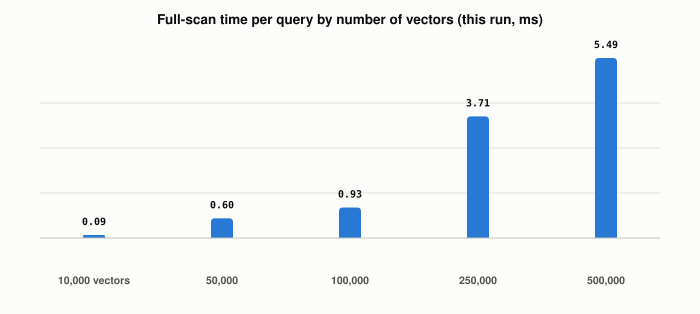

# What Does a Flat (Full-Scan) Vector Search Actually Cost?

*~3 min read*

**One-line answer:** a flat index answers a query by comparing it with every stored vector, so the work per query grows with the number of vectors; in the run below, one query took 0.09 ms over 10,000 vectors and 5.49 ms over 500,000.



*Median time for one full-scan query on synthetic vectors, on one machine. The bars come from `output.txt`.*

## The problem

Say you want to find "Okafor" in a phone book. You can read every line from page one until you hit it, or you can jump to the right page. Reading every line always works, but a book ten times thicker takes about ten times longer to read through.

A flat vector search is the read-every-line option. The [vector index post](what-different-vector-index-strategies-trade-off.md) places it as the baseline the other strategies are compared with. This post puts numbers on what that baseline costs.

## How it works

1. Each stored item is an [embedding](what-is-an-embedding.md): a list of numbers, here 384 of them.
2. For one query, the search scores the query against every stored vector. The Faiss paper describes this as "iterating over all database vectors: this is brute force search" [1].
3. It keeps the 10 best scores and returns them.
4. The script below builds nothing ahead of time. The Faiss paper says "Faiss's IndexFlat implements brute force search" [1], and the Faiss wiki lists the flat index as "Exact Search" with 4*d bytes per vector, where d is the vector length [2].

## Real example

`uv run examples/what-flat-vector-search-costs/flat_scan_cost.py` uses synthetic data: random unit vectors, 384 numbers each, float32, fixed seed. For each size it times one query (score against all vectors, then take the top 10). Each figure is the median of 20 runs after one warm-up. The timings are from one run on one machine. Rerunning the script gives different milliseconds each time; the vector counts and memory stay the same.

```
  vectors  ms/query  ms/1,000 vectors  memory (MB)
   10,000      0.09            0.0093         15.4
   50,000      0.60            0.0119         76.8
  100,000      0.93            0.0093        153.6
  250,000      3.71            0.0148        384.0
  500,000      5.49            0.0110        768.0
```

In this run, going from 10,000 to 500,000 vectors (50 times more) took the query from 0.09 ms to 5.49 ms (about 61 times more). The cost per 1,000 vectors stayed between 0.0093 and 0.0148 ms. Memory grew in step with the count: 1,536 bytes per vector, 768 MB at 500,000. Nothing here was measured beyond 500,000 vectors.

## When this picture isn't enough

This run used random vectors, one query, and one CPU. It does not measure real embeddings, other hardware, or batches of queries. Faiss also offers indexes that do not scan everything; the [index strategies post](what-different-vector-index-strategies-trade-off.md) covers them.

How an index avoids this cost is in [IVF](how-ivf-trades-recall-for-speed.md); how each score is computed is in [similarity measures](how-vector-search-measures-similarity.md).

## Takeaway

A flat index is the read-every-line phone book: it compares the query with every vector. In this run, 50 times more vectors meant about 61 times more time per query.

## Sources

[1] The Faiss library, Douze et al., https://arxiv.org/abs/2401.08281
[2] Faiss indexes (wiki), facebookresearch/faiss, https://github.com/facebookresearch/faiss/wiki/Faiss-indexes
