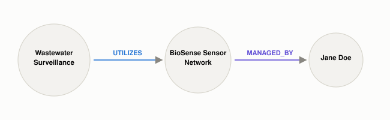

# What Does GraphRAG Add That Plain RAG Can't See?

*~3 min read*

**One-line answer:** GraphRAG has an LLM build an actual knowledge graph (entities as nodes, relationships as explicit edges) out of your documents first, so it can answer questions that require connecting facts spread across multiple documents. [Plain RAG](what-problem-does-rag-actually-solve.md)'s independent, unconnected chunks structurally can't do that [1].



*No single chunk states "Jane manages the system this project depends on". That fact only exists by walking both edges.*

```
One-hop fact (a vector search over the right chunk could find this too):
  Wastewater Surveillance --UTILIZES--> BioSense Sensor Network

Two-hop question: "Who manages the sensor network the Wastewater
Surveillance project utilizes?" -- no single chunk states this; it
only exists by walking two edges across the graph:
  Wastewater Surveillance -> BioSense Sensor Network -> Jane Doe
  answer: Jane Doe
```
*Neither document alone contains the answer. It only exists once you connect the edges.*

## The problem

[RAG](what-problem-does-rag-actually-solve.md) retrieves chunks that are each individually similar to your query. But a question that needs two separate facts stitched together (who manages the system that the project you asked about depends on) has no single chunk that's similar to the whole question, because the connecting link was never written down as one sentence anywhere. The paper that introduced GraphRAG names this directly: "RAG fails on global questions directed at an entire text corpus," because answering them is "a query-focused summarization (QFS) task, rather than an explicit retrieval task" [1].

## How it works

1. An LLM reads through the source documents and extracts entities and the relationships between them (people, projects, systems) and builds what the course material behind this post calls "a directed property graph:" nodes with properties, connected by typed, directed edges like `UTILIZES` or `MANAGED_BY`.
2. GraphRAG's own method: use the LLM to construct "an entity knowledge graph from the source documents," then "pregenerate community summaries for all groups of closely related entities" [1].
3. A question now gets answered by traversing this graph, following edges from one entity to the next, instead of only ranking isolated chunks by [embedding similarity](why-you-cant-just-grep-your-way-to-semantic-search.md).
4. Multi-hop questions (A relates to B, B relates to C, what's C?) become a graph walk instead of a search problem, because the relationships are explicit structure now, not just implicit meaning buried in prose.

## Real example

I built a tiny real graph with three edges (a project that uses a sensor network, which is managed by a person, who works in a division) and asked a question no single edge answers on its own (`uv run examples/what-graphrag-adds-that-plain-rag-cant-see/graph_vs_vector_demo.py`):

```
Two-hop question: 'Who manages the sensor network the Wastewater
Surveillance project utilizes?'
  Wastewater Surveillance -> BioSense Sensor Network -> Jane Doe
  answer: Jane Doe
```

A [vector search](why-you-cant-just-grep-your-way-to-semantic-search.md) over two separate chunks ("the project utilizes the sensor network" and "the sensor network is managed by Jane") could retrieve both chunks for a broad-enough query, but it has no mechanism to then combine them into one answer. Walking the graph's edges is what makes the two-hop connection explicit and traversable.

## When this picture isn't enough

Building the graph costs an LLM pass over every document up front, which plain RAG skips entirely. GraphRAG trades that setup cost for the ability to answer the multi-hop and whole-corpus questions plain retrieval can't. It also inherits a new failure mode: if the LLM extracts an entity or relationship wrong while building the graph, every later query that depends on that edge inherits the mistake. This is the same as [hallucination](why-llms-state-fake-facts-with-total-confidence.md) elsewhere in the pipeline, just moved earlier.

## Takeaway

Plain RAG asks "which chunks look like this question." GraphRAG asks that too, but also lets you ask "what connects to what", because the relationships got pulled out into explicit structure instead of staying buried in separate paragraphs.

## Sources

[1] From Local to Global: A Graph RAG Approach to Query-Focused Summarization, Edge et al., Microsoft Research (2024), https://arxiv.org/abs/2404.16130
