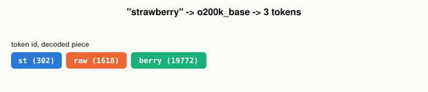

# Why Does An LLM Split "Strawberry" Into Three Pieces?

*~2 min read*

**One-line answer:** an LLM never reads letters or whole words. A tokenizer breaks text into pieces from a fixed, trained vocabulary first, and the model only ever sees those pieces as numbers [1].


*The model never sees the word "strawberry". It sees three integers. These are shown decoded back into the substrings they stand for.*

## The problem

Count the words in a sentence and you'd guess that's roughly how many units of text GPT-4o processes. It isn't. The model sees a sequence of token IDs from a fixed vocabulary learned during training, and one word can split into two, three, or more of them [1]. Any estimate of how much text fits in a model's input is wrong if you're counting words instead of tokens.

## How it works

1. Input text passes through a tokenizer tied to the model family. Different families can split identical text differently [1].
2. The tokenizer matches text against a fixed vocabulary of pieces (subwords, whole words, punctuation), learned via byte pair encoding (BPE), which merges frequently-occurring character pairs during training [1].
3. Each matched piece becomes an integer ID. OpenAI's `tiktoken` library, encoding `o200k_base` (what `tiktoken.encoding_for_model("gpt-4o")` returns), turns "strawberry" into `[302, 1618, 19772]`.
4. Decoding those IDs shows what they stand for: `st`, `raw`, `berry`: three pieces, not one word.
5. Everything the model reads or writes is a sequence of these IDs, never raw characters or whole words.

## Real example

I ran `tiktoken` myself to get these exact values, rather than trust a remembered one. Full runnable script: [`examples/what-is-a-token/tokenize_demo.py`](../examples/what-is-a-token/tokenize_demo.py) (`uv run examples/what-is-a-token/tokenize_demo.py`).

```python
import tiktoken
enc = tiktoken.get_encoding("o200k_base")  # tiktoken.encoding_for_model("gpt-4o")

for word in ["hello", "tokenization", "strawberry", "unbelievable"]:
    ids = enc.encode(word)
    print(word, "->", ids, "->", [enc.decode([i]) for i in ids])
```

```
hello        -> [24912]                  -> ['hello']
tokenization -> [10346, 2860]            -> ['token', 'ization']
strawberry   -> [302, 1618, 19772]       -> ['st', 'raw', 'berry']
unbelievable -> [373, 9880, 45794]       -> ['un', 'bel', 'ievable']
```

"hello" is common enough to be one token. "strawberry" isn't in the vocabulary whole, so it splits into pieces frequent enough to have been merged during training [1].

## When not to use this mental model

You can't eyeball token count from word or character count. The ratio isn't fixed, since common words stay whole and rarer ones fragment [1]. It isn't portable across model families either: a different vocabulary can split identical text into a different number of pieces with different IDs [1]. And token boundaries don't respect letters, so a model reasoning about individual characters inside a word is working with units it doesn't directly see. That is a separate problem from this post.

## Takeaway

A token, not a word or a letter, is the real unit of text an LLM operates on.


## Sources

[1] tiktoken, OpenAI, https://github.com/openai/tiktoken
