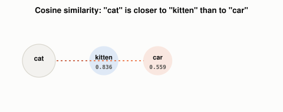

# Why Is "Kitten" Closer to "Cat" Than "Car" Is?

*~3 min read*

**One-line answer:** an embedding is a list of numbers assigned to a [token](what-is-a-token.md), learned during [training](how-a-program-learns.md) so that tokens used in similar ways end up close together in that number-space, close enough that you can measure it [1].


*Same first letter, same length. "Kitten" still sits much closer to "cat" in embedding space than "car" does.*

| Pair | Cosine similarity |
|---|---|
| cat ↔ kitten | 0.836 |
| cat ↔ car | 0.559 |

*Same first letter, same length. "Kitten" still sits much closer to "cat" than "car" does, because embeddings are learned from how words are used, not how they're spelled.*

## The problem

A [token](what-is-a-token.md) is just an integer ID. "Cat" might be token `3899`, "dog" might be `12` or `48201`, with nothing about the numbers themselves relating the two. But a [neural network](what-a-neuron-computes.md) computes weighted sums and [attention scores](how-attention-weighs-words.md) using dot products, and a dot product between two arbitrary ID numbers means nothing. The network needs a different kind of input: a point in space, where distance actually tracks something real.

## How it works

1. Every token in the vocabulary gets its own vector of numbers, initially random, called its embedding [1].
2. During [training](how-a-program-learns.md), those numbers get nudged like every other weight in the network, so tokens that show up in similar contexts drift toward similar vectors [1].
3. The vector's length (how many numbers per token) is fixed for a given model: the original transformer paper uses 512 numbers per token [1]; the local model I used below uses 768.
4. Once two tokens have vectors, "how close" they are can be measured with cosine similarity, a number that's high when two vectors point in a similar direction, regardless of their length. Doing this same comparison over millions of stored documents instead of two words is what [a vector database](why-you-cant-just-grep-your-way-to-semantic-search.md) is actually for.
5. This vector, not the raw token ID, is what actually flows into the attention and transformer calculations from the last few posts.

## Real example

I called a real embedding model (`nomic-embed-text`, running locally via Ollama, the same backend behind my AskTheDocs RAG build) for three words, then computed real cosine similarity between them (`uv run examples/what-is-an-embedding/embedding_similarity_demo.py`):

```
embedding dimensions: 768
similarity(cat, kitten) = 0.8360
similarity(cat, car)    = 0.5585
```

These are real computed vectors, not hand-picked numbers. "Kitten" lands much closer to "cat" than "car" does, even though "car" shares more letters with "cat". Spelling has nothing to do with it.

## When this picture isn't enough

Embeddings capture whatever patterns showed up in the training data, not a human-curated notion of meaning, so similarity can reflect incidental correlations as easily as real semantic closeness, and biases in the training data get baked into the vectors along with everything else. Also, the embedding described here is a word's *starting* vector, before it enters the network. Once attention mixes it with context from other tokens, the vector that actually represents "cat" in a specific sentence has already moved from this static starting point.

How closeness between embeddings is scored: [similarity measures](how-vector-search-measures-similarity.md); how they are compressed: [vector quantization](what-vector-quantization-trades-away.md).

## Takeaway

An embedding turns an arbitrary token ID into a point in space where distance means something. That is what gives a neural network numbers worth computing with.

## Sources

[1] Attention Is All You Need, Vaswani et al., Google Brain/Research & University of Toronto (2017), https://arxiv.org/abs/1706.03762
