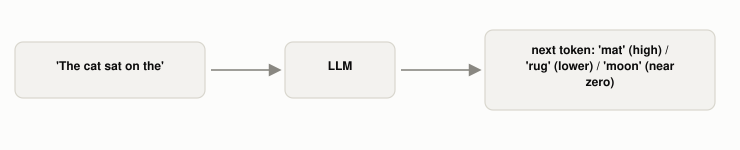

# What Is an LLM, Actually?

*~3 min read*

**One-line answer:** a large language model is a [neural network](what-a-neuron-computes.md) [trained](how-a-program-learns.md) on huge amounts of text to do one job: guess the next [token](what-is-a-token.md) in a sequence. Almost everything it can do comes out of doing that one job extremely well [1].



*The model isn't "answering a question." It's scoring every possible next token and picking from the likely ones, once per token, every token.*

## The problem

People use "LLM" as a stand-in for "the AI that talks," which hides what's actually happening and makes the behavior confusing. Why does it sometimes [state something false with total confidence](why-llms-state-fake-facts-with-total-confidence.md)? Why does it struggle with a task a simple script would nail, and ace a task that looks much harder? The answers all trace back to one fact: an LLM is a statistical machine that repeatedly predicts the next word in a sequence, built on a deep learning architecture, trained on enormous datasets [1]. It isn't retrieving facts from a database and it isn't reasoning the way a person does. It's scoring likely continuations.

## How it works

1. Text gets broken into [tokens](what-is-a-token.md), the actual units the model reads, not words [2].
2. Those tokens pass through a [neural network](what-a-neuron-computes.md): layers of neurons, each doing a weighted sum plus a nonlinear squash [3].
3. Specifically, the layers are a [**transformer**](why-transformers-need-position.md), an architecture built so every token can weigh [how relevant every other token in the input is to it](how-attention-weighs-words.md), instead of only looking at the one before it [4].
4. The network's final output is a probability for every token in its vocabulary: how likely is each one to come next. [How exactly it picks from those options](why-the-same-prompt-gives-different-answers.md) is a separate setting, and repeats the whole process to generate the token after that.
5. The "[learning](how-a-program-learns.md)" part (how the network ends up with weights that make this scoring useful) is the same nudge-toward-less-error procedure as any other neural network, just run on vastly more data and parameters [1].

## Real example

A real LLM's prediction comes from the transformer scoring across its whole training data. A tiny, non-neural stand-in shows the same *goal* (predict the next token from patterns in prior data) without any of the machinery: count what follows "the cat" in a 3-sentence toy corpus.

```python
# examples/what-is-an-llm/next_word_demo.py
after 'the cat': 'sat' -> 2/3 = 0.67
after 'the cat': 'ate' -> 1/3 = 0.33
```

I ran this myself (`uv run examples/what-is-an-llm/next_word_demo.py`). Given "the cat," the model would favor "sat" two-to-one over "ate," because that's what showed up more often in what it saw. An LLM does something far more sophisticated to get there. It weighs full sentences of context through a trained transformer, not pairs of words. But the underlying goal is identical: rank next-token candidates by what past data suggests, then pick one [1].

## When this mental model runs out

"Predicts the next token" explains a lot of LLM behavior, but not all of it. It doesn't by itself explain why scaling up data and parameters produces qualitatively new abilities (a separate, actively studied question), and it doesn't explain what happens after pretraining. Most LLMs you actually talk to have gone through further training stages: [fine-tuning](what-fine-tuning-changes.md) and [RLHF](what-rlhf-adds.md), tuned to make them more useful and safe to converse with, which change their behavior without changing this core mechanism. Separately, *how you phrase what you type* (for example [showing it examples](why-a-few-examples-teach-what-instructions-cant.md) or [asking it to reason step by step](what-thinking-step-by-step-actually-changes.md)) can change its output just as dramatically, with no training step involved at all.

## Takeaway

An LLM's entire job is next-token prediction at massive scale. Everything else you see it do is a consequence of that one job, done well, on an enormous amount of text.

## Sources

[1] Large Language Models, IBM, https://www.ibm.com/think/topics/large-language-models
[2] [Why Does An LLM Split "Strawberry" Into Three Pieces?](what-is-a-token.md)
[3] [What Does a Single Neuron In a Neural Network Actually Compute?](what-a-neuron-computes.md)
[4] Attention Is All You Need, Vaswani et al., Google Brain/Research & University of Toronto (2017), https://arxiv.org/abs/1706.03762
