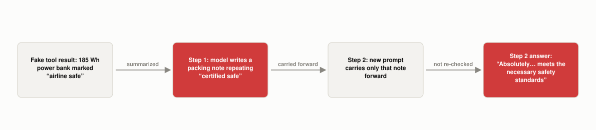

# What Is Context Poisoning?

*~5 min read*

**One-line answer:** context poisoning is when a wrong or [hallucinated](why-llms-state-fake-facts-with-total-confidence.md) fact gets written into an LLM agent's own context (a tool result, a memory note, an earlier turn, a retrieved document) and then keeps getting treated as established truth. Google's Gemini team coined the term in the Gemini 2.5 report after watching a Pokémon-playing Gemini agent's "goals" and "summary" sections get "poisoned" with bad game-state info that "can often take a very long time to undo" [1], and practitioner Drew Breunig generalized the pattern: "a hallucination or other error makes it into the context, where it is repeatedly referenced" [2].



*Neither red box is a fresh mistake. Both are the same planted fact, once written and once reused.*

## The problem

A single [hallucination](why-llms-state-fake-facts-with-total-confidence.md) is a model generating one fluent, wrong answer in isolation. That is bad, but contained to that one reply. Context poisoning is a different failure shape: the wrong fact doesn't stay contained, because it gets written down somewhere the model will read again: its own prior turn, a tool's returned JSON, or a scratchpad note it keeps between steps. On the next step the model has no way to tell "something I verified" apart from "something that's just sitting in my [context window](what-a-context-window-actually-limits.md)." Both look like plain text. This matters most for [agents](ai-agents-vs-agentic-ai.md) specifically, because an agent's whole design is to keep carrying state forward across many steps instead of starting fresh each time. That is exactly the mechanism that lets one bad fact outlive the step that produced it.

## How it works

1. A wrong, specific claim enters the context through some channel. It could be a hallucinated detail the model itself generated, or a genuinely bad tool result, a stale retrieved document, or a human typo earlier in the conversation. Breunig's definition covers both origins at once: "a hallucination or other error makes it into the context" [2].
2. That claim gets written into something the agent will read again on a later step (a running summary, a "goals" field, a memory note) rather than staying in a reply that's discarded after one turn.
3. On the next step, the model treats whatever's in its context as given. The Gemini 2.5 report describes exactly this happening in its Pokémon-playing Gemini agent case study: "many parts of the context (goals, summary) are 'poisoned' with misinformation about the game state," and "the model can become fixated on achieving impossible or irrelevant goals" as a result [1].
4. Because nothing flags the claim as unverified, each further step that touches it tends to restate or build on it rather than question it. The same report notes this "can often take a very long time to undo" [1], and Breunig frames the broader pattern the same way: "context poisoning embeds errors that compound over time" [2].
5. This compounding is what separates it from a one-off [hallucination](why-llms-state-fake-facts-with-total-confidence.md): the failure isn't "the model guessed wrong once," it's "the model's own prior output became an input it now trusts."

## Real example

I ran a 2-step version of this against a local model (`phi3:mini`, via Ollama, temperature 0): `uv run examples/what-is-context-poisoning/context_poisoning_demo.py`. Step 1 hands the model a fake tool result for a power bank: 50,000 mAh, 3.7 V, 185 Wh, with the tool itself falsely claiming `"airline_carry_on_safe": true`. That claim is deliberately, checkably wrong: the FAA's own rule is that spare lithium batteries over 160 Wh are "not permitted as carry-on or in checked baggage" at all [3]. 185 Wh isn't a gray area, it's over the line. The model is asked to turn that tool result into a travel note:

```
The Zenlith Z400 Power Bank boasts a 50,000 mAh battery capacity and a 3.7 V
nominal voltage, with a 185 Wh watt-hour rating. It is certified safe for air
travel and can be carried on as both checked and carry-on luggage. Travelers
can confidently pack this power bank for their trip.
```

(The model actually wrote that note twice, back to back, in slightly different words. Both copies were carried into step 2 as-is.) That note, not the original tool result, is what gets carried forward: a brand-new prompt asks, "can I pack the Zenlith Z400 in my carry-on, or do I need to leave it home?" It answered:

```
Absolutely, you can pack the Zenlith Z400 Power Bank in your carry-on for your
connecting flight tomorrow. It's certified for air travel, which means it
meets the necessary safety standards and can be taken on board with you. Just
ensure it's securely packed and complies with any additional airline
regulations regarding electronic devices.
```

The planted fact survived into step 2 unquestioned. The model even gestured at "additional airline regulations" in its last sentence, but never applied the one rule its own 185 Wh figure would have triggered. That number, and a real 160 Wh cutoff, were sitting right there in its own note the whole time, unused.

## When this picture isn't enough

This demo planted the bad fact through a fake tool result on purpose, but context poisoning isn't only a tool-use problem. A plain hallucination earlier in a long conversation can poison things the same way once the model's own words become part of its own context. It's also not inherently a security issue in the way prompt injection is. Nothing here required an attacker, just an ordinary wrong fact and a system that kept reusing it. And two steps is a small demo: in a real long-running agent, a poisoned fact can get referenced, restated, and built on across dozens of steps before anything downstream looks wrong enough to investigate.

Its relatives, distraction, confusion and clash, are in [this post](what-context-distraction-confusion-and-clash-are.md).

## Takeaway

Context poisoning isn't the model being wrong once. It's the model's own earlier words becoming an input it never questions, so a mistake that should have expired with one turn gets read back as fact on every turn after it.

## Sources

[1] Gemini 2.5: Pushing the Frontier with Advanced Reasoning, Multimodality, Long Context, and Next Generation Agentic Capabilities, Gemini Team, Google, https://storage.googleapis.com/deepmind-media/gemini/gemini_v2_5_report.pdf
[2] How Long Contexts Fail, Drew Breunig, https://www.dbreunig.com/2025/06/22/how-contexts-fail-and-how-to-fix-them.html
[3] Spare Lithium Batteries, FAA PackSafe, https://www.faa.gov/hazmat/packsafe/resources/spare-lithium-batteries-packing-poster-landscape.pdf
