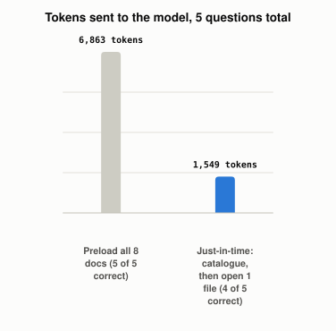

# What Is "Just-in-Time" Context?

*~3 min read*

**One-line answer:** just-in-time context means an [agent](ai-agents-vs-agentic-ai.md) doesn't preload everything that might be relevant. It keeps lightweight pointers (file paths, stored queries, links) and uses tools to load the details only when it needs them. Anthropic describes agents that "maintain lightweight identifiers (file paths, stored queries, web links, etc.) and use these references to dynamically load data into context at runtime using tools" [1].


*Same 5 questions, same model: about 4.4 times fewer tokens, with one fewer correct answer.*

## The problem

Picture two librarians. You ask about your company's vacation allowance. The first wheels the entire library onto your desk and says "it's in there somewhere." The second keeps the card catalogue on the desk, reads the one-line entries, walks to a single shelf, and hands you one book. Both can answer you. Only one leaves you room to work.

An LLM's [context window](what-a-context-window-actually-limits.md) is that desk (see also [more context can make a model worse](why-more-context-can-make-an-llm-worse.md)). One [retrieval](what-problem-does-rag-actually-solve.md) approach is to put everything possibly relevant in up front. Just-in-time context asks what is the smallest amount of text that still lets the model answer.

## How it works

1. The agent starts with a catalogue: names plus short descriptions, not contents. These are the lightweight pointers.
2. Given a question, the model picks which pointer to follow by calling a tool such as "open this file."
3. The tool returns just that item, and only now do its tokens enter the context.
4. The model answers, or follows another pointer. Anthropic calls this progressive disclosure: agents "incrementally discover relevant context through exploration" [1]. Its Agent Skills docs use the same idea, where Claude "loads information in stages as needed, rather than consuming context upfront" [2].
5. In the Skills docs' words: "Progressive disclosure ensures only relevant content occupies the context window at any given time" [2].

The cost is real, and Anthropic names it: "runtime exploration is slower than retrieving pre-computed data" [1].

## Real example

The script puts 8 small policy documents on disk and asks `llama3.1:8b` 5 questions, each answerable from exactly one file. Strategy A pastes all 8 documents into every prompt. Strategy B first shows a short catalogue so the model can name a file, then sends only that file plus the question.

```
TOTAL A: 6863 tokens, 5/5 correct
TOTAL B: 1549 tokens, 4/5 correct
```

Run it with `uv run examples/what-just-in-time-context-is/jit_context_demo.py`. Just-in-time used about 4.4 times fewer tokens (6,863 vs 1,549, counted with tiktoken) and got one fewer question right. This is a small demo (8 documents, 5 questions, one model).

## When this picture isn't enough

The demo uses two calls per question. Anthropic describes a hybrid in Claude Code: CLAUDE.md files are loaded up front, while glob and grep fetch other files on demand [1].

Related: [tool-result bloat](why-tool-results-bloat-context.md) and [prompt caching](how-prompt-caching-works.md).

## Takeaway

Just-in-time context swaps a big, always-on pile of text for a small catalogue plus the ability to fetch. In the demo it used fewer tokens and one extra call per question, and got one fewer answer right. Anthropic names the cost: runtime exploration is slower [1].

## Sources

[1] Effective context engineering for AI agents, Anthropic Engineering, https://www.anthropic.com/engineering/effective-context-engineering-for-ai-agents
[2] Agent Skills overview, Claude Platform Docs, https://platform.claude.com/docs/en/agents-and-tools/agent-skills/overview
