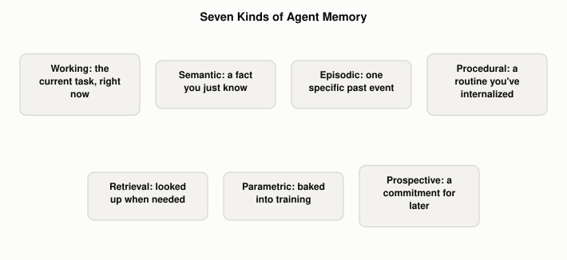

# What Kinds of Memory Does an AI Agent Actually Have?

*~4 min read*

**One-line answer:** "memory" for an agent isn't one thing — it splits into working memory (what's active right now), three long-term stores that CoALA names episodic, semantic, and procedural [1], plus three more practical categories worth naming on their own: retrieval (looked up from an outside source), parametric (baked into the model's training), and prospective (a commitment for later).



*Seven names for seven different jobs — not seven versions of the same thing.*

## The problem

Picture a new teammate's first full day on the job. Mid-standup, they're tracking what was just said thirty seconds ago, nothing more, nothing less — that's all that's active right now. Someone mentions the design lead is based in Austin, and from then on they just know it, no memory of the conversation attached. Later they recall a specific outage from last Tuesday, one dated event with an outcome. They run Friday's release checklist without thinking about the steps. They look something up in the team wiki because they never memorized it. They already know, in general, how REST APIs work, because they knew that before this job even started. And walking out on Friday, they make a mental note to check a ticket once QA signs off.

Six different things happened in that one day, and calling all of them "memory" flattens a real distinction: each one is stored differently, retrieved differently, and fails differently when it goes wrong.

## How it works

An agent's memory splits the same way, across seven practical categories:

1. **Working memory** — whatever's in the [context window](what-a-context-window-actually-limits.md) for the current task. It's short-lived and gets wiped at the end of a session; see [why agents need memory beyond the context window](why-agents-need-memory-beyond-the-context-window.md) for the short-term/long-term split this sits inside.
2. **[Semantic memory](what-semantic-memory-is-in-an-agent.md)** — a durable fact the agent has learned, stated cold, with no trace of when or how it was learned.
3. **[Episodic memory](what-episodic-memory-is-in-an-agent.md)** — a record of one specific past experience: what happened, when, and whether it worked.
4. **[Procedural memory](what-procedural-memory-is-in-an-agent.md)** — a stored routine or skill, reused instead of re-derived from scratch each time.
5. **Retrieval (external) memory** — knowledge fetched on demand from an outside index at the moment it's needed, rather than carried in the agent itself. This is what [RAG](what-problem-does-rag-actually-solve.md) does, pulling in documents the model was never trained on.
6. **Parametric memory** — general knowledge baked into the [LLM](what-is-an-llm.md)'s weights during training, available without looking anything up. [What problem does RAG actually solve](what-problem-does-rag-actually-solve.md) calls this the model's own "parametric memory," in contrast to the "non-parametric" index it searches.
7. **[Prospective memory](what-prospective-memory-is-in-an-agent.md)** — a commitment to act later, tied to a future trigger, not currently sitting in the context window at all.

Working memory, episodic, semantic, and procedural memory aren't just a list — CoALA models them as parts of one architecture, where working memory is the hub a "decision cycle" uses to read from and write to the three long-term stores. [What CoALA is, and why it splits memory this way](what-coala-is-and-why-agent-memory-splits-this-way.md) covers that mechanism; this post is the map of names, not the engine that connects them.

## Real example

A model was given a one-line definition of each of the seven types and asked to classify seven statements, one written for each type, into exactly one category. Run with `uv run examples/what-kinds-of-memory-an-agent-has/classify_demo.py` against `llama3.1:8b` on Ollama, temperature 0:

```
[MISS] expected=working     predicted=prospective "Hold on, let me finish typing up these standup notes before we move on."
[OK] expected=semantic    predicted=semantic    "The design lead is based in Austin."
[OK] expected=episodic    predicted=episodic    "Last Tuesday's deploy got rolled back because of a cache bug."
[OK] expected=procedural  predicted=procedural  "Every Friday I run the same release checklist: freeze the branch, tag it, notify the channel."
[OK] expected=retrieval   predicted=retrieval   "Let me look up the on-call rotation in the wiki, I don't have it memorized."
[OK] expected=parametric  predicted=parametric  "I already know how REST APIs generally work, nobody taught me that here."
[OK] expected=prospective predicted=prospective "Remind me to check the ticket again once QA signs off."

6/7 correct
```

Six of seven landed cleanly. The one miss is itself informative: the model read "let me finish typing this up before we move on" as a future commitment (prospective) rather than as something happening in the current task (working). Working memory is defined by *where* something lives — the active context — not by anything in the sentence's content, so a single statement in isolation doesn't always carry enough signal to tell it apart from a nearby category. That's not a demo bug; it's a real edge in the taxonomy.

## When this picture isn't enough

These categories are an engineering map, not a settled scientific fact. A 2026 paper arguing CoALA and similar frameworks lack an explicit knowledge layer puts it directly: without one, "systems apply cognitive decay to factual claims, or treat facts and experiences with identical update mechanics" [2] — in plain terms, code that should treat "the venue holds 80 people" (a fact to overwrite when it changes) very differently from "last booking fell through" (an event to keep as history) often doesn't draw that line at all. Worth keeping in mind: these names describe how a well-built system *should* separate its memory, not a guarantee that any given agent actually does.

## Takeaway

Seven names, seven different jobs: what's active now, what's known, what happened, how to do something, what to look up, what was already known going in, and what's owed later. Treating them as one undifferentiated "memory" is exactly how an agent ends up updating the wrong thing, or none of them.

## Sources

[1] Cognitive Architectures for Language Agents, Sumers et al., https://arxiv.org/abs/2309.02427
[2] The Missing Knowledge Layer in Cognitive Architectures for AI Agents, https://arxiv.org/abs/2604.11364
