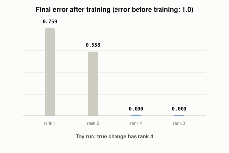

# What Does LoRA Change in a Model?

*~3 min read*

**One-line answer:** LoRA leaves the original weights untouched and trains a small add-on instead, the way you clip a 2-page errata sheet onto a 500-page manual rather than rewriting the manual. The LoRA paper describes it as one that "freezes the pretrained model weights and injects trainable rank decomposition matrices" [1].

*Toy run, printed by the script below: the error is near zero from rank 4 on, which is the rank of the planted change.*

## The problem

Ordinary [fine-tuning](what-fine-tuning-changes.md) updates every weight in the model. Rewriting a 500-page manual to fix a few facts means reprinting all 500 pages. The paper names the cost of doing this for GPT-3 175B: deploying independent fine-tuned instances, each with 175B parameters, "is prohibitively expensive" [1].

## How it works

1. Pick a weight matrix and freeze it. This is the manual: it is never edited.
2. Create two thin matrices. One is tall and narrow, the other is short and wide. Their shared thin side is called the rank.
3. Multiply the two thin matrices to get a full-size matrix, and add it to the frozen one. This is the errata sheet laid over the manual.
4. Train only the two thin matrices. The frozen matrix gets no updates.

The thinner the two matrices, the fewer numbers there are to train. That is the whole trade: a smaller add-on, but one that can only express a change up to a certain rank.

## Real example

The script `examples/what-lora-changes-in-a-model/lora_demo.py` uses synthetic data, fixed seed, numpy only. It is a toy, not an LLM. Part 1 counts trainable numbers for one 4096 by 4096 matrix:

| Method | Trainable numbers | Share of full |
|---|---|---|
| Full fine-tune | 16,777,216 | 100% |
| LoRA rank 1 | 8,192 | 0.049% |
| LoRA rank 4 | 32,768 | 0.195% |
| LoRA rank 8 | 65,536 | 0.391% |
| LoRA rank 16 | 131,072 | 0.781% |
| LoRA rank 64 | 524,288 | 3.125% |

Part 2 freezes a random 64 by 64 matrix. The target is that matrix plus a planted change of true rank 4. The script trains LoRA factors of rank 1, 2, 4 and 8 with plain gradient descent. The error before training is 1.0.

| LoRA rank | Final error |
|---|---|
| 1 | 0.759380 |
| 2 | 0.557932 |
| 4 | 0.000000 |
| 8 | 0.000000 |

In this run, ranks 1 and 2 left error behind, and ranks 4 and 8 reached zero to six decimals. Rank 4 trained 512 numbers against 4,096 in the full matrix.

The paper reports that, compared to GPT-3 175B fine-tuned with Adam, LoRA "can reduce the number of trainable parameters by 10,000 times and the GPU memory requirement by 3 times" [1].

## When this picture isn't enough

The demo plants a change that is exactly low rank, so it shows what happens when the rank matches. It does not show how a real model's needed change behaves. Real LoRA adds these pairs to a Transformer's layers, not to one random matrix [1].

For compressing the frozen weights as well, see [QLoRA](what-qlora-adds-to-lora.md); for other ways to train only a small part, see [other parameter-efficient methods](what-other-parameter-efficient-methods-exist.md).

## Takeaway

LoRA freezes the model and trains a thin add-on whose product is added to a weight matrix. In the toy run, the add-on matched the planted change once its rank reached the change's rank.

## Sources

[1] LoRA: Low-Rank Adaptation of Large Language Models, Hu et al., https://arxiv.org/abs/2106.09685
