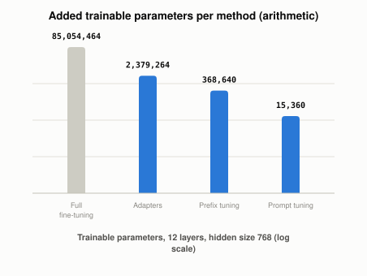

# What Other Ways Exist to Fine-Tune Without Changing Every Weight?

*~3 min read*

**One-line answer:** instead of updating every weight, three papers keep the original model frozen and train only a small extra piece: adapter layers inserted into the model [1], a prefix of trainable vectors [2], or trainable "soft prompt" tokens at the input [3].

*Arithmetic for one stated configuration, not a training run. Log scale.*

## The problem

Picture a shared textbook. [Fine-tuning](what-fine-tuning-changes.md) is rewriting every page for each new course. The Houlsby et al. paper describes the cost: "an entire new model is required for every task" [1]. Li and Liang say the same about storage: fine-tuning "modifies all the language model parameters and therefore necessitates storing a full copy for each task" [2].

## How it works

The textbook stays fixed in all three methods. Each one adds a small trainable piece somewhere else.

1. **Adapters.** The authors "propose transfer with adapter modules" and, in their words, "The parameters of the original network remain fixed" [1]. An adapter first projects the features into a smaller dimension, then projects back. One is inserted after each of two sub-layers in every Transformer layer [1].
2. **Prefix tuning.** It "keeps language model parameters frozen, but optimizes a small continuous task-specific vector (called the prefix)" [2]. Later tokens can "attend to this prefix as if it were 'virtual tokens'" [2].
3. **Prompt tuning.** The authors "freeze the entire pre-trained model and only allow an additional k tunable tokens per downstream task to be prepended to the input text" [3]. They say their method "can be seen as a simplification" of prefix tuning [3].

LoRA and QLoRA are covered in their own posts.

None of this is [RAG](what-problem-does-rag-actually-solve.md). These methods run training: they train the adapter parameters, the prefix vectors or the prompt tokens.

## Real example

`uv run examples/what-other-parameter-efficient-methods-exist/peft_param_counts.py` counts trainable parameters for one chosen configuration: 12 layers, hidden size 768, adapter bottleneck 64, prefix length 20, prompt length 20. The formulas come from the papers: 2md + d + m per adapter, two adapters per layer [1]; prefix length times the size of the joined activations [2]; prompt length times embedding size [3]. For the prefix, I took each layer's activation as a key-value pair, per the paper's footnote, so 2 x 12 x 768 per prefix position.

| Method | Trainable parameters | % of full |
|---|---|---|
| Full fine-tuning (12 blocks) | 85,054,464 | 100.000% |
| Adapters | 2,379,264 | 2.797% |
| Prefix tuning | 368,640 | 0.433% |
| Prompt tuning | 15,360 | 0.018% |

The full count covers the 12 Transformer blocks only, with no embeddings, since no vocabulary size was stated. These counts depend on the configuration I chose. This is arithmetic, not a training run, so it says nothing about accuracy.

## When this picture isn't enough

Parameter counts are not quality. The papers report accuracy on their own tasks and models, which this demo does not test. Prefix tuning also trains with an extra reparametrization that is dropped after training [2], which this count ignores.

Two of the best-known methods have their own posts: [LoRA](what-lora-changes-in-a-model.md) and [QLoRA](what-qlora-adds-to-lora.md).

## Takeaway

Adapters, prefix tuning and prompt tuning each train a small piece and freeze the rest. In this configuration the trainable piece ranged from 2.797% of the blocks down to 0.018%.

## Sources

[1] Parameter-Efficient Transfer Learning for NLP, Houlsby et al., https://arxiv.org/abs/1902.00751
[2] Prefix-Tuning: Optimizing Continuous Prompts for Generation, Li and Liang, https://arxiv.org/abs/2101.00190
[3] The Power of Scale for Parameter-Efficient Prompt Tuning, Lester et al., https://arxiv.org/abs/2104.08691
