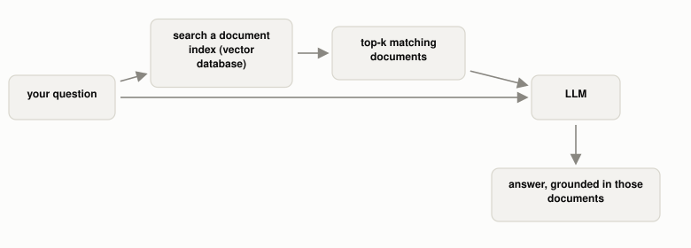

# What Problem Does RAG Actually Solve?

*~3 min read*

**One-line answer:** Retrieval-Augmented Generation (RAG) combines a pretrained [LLM](what-is-an-llm.md)'s own learned knowledge (its "parametric memory") with a live, searchable index of outside documents (a "non-parametric memory"). It fetches the relevant documents at the moment you ask, instead of relying only on whatever got baked into the model's weights during [training](how-a-program-learns.md) [1].


*The LLM never had to memorize these documents during training. It's reading them fresh, every time, as part of the prompt.*

## The problem

A plain LLM's knowledge is frozen the moment [training](how-a-program-learns.md) ends: anything that happened after that, or anything too specific/private to have been in the training data at all, simply isn't in its weights. The paper that introduced RAG names exactly this limitation it was built to fix. It asks whether a model's "ability to access and precisely manipulate knowledge is still limited" when that knowledge only exists implicitly, inside parameters [1].

## How it works

1. Your documents get split into [chunks](why-chunking-strategy-matters-more-than-your-database.md) and turned into [embeddings](what-is-an-embedding.md), stored in a [vector database](why-you-cant-just-grep-your-way-to-semantic-search.md) ahead of time.
2. When you ask a question, the question itself gets embedded the same way, and the database returns the most similar stored chunks: "a dense vector index... accessed with a pre-trained neural retriever" [1]. Real systems often [combine this with keyword search](why-rag-systems-combine-keyword-and-vector-search.md) rather than relying on embeddings alone.
3. Those retrieved chunks get inserted directly into the prompt, alongside your question.
4. The [LLM](what-is-an-llm.md) generates its answer the same way it always does (next-token prediction), except now the retrieved text is sitting right there in its context, so it can draw on specific facts it never needed to memorize.
5. The paper's own framing: RAG models "combine pre-trained parametric and non-parametric memory for language generation"; "the parametric memory is a pre-trained seq2seq model" (what the model learned), and "the non-parametric memory is a dense vector index" (what gets looked up fresh) [1].

## Real example

I asked my own locally running RAG system (AskTheDocs) a question about RAG itself, and it had to retrieve real documents to answer it (`uv run examples/what-problem-does-rag-actually-solve/rag_demo.py`):

```
citations (the actual documents retrieved to ground that answer):
  https://arxiv.org/pdf/2005.11401   <- the RAG paper itself
  https://arxiv.org/pdf/2210.03629
```

The system didn't have "what is RAG" memorized as a canned answer. It searched its own document index, pulled back the actual RAG paper (among others), and built its answer from that retrieved text, live, at query time. That retrieval step is the entire mechanism; everything else is just the LLM doing what it already does with better material in front of it.

## When this picture isn't enough

RAG only helps if the retrieval step actually finds the right documents. A [vector database](why-you-cant-just-grep-your-way-to-semantic-search.md) returning irrelevant or incomplete chunks produces a confidently wrong answer just as easily as no retrieval at all, sometimes described as retrieval making a model's [hallucination](why-llms-state-fake-facts-with-total-confidence.md) more convincing, not less. Plain RAG also treats each retrieved chunk independently. It has no way to connect a fact spread across two different documents, which is the specific gap [GraphRAG](what-graphrag-adds-that-plain-rag-cant-see.md) is built to close. And none of this tells you whether it's actually working. That's what [evaluating RAG outputs](how-do-you-know-if-a-rag-answer-is-any-good.md) is for.

## Takeaway

RAG doesn't make a model smarter. It hands the model better, more current material to read at the moment you ask, instead of asking it to recall everything from memory alone.

## Sources

[1] Retrieval-Augmented Generation for Knowledge-Intensive NLP Tasks, Lewis et al., Facebook AI Research (2020), https://arxiv.org/abs/2005.11401
