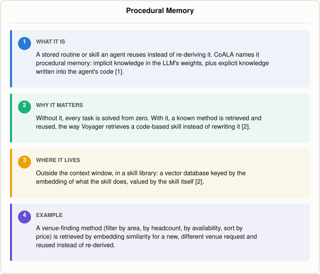

# What Is Procedural Memory in an AI Agent?

*~5 min read*

**One-line answer:** procedural memory is a stored routine or skill an [agent](ai-agents-vs-agentic-ai.md) reuses on a new task instead of working out the method again from scratch; CoALA defines it as "implicit knowledge stored in the LLM weights" plus "explicit knowledge written in the agent's code" [1], and Voyager's skill library is the clearest working example of that explicit form in practice [2].



*The four-part gist: a stored method, retrieved and reused instead of re-derived.*

## The problem

Picture that same teammate running their tenth sprint planning meeting. They've done this enough times that nobody has to hand them a checklist: pull over last sprint's leftover tickets, check the team's capacity for the week, triage the backlog by priority, confirm the sprint goal out loud before closing the meeting. Nobody walks them through the steps anymore. The procedure itself is what they remember, not any one sprint in particular.

That is procedural memory: not a fact, and not a record of one specific past event, but a reusable way of doing a kind of thing. For an AI agent, procedural memory is a stored routine or skill, a sequence of steps or a snippet of reusable logic, that it learned once by solving a task, and can reuse directly the next time a similar task comes up instead of reasoning through the whole thing again from zero.

This sits alongside two other kinds of long-term memory an agent can have: a fact ("the venue holds 80 people") is semantic memory, a record of one specific past event ("last Saturday's booking fell through") is episodic memory. Procedural memory is neither; it is the method, not the fact or the event. Part of a series on the different kinds of memory an agent can have: see [what-kinds-of-memory-an-agent-has.md](what-kinds-of-memory-an-agent-has.md). For how an agent splits short-term memory, the context window, from long-term memory in general, see [why-agents-need-memory-beyond-the-context-window.md](why-agents-need-memory-beyond-the-context-window.md).

## How it works

1. CoALA splits procedural memory into two forms: "implicit knowledge stored in the LLM weights, and explicit knowledge written in the agent's code" [1]. The weights form is whatever the model already knows from training; the code form is anything the agent's designer wrote down as a reusable routine.
2. The code form usually starts out human-written, CoALA says, "initialized by the designer." Adding to it later is possible but "significantly riskier than writing to episodic or semantic memory" [1].
3. CoALA's own example of an agent adding to procedural memory at runtime is Voyager, which has "a long-term procedural memory that stores a library of code-based grounding procedures a.k.a. skills" [1].
4. Concretely, that skill library is a lookup table. In Voyager's words: "Each time GPT-4 generates and verifies a new skill, we add it to the skill library, represented by a vector database. The key is the embedding vector of the program description (generated by GPT-3.5), while the value is the program itself" [2]. A new task is solved by embedding its description, retrieving the closest matching skill, and handing the code straight to the model instead of asking it to write a new program.
5. This is a shortcut inside the [agent loop](what-the-agent-loop-is.md): a matched procedure skips straight to execution instead of reasoning out a new plan from zero.

## Real example

The script gives `llama3.1:8b` (Ollama, temperature 0) two structurally similar venue-booking tasks, scored against a ground-truth Python filter, not the model's own judgment.

Task 1: cheapest available Riverside-area venue for 7 people. The model works through it correctly:

```
Step 1 - venues in the Riverside area: Garden Hall, Oak Room, River Pavilion, Elm Hall
Step 2 - of those, where meets headcount is Yes: Oak Room, River Pavilion, Elm Hall
Step 3 - of those, where available is Yes: Oak Room, River Pavilion
Step 4 - cheapest of those: River Pavilion, 30
ANSWER: River Pavilion

model picked: River Pavilion   ground truth: River Pavilion ($30)   correct: True   output tokens: 83
```

The script then asks the model to write down the *general method* it used, not the answer, with no task-specific detail allowed:

```
1. Define the requirements: Identify the specific needs of the event, including the location, date, and number of guests (the headcount).
2. Research potential venues: Gather a list of potential venues in the desired area that can accommodate the headcount and meet any other specific needs.
3. Evaluate and compare options: Assess each potential venue based on factors such as capacity, amenities, pricing, and location, to determine the best fit.
4. Confirm the booking: Once a suitable venue is selected, confirm the booking with the venue management.
```

A check for leaked specifics ("Riverside", "River Pavilion", the price) found none. Keyed by an [embedding](what-is-an-embedding.md) of its task type, this text becomes the stored skill, alongside an unrelated distractor about splitting a dinner bill.

Task 2: a different area and headcount, Downtown, 5 people. Retrieval by embedding similarity correctly favors the venue skill over the distractor:

```
similarity 0.806  -  finding the cheapest available venue that matches an area and a headcount
similarity 0.426  -  splitting a shared dinner bill fairly among people who ordered different amounts
```

Solved from scratch, the model gets the right venue (City Center Hall, $22) but takes 116 output tokens. Handed the retrieved procedure as a shortcut, it reaches the same answer in 90:

```
Step 1 - venues in the Downtown area: Downtown Studio, Lakeside Room, City Center Hall, Metro Hall
Step 2 - of those, where meets headcount is Yes: Lakeside Room, City Center Hall, Metro Hall
Step 3 - of those, where available is Yes: City Center Hall, Metro Hall
Step 4 - cheapest of those: City Center Hall, 22
ANSWER: City Center Hall

model picked: City Center Hall   ground truth: City Center Hall ($22)   correct: True   output tokens: 90
```

That is a 22% drop in output tokens (116 to 90) for the same correct answer. Run three times, the pattern held: the procedure-following run was correct and used fewer tokens every time, while the from-scratch baseline flipped to the wrong venue once, picking the option that passed the filters but was not the cheapest. Run it with `uv run examples/what-procedural-memory-is-in-an-agent/procedural_memory_demo.py`.

This is a small, text-based stand-in for Voyager's skill library: Voyager stores and reuses executable code [2]; this demo stores and reuses a short text recipe.

## When this picture isn't enough

A stored procedure is only as good as the moment it was written down. CoALA flags this directly: writing to procedural memory "is significantly riskier than writing to episodic or semantic memory, as it can easily introduce bugs or allow an agent to subvert its designers' intentions" [1]. If prices change or the shape of a request shifts, a saved method can quietly stop fitting, with no built-in way for the agent to notice.

Retrieval by embedding similarity also only checks whether a new task *looks* like one already solved. A task that resembles a stored skill on the surface but differs in a way that matters, a constraint the old method never had to handle, can still pull back the wrong recipe and get followed with unwarranted confidence. Neither problem showed up in the small two-skill demo above, but with hundreds of stored skills it gets harder to tell a stale or mismatched procedure from a good one.

## Takeaway

Procedural memory is the *how*: a routine stored once and reused directly, instead of re-derived every time [1][2]. In this demo, handing the agent its own previously written method cut output tokens by about a fifth and produced a consistently correct answer across repeat runs, while solving the same task from scratch occasionally slipped on the final comparison.

## Sources

[1] Cognitive Architectures for Language Agents, Sumers et al., https://arxiv.org/abs/2309.02427
[2] Voyager: An Open-Ended Embodied Agent with Large Language Models, Wang et al., https://arxiv.org/abs/2305.16291
