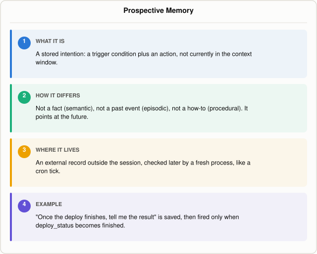

# What Is Prospective Memory in an AI Agent?

*~5 min read*

**One-line answer:** prospective memory is "the ability to execute an intention at a specific future cue or state while other activities are ongoing" [1]: a stored commitment to act later, not a fact, a past event, or a how-to.



*A deferred intention is a trigger and an action, filed away until something checks it.*

## The problem

Picture that same teammate wrapping up a long Friday. Walking out the door, they think: "Once Monday's deploy goes out, I need to check whether the checkout bug actually got fixed." They're not thinking about it right now, they're thinking about the weekend. But some part of them has filed away a commitment: do this specific thing, at this specific future point. Monday, something has to remind them, a calendar ping, a sticky note, or the intention just evaporates.

That's prospective memory: not a fact, not a memory of something that already happened, but a commitment to do something later, tied to a future trigger. For an AI agent, it's what lets it carry forward a deferred task, "check back on this in an hour," "follow up once the deploy finishes," and actually act on it when the trigger fires, instead of the intention disappearing when the current session ends.

## How it works

1. **The intention gets a shape, not just a sentence.** PM-Bench, by Genglin Liu and Saadia Gabriel, frames it precisely: "A task in PM-Bench is a deferred intention specified by a natural-language label, a trigger condition, and an executable action. For example, a task may be time-based ('Take asthma medication at 21:00') or event-based ('Book the appointment when a slot opens in the portal')" [1]. It borrows the Virtual Week paradigm from cognitive science: "scenarios unfold over a seven-day schedule. At every step, the agent must continue an ongoing activity while deciding whether any deferred intention should be executed at that given moment" [1]. The hard part isn't knowing the task exists; it's noticing, mid-activity, that the moment to act has arrived.
2. **This needs the same outside-the-window storage as any other memory, plus a trigger.** The companion post on [agent memory beyond the context window](why-agents-need-memory-beyond-the-context-window.md) covers writing a fact to a file and reading it back in next session. Prospective memory reuses that storage, but the record carries a trigger condition, and something has to actively re-check that condition later rather than just loading it back in.
3. **Checking the trigger is a loop concern, related to but distinct from a stop condition.** [Agent loops need their own stop conditions](why-agent-loops-need-stop-conditions.md) to know when to end a run; a stored trigger is a separate condition the loop checks on each pass to decide whether a deferred task is due.
4. **Current models still miss this often.** Comparing eight LLMs under eight agent configurations, PM-Bench's authors report that "PM-Bench does not have a universal winning scaffold. In the aggregate, the best overall method is the optional-heartbeat single agent, with macro Set-F1 of 65.1%" [1] (averaged across all eight models; per-model, the strongest single result they report is GPT-5.4 with optional heartbeat at 79.1%), a score that punishes both missed actions and actions taken when nothing was actually due. The authors add that "no single strategy for improving prospective memory dominates across models" [1].

## Real example

The script below (`llama3.1:8b` via Ollama, temperature 0) runs as four separate process invocations: one session, then three independent "tick" checks, like a cron job, each with no memory of the session's conversation, only whatever is in the stored record on disk.

`... session`: the user says "Once the deploy finishes, tell me the result and whether we need to roll back." The model fills in a structured record (the keys are fixed by the prompt, the values come from the model), mirroring PM-Bench's label/trigger/action schema, and it's saved to an external JSON store. This process then exits:

```
=== INTENTION WRITTEN TO EXTERNAL STORE ===
{
  "label": "Check Deploy Result",
  "trigger_state_key": "deploy_status",
  "trigger_value": "finished",
  "action_text": "Tell user the result and whether we need to roll back",
  "status": "pending"
}
```

`... tick running`, a brand-new process: the deploy is still running, so the model is never even called:

```
=== TICK (new process) ===
current state: {'deploy_status': 'running', 'tests_failed': 0}
trigger not met: deploy_status='running', waiting for 'finished' -> nothing happens
```

`... tick finished`, another new process: the trigger matches, so a fresh prompt built from only the stored record and the current state, no session history at all, goes to the model:

```
=== TICK (new process) ===
current state: {'deploy_status': 'finished', 'tests_failed': 0}
trigger met: deploy_status='finished' -> firing stored action

--- fresh prompt sent to the model (no session history included) ---
You previously agreed to this deferred task:
  label: Check Deploy Result
  action to take: Tell user the result and whether we need to roll back

The trigger has now fired. Current state: {"deploy_status": "finished", "tests_failed": 0}

Carry out the action using only this information. Be brief.

--- model output ---
The deployment was successful. No rollback needed.
```

`... tick finished` run a second time, yet another new process, same state: the stored status is already `"done"`, so it doesn't fire again:

```
=== TICK (new process) ===
current state: {'deploy_status': 'finished', 'tests_failed': 0}
trigger field 'deploy_status' already handled (status=done) -> skip, no re-fire
```

Run it with `uv run examples/what-prospective-memory-is-in-an-agent/prospective_memory_demo.py session`, then `... tick running`, then `... tick finished` twice. The defining trait on display: the intention lived outside the context window the entire time between the session process and the tick processes, and nothing fired until a later, separate process actually checked the stored trigger against real state.

## When this picture isn't enough

A trigger that's never checked is the same as no memory at all; this demo's ticks are triggered manually, and a real agent needs a scheduler, a webhook, or the next session's startup to actually call the check. A trigger checked too late ("the deploy finished an hour ago, why tell me now") is still a failure even if it eventually fires. PM-Bench's results show this is genuinely hard, and not just a matter of checking more often: "more reminders do not automatically yield a better operating point" [1], since each extra check also risks firing on something that wasn't actually due.

This post is part of a series on the different kinds of memory an agent can have: see [what kinds of memory an agent has](what-kinds-of-memory-an-agent-has.md) for how prospective memory relates to semantic, episodic, and procedural memory.

## Takeaway

Prospective memory is a stored trigger-plus-action, not a fact or a log entry, and it only works if something outside the original session actually checks the trigger later. Across eight models and eight agent configurations, PM-Bench's best setup still only averages 65.1% macro Set-F1, and no single strategy wins for every model [1].

## Sources

[1] PM-Bench: Evaluating Prospective Memory in LLM Agents, Genglin Liu and Saadia Gabriel, https://arxiv.org/abs/2607.12385
