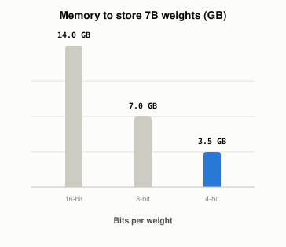

# What Does QLoRA Add to LoRA?

*~3 min read*

**One-line answer:** QLoRA keeps the frozen base model compressed to 4 bits and trains a small add-on on top of it. The paper says this "reduces memory usage enough to finetune a 65B parameter model on a single 48GB GPU" [1].

*Plain arithmetic printed by the demo: bytes = parameters x bits / 8.*

## The problem

Picture a huge manual you must edit. Keeping every page at full size fills the desk. Keeping the manual in compressed storage and unpacking a page only while you read it leaves room to work.

[Fine-tuning](what-fine-tuning-changes.md) a big model has the same problem. The paper states that regular 16-bit finetuning of a LLaMA 65B model "requires more than 780 GB of GPU memory" [1]. LoRA trains a small add-on while the original weights stay frozen. QLoRA also shrinks those frozen weights.

## How it works

1. The frozen base model is stored in 4-bit form. The paper describes QLoRA as backpropagating "gradients through a frozen, 4-bit quantized pretrained language model into Low Rank Adapters (LoRA)" [1].
2. Weights are unpacked only when used: "whenever a QLoRA weight tensor is used, we dequantize the tensor to BFloat16, and then perform a matrix multiplication in 16-bit" [1]. This is the unpack-a-page step.
3. 4-bit NormalFloat (NF4) is the 4-bit data type. The paper calls it "an information theoretically optimal quantization data type for normally distributed data" [1].
4. Double Quantization is "a method that quantizes the quantization constants, saving an average of about 0.37 bits per parameter (approximately 3 GB for a 65B model)" [1].
5. Paged Optimizers use "NVIDIA unified memory to avoid the gradient checkpointing memory spikes that occur when processing a mini-batch with a long sequence length" [1].

## Real example

`uv run examples/what-qlora-adds-to-lora/quant_memory.py` first does the memory arithmetic for 7B parameters. Then it quantizes a synthetic 4096x4096 Gaussian matrix (synthetic data, fixed seed, not real model weights) in blocks of 64, each block scaled by its largest absolute value.

This is plain uniform quantization used to show the memory-versus-error trade. It is not NF4.

| Bits | 7B model memory | Mean abs error (synthetic matrix) | Saved vs 16-bit (incl. scales) |
|---|---|---|---|
| 16 | 14.0 GB | n/a | n/a |
| 8 | 7.0 GB | 0.00503 | 46.9% |
| 4 | 3.5 GB | 0.09128 | 71.9% |

In this run the weights have a mean absolute value of 0.79758. Going from 8 to 4 bits saved more memory and raised the average error from 0.00503 to 0.09128.

## When this picture isn't enough

The demo shows only memory and error on random numbers, not model quality. Block size and scale storage here are my demo's choices, not the paper's: one 32-bit scale per block of 64 weights.

The add-on it trains is explained in [LoRA](what-lora-changes-in-a-model.md); compressing stored vectors instead of weights is in [vector quantization](what-vector-quantization-trades-away.md).

## Takeaway

LoRA shrinks what you train. QLoRA also shrinks the frozen model you train on top of, using 4-bit storage, double quantization and paged optimizers.

## Sources

[1] QLoRA: Efficient Finetuning of Quantized LLMs, Dettmers, Pagnoni, Holtzman, Zettlemoyer, https://arxiv.org/abs/2305.14314
