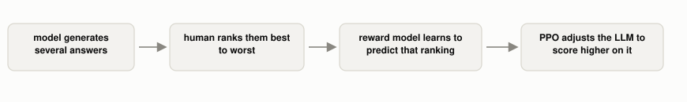

# What Does RLHF Add on Top of Fine-Tuning?

*~3 min read*

**One-line answer:** RLHF replaces "write a correct example answer" with "rank a few answers from best to worst". This is easier for a human to do, and it gives the model a preference signal instead of a single right answer to copy [1].

*Three extra pieces beyond plain fine-tuning: multiple outputs, a learned stand-in for human judgment, and a training algorithm that optimizes against it.*

## The problem

[Fine-tuning](what-fine-tuning-changes.md) needs someone to write a correct example answer for every training case, which breaks down for open-ended tasks where there isn't one right answer, only better and worse ones. Ranking a handful of existing outputs is something a person can do quickly; writing a great answer from scratch, for every single example, isn't. RLHF is built around that difference.

## How it works

1. Start from a model already fine-tuned on human-written examples [2].
2. For a given prompt, have the model generate several different candidate answers.
3. Have a human rank those candidates from best to worst. OpenAI describes this directly: "we collect a dataset of comparisons between model outputs, where labelers indicate which output they prefer for a given input" [1].
4. Train a separate, smaller "reward model" on those rankings, so it learns to predict which output a human would prefer, without needing a human in the loop every time [1].
5. Use that reward model's score as the training signal, and run a reinforcement learning algorithm (OpenAI used PPO, Proximal Policy Optimization) to adjust the LLM's weights to score higher on it: "we use this RM as a reward function and fine-tune our supervised learning baseline to maximize this reward using the PPO algorithm" [1].

## Real example

This is the exact two-step process from the InstructGPT paper: step one collects human comparisons and trains a reward model on them; step two uses that reward model, with PPO, to push the fine-tuned model toward outputs the reward model scores well [1]. The reward model is the key new piece. It's what lets "a human preferred this" scale beyond the rankings actually collected, by learning to predict more of them.

## When this isn't enough

The reward model is only an approximation of human preference, trained on a limited set of comparisons from a limited set of labelers. It can end up rewarding outputs that look good to it without that generalizing to what people actually want, especially outside the range of what it was trained to judge. The final model's behavior is also only as good as the rankings it learned from, so inconsistent or narrow human judgments become narrow or inconsistent model behavior.

## Takeaway

RLHF turns "humans rank a few outputs" into a model that can be trained against that preference signal at scale, via a reward model standing in for the human judgment that produced it.

## Sources

[1] Training Language Models to Follow Instructions with Human Feedback, Ouyang et al., OpenAI (2022), https://arxiv.org/abs/2203.02155
[2] [What Does "Fine-Tuning" Actually Change in an Already-Trained Model?](what-fine-tuning-changes.md)
