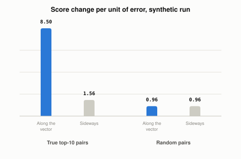

# What Does ScaNN Do Differently From Other Vector Indexes?

*~4 min read*

**One-line answer:** ScaNN is Google Research's vector search library. Its paper's idea is about compression: when vectors are squeezed to make search faster, the paper's loss weights the squeezing error along the vector's own direction more heavily than the error sideways to it [1][2]. In the demo below, a unit of error along the vector moved the scores of the true top-10 pairs 5.5 times as much as a unit of sideways error.



*Printed numbers from the demo below (synthetic data, one run).*

## The problem

Picture measuring a plank with a ruler that is slightly off. If the ruler's mistake is a wobble to the side, your reading of the length barely changes. If the mistake is stretched along the plank, your reading is wrong. Same size of mistake, different damage.

Other [vector indexes](what-different-vector-index-strategies-trade-off.md) such as flat, IVF and HNSW are about how to organise the search. ScaNN's paper is about the compression step inside it.

## How it works

1. Many fast search methods compress each stored vector into a nearby code. The blog post says previous schemes did this "with the aim of minimizing the average distance between each vector x and its quantized form" [2].
2. The paper's abstract says that "Traditional approaches to quantization aim to minimize the reconstruction error of the database points" [1].
3. The paper's observation: "for a given query, the database points that have the largest inner products are more relevant" [1].
4. The blog adds: "Error in the parallel direction is much more harmful in the MIPS problem because it disproportionately impacts high inner products, which by definition are the ones that MIPS is trying to estimate accurately." [2] (MIPS means maximum inner product search.)
5. So the paper's loss function "more greatly penalizes the parallel component of a datapoint's residual relative to its orthogonal component" [1]. The ruler analogy: error along the plank is punished more than wobble to the side.
6. The blog's conclusion: "encodings with higher average distance may actually result in superior MIPS accuracy" [2].

## Real example

`examples/what-scann-does-differently/error_directions.py` is a small numpy illustration. It does not use ScaNN and is not an implementation of it. It uses synthetic data with a fixed seed: 20,000 vectors in 64 dimensions, quantised with ordinary k-means (256 centroids), and 200 random queries. Each vector's quantisation error is split into the part along the original vector and the part sideways to it.

The script makes two measurements.

First, it applies only one part of the error to every vector and counts how much of each query's true top-10 drops out of the top-10:

```
average length of parallel error:    3.368
average length of perpendicular error: 6.933

  full quantisation error applied:  95.8%
  only parallel error applied:      37.1%
  only perpendicular error applied: 63.0%
```

In this run the sideways error was longer, and applying it moved more of the top-10. This measurement applies the error to every vector and uses random queries. It does not compare high-scoring pairs with other pairs, so it is not a test of the paper's claim.

Second, it measures how much a unit-length error moves the score `<q, x>` (the inner product of query and vector), for the true top-10 pairs and for 200,000 randomly chosen pairs. The numbers are the mean squared score change:

```
  true top-10 pairs  along the vector:   8.50   sideways:  1.56   ratio:   5.5
  random pairs       along the vector:   0.96   sideways:  0.96   ratio:   1.0
```

For the high-scoring pairs, error along the vector moved the score 5.5 times as much as sideways error. For random pairs the two were equal. This matches the direction of the paper's statement: "For such w, we show that parallel quantization error is weighted more heavily than orthogonal quantization error." [1] Here "such w" means a weight that "puts greater weight on larger inner products" [1]. The demo does not train anything with the paper's loss and does not measure search accuracy with it.

## When this picture isn't enough

The paper has math on when the weight on the parallel part grows, which this post leaves out. The demo uses one synthetic dataset, one run and random queries, so it says nothing about real data.

Compression of vectors in general is in [vector quantization](what-vector-quantization-trades-away.md); the exact baseline is in [flat search](what-flat-vector-search-costs.md).

## Takeaway

ScaNN's published idea is not a new way to organise the search. It is a new way to score compression mistakes: error along the vector's direction costs more than error sideways to it. In this demo, that held for the true top-10 pairs and not for random pairs.

## Sources

[1] Accelerating Large-Scale Inference with Anisotropic Vector Quantization, Guo et al., ICML 2020, https://arxiv.org/abs/1908.10396
[2] Announcing ScaNN: Efficient Vector Similarity Search, Philip Sun, Google Research blog, https://research.google/blog/announcing-scann-efficient-vector-similarity-search/
