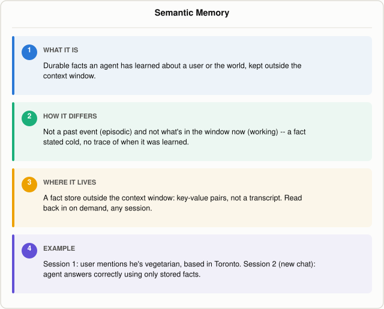

# What Is Semantic Memory in an AI Agent?

*~4 min read*

**One-line answer:** semantic memory is the durable facts an [agent](ai-agents-vs-agentic-ai.md) has learned about a user or the world — CoALA defines it as what "stores an agent's knowledge about the world and itself" [1] — kept outside the context window and read back in without re-deriving them from a past conversation.



*Semantic memory is fact-shaped and context-free: it answers "what is true," not "what happened."*

## The problem

Picture a new teammate in their first week on the job. Someone mentions, in passing, that the design lead just relocated to the Austin office. Weeks later, someone else asks the new teammate where the design lead is based, and they just answer "Austin" — they aren't replaying the conversation where they heard it, and they couldn't tell you who mentioned it or when. It's just a fact they now have, the kind of thing they could state cold, out of context, from any starting point.

That's semantic memory: not "what happened" but "what is true." For an AI agent, semantic memory is the durable facts and profile info it has learned about a user or the world — a dietary restriction, a home city, a job title — stored outside the [context window](what-a-context-window-actually-limits.md), read back in without needing to re-derive them from a past conversation. It's a narrower idea than the general split covered in [why agents need memory beyond the context window](why-agents-need-memory-beyond-the-context-window.md): that post is about short-term versus long-term storage; this one is about one particular shape of long-term memory — the fact, stripped of the episode that produced it. A specific past event is episodic memory instead, and a skill or procedure the agent follows is procedural memory — both are their own posts in this series.

## How it works

1. **It's defined by content, not location.** CoALA (Cognitive Architectures for Language Agents) splits an agent's long-term memory into semantic, episodic, and procedural stores, and gives semantic memory this job: "Semantic memory stores an agent's knowledge about the world and itself" [1]. The defining trait is that the content is a fact, independent of any one conversation.
2. **It gets written by reasoning over experience, not by logging the experience itself.** CoALA describes agents that "reason about raw experiences and store the resulting inferences in semantic memory" — its example is Reflexion, which reflects on a failed episode and stores the takeaway (e.g., "there is no dishwasher in kitchen") as semantic knowledge, separate from the episode that produced it [1].
3. **It gets read back in at decision time, detached from its origin.** CoALA's generative-agents example writes reflections like "I like to ski now" to semantic memory, then "retrieves relevant reflections from semantic memory" during planning [1] — the plan uses the fact, not the conversation that generated it.
4. **It can also start out pre-loaded rather than learned.** CoALA notes that retrieval-augmented methods can be viewed as "retrieving from a semantic memory of unstructured text" such as Wikipedia [1] — semantic memory doesn't have to come from the agent's own experience; it can be seeded from an external knowledge source and then added to over time.

## Real example

The script below runs two separate "sessions" with `llama3.1:8b` (Ollama, temperature 0) and a tiny JSON file as the semantic memory store. In session 1 the user, Marco, mentions he's vegetarian, based in Toronto, and works as a backend engineer — three durable facts dropped into an ordinary message, not a scripted form. The model is asked to pull out `key: value` facts, which are saved to the file:

```
=== FACTS WRITTEN TO THE SEMANTIC MEMORY STORE ===
 - vegetarian: true
 - based in toronto: true
 - remote worker: true
 - backend engineer: true
 - programming languages: go, postgres
```

Session 2 is a brand-new conversation — no transcript from session 1 is loaded or available, only the fact file. Asked "I'm about to book Marco a lunch meeting. What should the restaurant avoid, and where is he based?":

```
--- A) no memory ---
To provide a helpful response, I'll need to know a bit more about Marco's
preferences and location. Could you please tell me: ...

--- B) with semantic facts loaded from the store ---
loaded facts: {'vegetarian': 'true', 'based in toronto': 'true', ...}
The restaurant should avoid serving meat. Marco is based in Toronto.
```

Without the store, the model has nothing to go on and asks for the facts back. With the store, it answers correctly using facts that came from a conversation it has no record of — no timestamp, no transcript, nothing except the fact itself. Run it with `uv run examples/what-semantic-memory-is-in-an-agent/semantic_memory_demo.py`.

## When this picture isn't enough

A fact is only as good as when it was written. Marco could go back to eating meat or move out of Toronto, and the store won't know until something tells it so — stale or wrong semantic facts get read back into later conversations exactly like fresh ones, which is a form of [context poisoning](what-is-context-poisoning.md). This demo also sidesteps conflict resolution: a real store needs a rule for what happens when a new fact contradicts an old one, which this script doesn't attempt.

This post is part of a series on [the different kinds of memory an agent can have](what-kinds-of-memory-an-agent-has.md).

## Takeaway

Semantic memory is the fact, not the story: durable knowledge about a user or the world, written once from experience and reused in any later session without needing the original conversation [1].

## Sources

[1] Cognitive Architectures for Language Agents, Sumers et al., https://arxiv.org/abs/2309.02427
