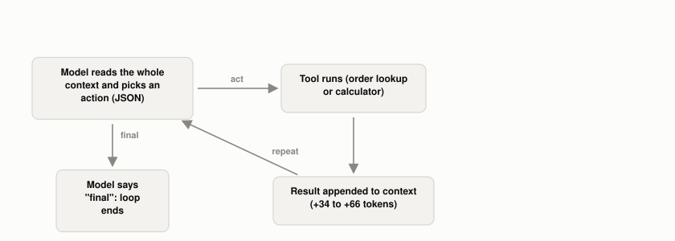

# What Is the Agent Loop?

*~3 min read*

**One-line answer:** an agent is a model run inside a loop: decide an action, call a tool, read the result, append it to the context, and go round again until the model says it is done. Anthropic puts it plainly: agents "are typically just LLMs using tools based on environmental feedback in a loop" [1].



*Every trip around the loop adds tokens to the context; the only exit is the model choosing "final".*

## The problem

Think of a cook making soup. Nobody gets it right in one go. You taste, add salt, taste again, notice it is too thin, simmer, and taste again. A single-shot LLM call is a cook who writes the whole recipe blindly and never tastes.

An [agent](ai-agents-vs-agentic-ai.md) is the cook who tastes. The "tasting" is a tool result coming back. The "adjusting" is the model choosing its next move from what it just saw.

## How it works

1. The program sends the model the goal plus everything so far (the [context window](what-a-context-window-actually-limits.md)).
2. The model replies with a structured action: which tool, with which arguments, or "final".
3. Ordinary code runs the tool. In this demo, the model only returns text.
4. The tool's output is appended to the context as a new message, and step 1 repeats with a longer context.
5. The loop stops when the model emits "final", or when the program hits a step limit. Anthropic says it is "common to include stopping conditions (such as a maximum number of iterations) to maintain control" [1].

This is the shape of the ReAct pattern, which interleaves "reasoning traces and task-specific actions" so reasoning helps the model "track, and update action plans" while actions "gather additional information" from outside [2]. Anthropic adds that it is "crucial for the agents to gain 'ground truth' from the environment at each step (such as tool call results or code execution)" to assess progress [1].

## Real example

The whole loop is under 50 lines of plain Python. It gives a local model two tools: an order lookup (one order, A-1001: 3 desk lamps at 24.50) and a calculator. The task is "What is the total cost of order A-1001, with 8% tax added?"

```
start: context = 129 tokens
step 1  MODEL: {"action": "lookup_order", "args": {"order_id": "A-1001"}}
        TOOL : {'item': 'desk lamp', 'unit_price': 24.5, 'qty': 3}   -> 195 tokens
step 2  MODEL: {"action": "calculator", "args": {"expression": "24.5*3"}}
        TOOL : 73.5                                                  -> 232 tokens
step 3  MODEL: {"action": "calculator", "args": {"expression": "73.5*0.08+73.5"}}
        TOOL : 79.38                                                 -> 277 tokens
step 4  MODEL: {"action": "final", "args": {"answer": "79.38"}}      -> 311 tokens
```

Run it with `uv run examples/what-the-agent-loop-is/agent_loop_demo.py`.

Three tool calls, one final answer, and 79.38 is correct. The context grew from 129 to 311 tokens. In this run the model added the tax in one expression instead of two calculator calls. At step 4 the earlier results were in its context.

## When this picture isn't enough

This is a toy: two deterministic tools and one run. It shows nothing about noisy tools or long runs. For what goes into the context each turn, see [context engineering](what-context-engineering-is.md); for a bad result staying in the history, see [context poisoning](what-is-context-poisoning.md).

A loop that never ends is the subject of [stop conditions](why-agent-loops-need-stop-conditions.md); how a loop uses its own errors is in [recovering from mistakes](how-an-agent-recovers-from-its-own-mistakes.md).

## Takeaway

In this demo, the "act, observe, append, repeat" loop took one question through three tool calls to a correct answer, and the context grew from 129 to 311 tokens along the way.

## Sources

[1] Building effective agents, Anthropic, https://www.anthropic.com/engineering/building-effective-agents (quotes verified verbatim in fetched page)
[2] ReAct: Synergizing Reasoning and Acting in Language Models, Yao et al., https://arxiv.org/abs/2210.03629 (quotes verified verbatim in fetched abstract)
