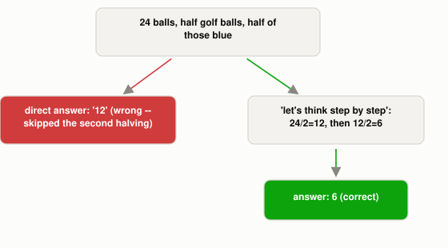

# What Does Telling an LLM to "Think Step by Step" Actually Change?

*~3 min read*

**One-line answer:** chain-of-thought prompting gets the model to write out its intermediate reasoning steps before the final answer, instead of jumping straight to it. This matters because an [LLM](what-is-an-llm.md) only has its own already-generated tokens to condition on, so writing the steps out loud gives it a working memory it otherwise wouldn't have [1].



*Same model, same weights. Forcing the intermediate step into visible tokens is what gets the second halving done.*

| Prompt | Model's answer | Correct? |
|---|---|---|
| "Answer with only the final number, no explanation." | 12 | No |
| "...Let's think step by step." | 6 (full reasoning shown first) | Yes |

*Same question, same model, same weights. The only difference is whether the reasoning is forced into the visible output before the number is.*

## The problem

A two-step math word problem needs its first result before the second step can use it. But an [LLM](what-is-an-llm.md) generates one [token](what-is-a-token.md) at a time, conditioned only on tokens that already exist. If it's told to answer immediately, it has to collapse both steps into a single guess with nothing written down yet to carry the first result forward. The paper that introduced this technique names the fix directly: give the model "a series of intermediate reasoning steps" to produce before the final answer, via "a simple method called chain of thought prompting," where "a few chain of thought demonstrations are provided as exemplars in prompting" [1].

## How it works

1. Add something to the prompt that elicits visible reasoning, either a plain instruction like "let's think step by step" (zero-shot chain-of-thought), or [a few worked examples](why-a-few-examples-teach-what-instructions-cant.md) that show the reasoning steps themselves (few-shot chain-of-thought) [1].
2. Because the model's next-token prediction is conditioned on every token generated so far, each intermediate line it writes becomes part of its own input for the next line. The written-out steps act as a scratchpad the model can build on, which it doesn't have if it jumps straight to an answer.
3. This isn't a separate reasoning engine bolted onto the model. It's the same [transformer](why-transformers-need-position.md) doing the same next-token prediction. Chain-of-thought just changes what sequence of tokens it's predicting.
4. The paper describes the gain as an emergent ability: it shows up reliably only once the model is large enough, and can actually make small models worse [1].

## Real example

I ran the same two-step word problem against a local model (`llama3.1:8b`, via Ollama) two ways (`uv run examples/what-thinking-step-by-step-actually-changes/cot_demo.py`): "A juggler has 24 balls. Half are golf balls, and half of the golf balls are blue. How many blue golf balls are there?"

```
--- direct answer ---
12

--- chain-of-thought ---
1. Total number of balls: 24
2. Half of the balls are golf balls: 24 / 2 = 12 golf balls
3. Half of the golf balls are blue: 12 / 2 = 6 blue golf balls
Therefore, there are 6 blue golf balls.
```

Told to answer immediately, the model stops after the first halving and reports 12, which is wrong because it skipped the second step entirely. Told to think step by step, it writes out both divisions in order and lands on the correct answer, 6. Same question, same weights; the only change was whether intermediate steps were allowed to exist as tokens before the final number did.

## When this picture isn't enough

Chain-of-thought doesn't guarantee correct reasoning. It just makes reasoning visible, which usually (not always) improves it. The paper notes the benefit is task-dependent: simple tasks that don't need multiple steps gain little or nothing from it. And visible steps aren't a transparency guarantee either. A model can write out reasoning that looks coherent but doesn't actually reflect how it arrived at its answer, so a convincing-looking chain of thought is not the same claim as a correct or honest one.

## Takeaway

An LLM has no scratchpad except the tokens it has already written. Chain-of-thought prompting works by turning the reasoning itself into tokens the model can condition on, one step at a time, instead of forcing the whole answer out in one guess.

## Sources

[1] Chain-of-Thought Prompting Elicits Reasoning in Large Language Models, Wei et al., Google Research (2022), https://arxiv.org/abs/2201.11903
