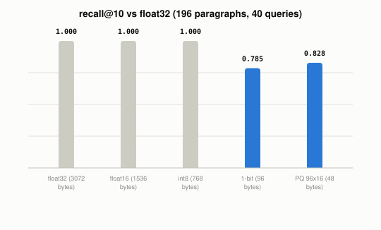

# What Does Compressing Vectors Trade Away?

*~3 min read*

**One-line answer:** compressing stored vectors means keeping fewer bits per number, or a short code per piece of the vector, so memory drops and the search can return a different set of nearest neighbours than the full-size vectors would.



*Bars are the recall@10 values printed by the demo run. Labels give bytes per vector.*

## The problem

Think of shrinking photos so a thousand of them fit on a phone. A small copy still shows a cat. Two similar cats can end up looking the same.

A stored [embedding](what-is-an-embedding.md) has the same trade. Each one is a list of numbers; in the demo below, a float32 vector of 768 numbers takes 3072 bytes. Compression makes each vector smaller, and in the demo the nearest neighbours it found changed for some methods.

## How it works

1. **Scalar quantization** keeps every number but stores it with fewer bits. Faiss describes 8-bit integer encoding as "vectors quantized to 256/64/16 levels" for 8, 6 and 4 bits [1]. Half precision is the mildest step: pgvector says "Use the `halfvec` type to store half-precision vectors" [2], and Faiss notes 16-bit floats "may cause some loss of precision" [1].
2. **Binary quantization** keeps only one bit per number. In the demo that bit is the sign of the number. pgvector stores binary vectors with the `bit` type: "Use the `bit` type to store binary vectors" [2]. The demo compares two such vectors by counting how many bits differ, which is Hamming distance (pgvector lists Hamming distance among its distance types [2]).
3. **Product quantization** splits the vector into pieces and replaces each piece with the number of its closest entry in a small table. Jegou et al. write: "A vector is represented by a short code composed of its subspace quantization indices." [3] Faiss says the sub-vectors are "each quantized to a few bits (usually 8)" [1].

For the index side of the same memory question, see [what different vector index strategies trade off](what-different-vector-index-strategies-trade-off.md).

## Real example

The script embeds paragraphs from a fixed list of 27 of this repo's posts (the ones that existed before the later posts were added, so edits to other posts do not change the numbers) with `nomic-embed-text` through Ollama. A paragraph counts if it has at least 20 words. The corpus is 196 paragraphs. The script uses 40 of them as queries and leaves each query out of its own results. It finds the top 10 neighbours by cosine with the full float32 vectors, then repeats the search after each compression. Recall@10 is the share of those 10 that the compressed search also returns. Run it with `uv run examples/what-vector-quantization-trades-away/quantization_demo.py`.

```
paragraphs: 196
embedding dimensions: 768
PQ: 96 subvectors x 16 centroids (196 vectors are too few to train 256 centroids)

method          bytes/vector  saved vs float32  recall@10
float32                 3072              0.0%      1.000
float16                 1536             50.0%      1.000
int8 scalar              768             75.0%      1.000
1-bit binary              96             96.9%      0.785
PQ 96x16                  48             98.4%      0.828
```

In this run, float16 and int8 returned the same 10 neighbours as float32 for all 40 queries while using half and a quarter of the memory. The 1-bit and product quantization versions saved 96.9% and 98.4%, and returned 78.5% and 82.8% of the true top 10.

Because the corpus is small, the script gives product quantization 16 centroids per piece instead of 256, with 10 k-means iterations; I did not test 256. These recall numbers hold for this corpus only.

## When this picture isn't enough

The demo ranks every vector, so it does not show how compression behaves inside an index. It also uses one embedding model and one corpus. The recall figures in this post come only from this run.

How scores are computed is in [similarity measures](how-vector-search-measures-similarity.md); the same idea applied to model weights is in [QLoRA](what-qlora-adds-to-lora.md).

## Takeaway

Compression buys memory with accuracy. In this run, the 8-bit and 16-bit versions returned the same top 10 as float32, and the 1-bit and product quantization versions returned 78.5% and 82.8% of it.

## Sources

[1] Faiss indexes, Faiss wiki, https://github.com/facebookresearch/faiss/wiki/Faiss-indexes
[2] pgvector README, https://github.com/pgvector/pgvector
[3] Product quantization for nearest neighbor search, Jegou, Douze, Schmid, https://inria.hal.science/inria-00514462v2
