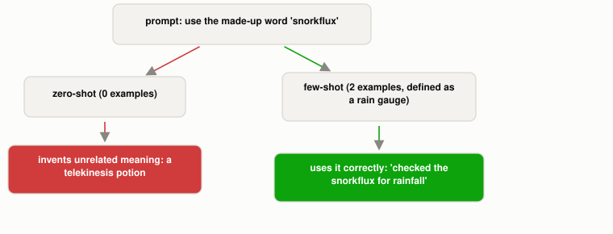

# Why Can a Few Examples Teach an LLM Something a Plain Instruction Can't?

*~3 min read*

**One-line answer:** few-shot prompting puts a handful of example input→output pairs directly in the prompt, so the model can pick up a brand-new pattern at inference time, with no weight update. Zero-shot and one-shot are the same mechanism, just with 0 and 1 examples instead of several [1].


*No retraining happened between these two calls. Only what sat in the prompt changed.*

| Setting | Demonstrations in the prompt | What the model gets |
|---|---|---|
| Zero-shot | 0 | An instruction, nothing else |
| One-shot | 1 | An instruction plus one worked example |
| Few-shot | several (the GPT-3 paper allowed "typically 10 to 100") | An instruction plus multiple worked examples |

*Same model, same weights, same forward pass. The only thing changing between rows is how much example material sits in the prompt before the real question.*

## The problem

An [LLM](what-is-an-llm.md)'s weights are frozen after [training](how-a-program-learns.md); nothing you type changes them. So if you need the model to follow a brand-new convention it never saw in training, such as a made-up word's definition, an unusual output format, or a house style, a plain instruction has nothing to draw on. The GPT-3 paper's authors ran into this directly: they found a model conditioned only on "a natural language instruction and/or a few demonstrations of the task" could still complete new instances of that task, just by predicting what comes next [1].

## How it works

1. The prompt literally contains example pairs before the real question. This is called "in-context learning," because the model is learning the pattern from the context window, not from a gradient update [1].
2. **Zero-shot**: "no demonstrations are allowed and only an instruction in natural language is given to the model" [1]. The model has to rely entirely on what it already picked up in training.
3. **One-shot**: exactly one demonstration, a single reference point for the expected structure or content.
4. **Few-shot**: "as many demonstrations as will fit into the model's context window" [1]. That is enough examples for the model to infer the pattern itself, without being told it explicitly.
5. Mechanically, nothing changes: the model is still just predicting the next [token](what-is-a-token.md) given everything before it. The examples simply become part of "everything before it," so continuing the pattern they establish is now the most likely continuation.

## Real example

I asked a local model (`llama3.1:8b`, via Ollama) to use a word ("snorkflux") that cannot exist anywhere in its training data, because I made it up for this script (`uv run examples/why-a-few-examples-teach-what-instructions-cant/fewshot_demo.py`):

```
--- zero-shot (0 examples) ---
...a strange and colorful substance..."Snorkflux," said to grant the drinker
temporary telekinetic abilities.

--- few-shot (2 examples, defining "snorkflux" as a rain-measuring device) ---
"The farmer checked the snorkflux to see how much rain had fallen overnight."
```

Zero-shot, the model has nothing to go on, so it invents an unrelated meaning (a telekinesis potion). Shown two worked examples that establish the made-up-word pattern, including one that defines "snorkflux" as a rain gauge, it picks up the pattern and uses the word correctly. No retraining happened between those two calls; the only difference is what was sitting in the prompt.

## When this picture isn't enough

Few-shot isn't free of pitfalls: which examples you pick, and the order you put them in, measurably changes the output, and a bad or inconsistent example can mislead the model as easily as a good one teaches it. It's also not learning in the sense [training](how-a-program-learns.md) is: nothing persists once the conversation ends; the next prompt starts from the same frozen weights as before. And for problems that need multiple sequential reasoning steps rather than just a pattern to copy, more examples alone often isn't enough. That is what [chain-of-thought prompting](what-thinking-step-by-step-actually-changes.md) adds.

## Takeaway

Zero-shot, one-shot, and few-shot are the same trick: conditioning the model on demonstrations inside the prompt, with the dial turned from no examples to several. More demonstrations usually means a clearer pattern for the model to continue.

## Sources

[1] Language Models are Few-Shot Learners, Brown et al., OpenAI (2020), https://arxiv.org/abs/2005.14165
