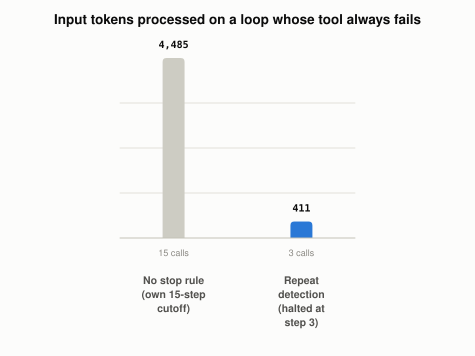

# Why Do Agent Loops Need Stop Conditions?

*~3 min read*

**One-line answer:** an [agent](ai-agents-vs-agentic-ai.md) is a model called in a loop, and a loop repeats until some rule ends it. Stop rules include a step limit, a repeat-call check, a timeout and a human checkpoint. Anthropic says it is "common to include stopping conditions (such as a maximum number of iterations) to maintain control" [1].


*Same failing tool, same model: the only difference is whether anything was allowed to say "stop".*

## The problem

Picture a taxi with a broken route. The driver is told "get me to Elm Street," but the bridge is closed, and the GPS keeps saying "turn around when possible." The driver obeys, ends up at the same junction, and the GPS says it again. The meter never stops.

An agent loop is that taxi. The model picks an action, a tool runs, the result is appended to the conversation, and the model is called again. In the demo below, the tool keeps failing, the model repeats the identical call, and every step re-sends the whole growing history as input. OWASP names a related risk "Unbounded Consumption," which it says occurs when an application allows users to conduct "excessive and uncontrolled inferences," leading to risks such as "economic losses" [2].

## How it works

Four exits, three from the sources and one from the demo:

1. **Max iterations.** Count steps and stop at N (Anthropic, quoted above).
2. **Repeat-action detection.** The demo remembers each (tool, arguments) pair and stops when the same one shows up a third time.
3. **Timeout.** OWASP's mitigation list says: "Set timeouts and throttle processing for resource-intensive operations to prevent prolonged resource consumption." [2]
4. **Human checkpoint.** Anthropic notes agents "can then pause for human feedback at checkpoints or when encountering blockers" [1].
In run A below, nothing outside the model could end the loop except the safety cutoff, and the model did not stop itself.

## Real example

The script runs a small loop with one tool, `lookup_record`, that always fails. With a clear error (`record 4471 not found`), in this run the model stopped on its own after 3 steps (two failed lookups, then "done") and 309 input tokens. So the demo is deliberately set up to loop (token counts use tiktoken's `cl100k_base`, an approximation for this model): the error is vague (`temporary lookup failure for record 4471, please retry`) and the prompt insists the record exists and the model must never give up. Run A has no stop rule except a safety cutoff of 15 steps.

```
step  1 | context  110 tok | model: {"action":"lookup_record","id":"4471"}
        tool -> ERROR: temporary lookup failure for record 4471, please retry
step  2 | context  137 tok | model: {"action":"lookup_record","id":"4471"}
...
step 15 | context  488 tok | model: {"action":"lookup_record","id":"4471"}
STOPPED: safety cutoff of 15 steps (nothing else stopped it)
total input tokens processed across all calls: 4485
```

Run B is the same setup with `max_steps=4` and "halt when the same call is made a third time":

```
step  1 | context  110 tok | model: {"action":"lookup_record","id":"4471"}
step  2 | context  137 tok | model: {"action":"lookup_record","id":"4471"}
step  3 | context  164 tok | model: {"action":"lookup_record","id":"4471"}
STOPPED: same call made 3 times
total input tokens processed across all calls: 411
```

Run it with `uv run examples/why-agent-loops-need-stop-conditions/stop_conditions_demo.py`.

Without a stop rule, the identical call ran 15 times (to the safety cutoff) and used 4,485 input tokens, and every call failed. With repeat detection, the loop halted at step 3 and used 411 input tokens, about a tenth as many.

## When this picture isn't enough

This demo repeats exactly, so an identical-call check catches it. The demo does not test calls that vary a little, one model, or one run.

The loop these limits wrap is explained in [the agent loop](what-the-agent-loop-is.md); a loop that fixes itself is in [recovering from mistakes](how-an-agent-recovers-from-its-own-mistakes.md).

## Takeaway

In this demo, a failing tool with a persistent prompt kept the model repeating one call for 15 steps and 4,485 input tokens. A step cap plus a repeat check ended the same setup at step 3 with 411 tokens.

## Sources

[1] Building effective agents, Anthropic, https://www.anthropic.com/engineering/building-effective-agents
[2] LLM10:2025 Unbounded Consumption, OWASP GenAI Security Project, https://genai.owasp.org/llmrisk/llm102025-unbounded-consumption/
