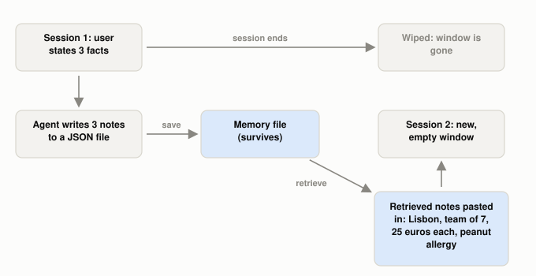

# Why Do Agents Need Memory Beyond the Context Window?

*~4 min read*

**One-line answer:** the [context window](what-a-context-window-actually-limits.md) is the model's short-term memory and is "short and finite" [2], so an [agent](ai-agents-vs-agentic-ai.md) that must carry knowledge across sessions writes notes to storage outside the window and pulls them back in later [1][3].



*In this demo, the only thing that crosses from session 1 to session 2 is the file in the middle.*

## The problem

Picture a colleague who works at a whiteboard all day and has it wiped every night. Monday you tell her your team has 7 people and one of them has a peanut allergy. Tuesday the board is blank, so she asks again. Now give her a notebook in a desk drawer: before the wipe she copies the important lines into it, and next morning she flips to the right page. Same colleague, same brain: the notebook is what changed.

An [LLM](what-is-an-llm.md) is the colleague, and the context window is the whiteboard. Weng's survey of agents maps short-term memory to in-context learning, which is "short and finite, as it is restricted by the finite context window length of Transformer," and long-term memory to "the external vector store that the agent can attend to at query time" [2].

## How it works

1. During a session the agent decides what is worth keeping: a preference, a constraint, a decision. Anthropic calls this structured note-taking: the agent "regularly writes notes persisted to memory outside of the context window. These notes get pulled back into the context window at later times" [1].
2. The notes go into storage outside the window. The sources name a `NOTES.md` file [1], memory files [3], and an external vector store [2].
3. When a new session starts, the notes are read back in. Anthropic's memory docs describe it this way: "Rather than loading all relevant information up front, an agent records what it learns in memory files and reads them back on demand" [3]. The demo below finds notes by [embedding](what-is-an-embedding.md) similarity, the same lookup used in [RAG](what-problem-does-rag-actually-solve.md).
4. Anthropic's memory tool follows this pattern, and its docs say this "keeps the active context focused on the current task" [3]. Claude can "create, read, update, and delete files that persist between sessions, building up knowledge over time without keeping everything in the context window" [3].

## Real example

The script runs two sessions with `llama3.1:8b` (Ollama, temperature 0). In session 1 the user says she runs a team of 7 in Lisbon, a teammate has a severe peanut allergy, and the meal budget is 25 euros per person. The model is asked to write these facts as notes, which are saved with their embeddings to a JSON file. In the run quoted here, they were:

```
- Priya runs a team of 7 people in Lisbon.
- Tomas has a severe peanut allergy.
- The team's budget for meals is 25 euros per person.
```

Session 2 is a brand-new conversation: "Which city should I search in, how many seats do I need, what is the max total budget, and what must the restaurant avoid?" Without the notes, the model has nothing from session 1 in its prompt. With the three notes pasted above the question, it answered:

```
Search in: Lisbon
Seats needed: 7
Max total budget: 175 euros (25 euros/person x 7 people)
Restaurant must avoid: peanuts
```

Run it with `uv run examples/why-agents-need-memory-beyond-the-context-window/memory_demo.py`. The two runs differ by the retrieved notes and one added line telling the model to use them. This is a small demo: three notes, and the script retrieves up to three, so all of them are returned.

## When this picture isn't enough

A note is read back in as written. If it is wrong, the next session starts from the wrong note, which is [context poisoning](what-is-context-poisoning.md).

When the window fills up instead of resetting, see [context compaction](what-context-compaction-is.md); to load notes only when needed, see [just-in-time context](what-just-in-time-context-is.md). This post treats "memory outside the window" as one idea; for the different shapes that memory actually takes (a fact, a past event, a learned routine, a future commitment, and more), see [what kinds of memory does an AI agent actually have](what-kinds-of-memory-an-agent-has.md).

## Takeaway

The window is the whiteboard; agent memory is notes stored outside it and read back in later [1][3]. A note read back in is only as correct as when it was written.

## Sources

[1] Effective context engineering for AI agents, Anthropic Engineering, https://www.anthropic.com/engineering/effective-context-engineering-for-ai-agents
[2] LLM Powered Autonomous Agents, Lilian Weng, https://lilianweng.github.io/posts/2023-06-23-agent/
[3] Memory tool, Claude Platform Docs, https://platform.claude.com/docs/en/agents-and-tools/tool-use/memory-tool
