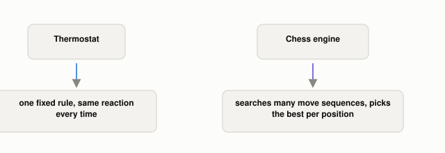

# Why Doesn't an AI Have to Think Like a Human?

*~2 min read*

**One-line answer:** artificial intelligence is the engineering of machines that behave intelligently, and nothing in that definition requires copying how a human brain works [1].

*Only the chess engine evaluates and chooses between options. That's the behavior "AI" actually names, not how human-like the method looks.*

| | Thermostat (fixed rule) | Chess engine (AI) |
|---|---|---|
| Decision method | One hard-coded rule: if temp is below X, turn on heat | Searches huge numbers of possible move sequences and picks the best |
| Reacts differently per situation? | No, same rule regardless of context | Yes, a different search for every unique board position |
| Needs human-style reasoning? | N/A, there's no reasoning | No, it relies on raw computation, not how a person visualizes a board [1] |

*Both react to input. Only one searches through possibilities to decide what to do. That's the behavior the term "AI" is actually pointing at, not human-like thought.*

## The problem

Engineers often expect "intelligent" to mean "reasons like a person," so when a system's behavior looks nothing like human reasoning, it feels broken, or not really AI. That expectation is wrong from the start. John McCarthy defined AI as the engineering of machines that behave intelligently, with no requirement that the method resemble biological thought [1].

## How it works

1. AI is defined by the *behavior* a machine produces: does it act in ways that would be called intelligent if a person did them [1]?
2. The method used to get that behavior is unconstrained. McCarthy states directly that "AI does not have to confine itself to methods that are biologically observable" [1].
3. A fixed rule reacting the same way every time (a thermostat) isn't AI, because it isn't evaluating options. It's just executing one instruction.
4. A system that searches, evaluates, and picks among many possible actions is doing the kind of behavior the term describes, regardless of whether its internal method looks anything like a brain.

## Real example

Chess engines "now play at grandmaster level," McCarthy writes, but they get there "relying on much more computation than a human" and not on the understanding a strong human player uses [1]. The engine doesn't picture the board the way a grandmaster does; it brute-force-evaluates an enormous number of move sequences. Both are intelligent chess behavior. Only one is modeled on how people actually think.

## When this definition runs out

McCarthy's own page carries a disclaimer: these are his answers, not "consensus opinion among researchers in AI" [1]. The field doesn't have one universally agreed definition, so you'll see other framings elsewhere. The definition also doesn't tell you how much search, learning, or adaptability a system needs before "intelligent behavior" counts as AI rather than a very elaborate fixed rule; that line is genuinely blurry, and this post doesn't resolve it.

## Takeaway

AI is a question about behavior: does the machine evaluate and choose? It is not a question about whether it thinks the way we do.

## Sources

[1] What is Artificial Intelligence? Basic Questions, John McCarthy, Stanford University, https://www-formal.stanford.edu/jmc/whatisai/node1.html
