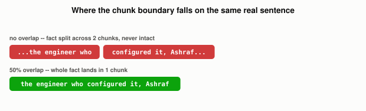

# Why Does Chunking Strategy Matter More Than Which Database You Pick?

*~3 min read*

**One-line answer:** before anything gets [embedded](what-is-an-embedding.md) or stored in a [vector database](why-you-cant-just-grep-your-way-to-semantic-search.md), a document has to be split into chunks. If a chunk boundary happens to fall in the middle of the fact you needed, no retrieval algorithm downstream can put the pieces back together, because that intact fact never existed as one retrievable unit in the first place [1].


*The same sentence, chunked two ways. Only one of them leaves the fact in one retrievable piece.*

```
source text: "The project's vector database is Chroma, and the engineer
who configured it, Ashraf, chose it for local-first simplicity..."

chunked at size 10, NO overlap:
  "The project's vector database is Chroma, and the engineer who"
  "configured it, Ashraf, chose it for local-first simplicity over..."
  -- the fact "the engineer... configured it... Ashraf" is split in half.
     No single chunk contains it intact.

chunked at size 10, overlap 5:
  "Chroma, and the engineer who configured it, Ashraf, chose it"
  -- the same fact now exists whole, inside one chunk.
```

## The problem

A [RAG](what-problem-does-rag-actually-solve.md) pipeline's first stage is indexing: chunking documents, then creating vector embeddings from each chunk. Chunking happens *before* embedding, which means whatever got cut apart at this stage is permanently cut apart for every later retrieval, no matter how good the embedding model or [vector database](why-you-cant-just-grep-your-way-to-semantic-search.md) is downstream. As one guide to this puts it plainly: "if our chunks are too small or too large, it may lead to imprecise search results" [1].

## How it works

1. A document gets split into chunks, by some rule. The simplest is fixed-size: "we simply decide the number of tokens in our chunk" [1]. Every N tokens becomes one chunk, usually sized to fit comfortably inside the embedding model's own limit. [Other rules](what-different-ways-to-chunk-a-document-exist.md) split on natural boundaries first (recursive/paragraph-aware), on actual topic shifts (semantic), or on structural boundaries (function/class for code, section for legal documents).
2. Each chunk gets its own [embedding](what-is-an-embedding.md), stored independently. The database has no idea chunk 3 and chunk 4 came from adjacent text; they're just two more vectors.
3. **Overlap** means consecutive chunks share some of their words at the boundary, instead of cutting cleanly. So a fact that straddles where a chunk boundary *would* have fallen has a better chance of landing whole inside at least one chunk anyway.
4. There's a real, concrete tradeoff behind the chunk-size number itself: smaller chunks retrieve more precisely (less irrelevant text riding along) but are more likely to cut a fact in half; larger chunks preserve more complete facts but dilute the embedding with less-relevant surrounding text, which can push the chunk's vector further from the query's.

## Real example

I took one real sentence containing a single fact (who configured a database, and why) and chunked it two ways (fixed-size with no overlap, and the same size with 50% overlap) and then ran the real query "Who configured the vector database?" against both chunk sets using real embeddings (`uv run examples/why-chunking-strategy-matters-more-than-your-database/chunking_demo.py`):

```
no overlap:  no single chunk contains both "configured" and "Ashraf" together
with overlap (score 0.5765): "Chroma, and the engineer who configured it,
  Ashraf, chose it" -- the complete fact, intact, in one chunk
```

Without overlap, the sentence was cut exactly between "the engineer who" and "configured it, Ashraf". The fact exists, technically, split across two adjacent chunks, but no single retrieved chunk ever states it completely. With overlap, the fact survives intact as its own retrievable unit, because the boundary that would have cut it apart got duplicated into the neighboring chunk instead.

**[Try it live: Chunking Playground →](https://claude.ai/artifact/LEDeufTCUbNbtRVPPBA47F)**: this exact sentence is the default text. Drag the overlap slider up from 0 and watch the "fact phrase intact" badge flip from split to whole.

## When this picture isn't enough

Overlap isn't free. It multiplies your total chunk count and therefore your storage and embedding cost, for a benefit that only matters when a fact genuinely straddles a boundary; most sentences don't. The right chunk size and overlap also depends heavily on the content: a FAQ page benefits from small, precise chunks, while a legal contract needs larger, section-aware chunks so a clause's conditions don't get separated from the clause itself. There's no universal "right" number, only a tradeoff tuned to what you're actually chunking.

## Takeaway

Chunking happens before anything else in the [RAG](what-problem-does-rag-actually-solve.md) pipeline, which means a bad chunking decision is a ceiling nothing downstream (better embeddings, better database, better LLM) can retrieve its way past.

## Sources

[1] Chunking Strategies for LLM Applications, Pinecone, https://www.pinecone.io/learn/chunking-strategies/
