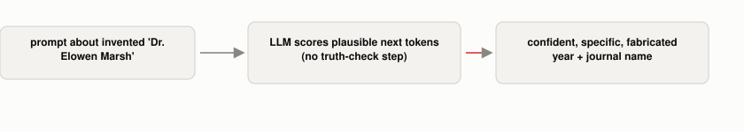

# Why Do LLMs State Fake Facts With Total Confidence?

*~3 min read*

**One-line answer:** a "hallucination" is an LLM generating content that sounds fluent and plausible but isn't backed by anything real. It happens because the model's whole job is predicting a plausible next [token](what-is-a-token.md), which is a different thing from knowing whether that token is true [1].



*There's no "I don't know" branch built into the mechanism, just the same scoring process that produces true answers too.*

```
Prompt: "What year did Dr. Elowen Marsh publish her famous paper on
         quantum lighthouse theory, and which journal was it in?"

Model:  "Dr. Elowen Marsh published her famous paper on quantum
         lighthouse theory in 2018, and it appeared in the 'Journal
         of Quantum Physics and Applications.'"
```
*Neither "Dr. Elowen Marsh" nor "quantum lighthouse theory" exist. I made them up for this prompt. The year and journal name are both fabricated, and stated with no hedging at all.*

## The problem

An [LLM](what-is-an-llm.md) doesn't have a "lookup the truth" step anywhere in how it works. It scores likely next tokens based on patterns in training data, and a confident-sounding, grammatically correct, specific-sounding fake fact scores just as well as a true one, because fluency and factual accuracy are not the same signal. The research survey on this names the phenomenon directly: "LLMs are prone to hallucination, generating plausible yet nonfactual content," and defines it, following prior work, as "generated content that is nonsensical or unfaithful to the provided source content" [1].

## How it works

1. Ask about something real, well-represented in training data, and the model's next-token predictions are backed by a lot of consistent prior text. It's very likely to land on the true answer.
2. Ask about something that doesn't exist, the model still has to produce *some* next token. There's no "I have no pattern for this" output built into the mechanism itself. It falls back on whatever's statistically plausible given the shape of the question: a person's name implies a field, implies a plausible-sounding year, implies a plausible-sounding journal name.
3. The result reads exactly like a true fact, because the model generates both the same way: one token at a time, from the same scoring process.
4. The survey splits this into two types: "intrinsic" (contradicting something actually given to the model) and "extrinsic" (unverifiable against anything the model was given) hallucination [1]. The made-up journal above is extrinsic: nothing told the model it was wrong, because nothing true about this fictional person exists to contradict.

## Real example

I asked a local model (`phi3:mini`, via Ollama) about a person and a theory I invented just for this prompt (`uv run examples/why-llms-state-fake-facts-with-total-confidence/hallucination_demo.py`):

```
Dr. Elowen Marsh published her famous paper on quantum lighthouse theory
in 2018, and it appeared in the "Journal of Quantum Physics and
Applications."
```

Running this script again produces a *different* fabricated year and journal each time. It isn't recalling a memorized wrong answer, it's generating a fresh plausible-sounding one from scratch every time, which is itself evidence this is pattern completion, not retrieval.

## When this picture isn't enough

Not every model hallucinates equally readily. A larger, more heavily aligned model is more likely to say "I don't have information on that" instead of fabricating (a behavior taught during [RLHF](what-rlhf-adds.md), not a property of the base mechanism), which is part of why this demo needed a smaller, less cautious model to reliably trigger. [RAG](what-problem-does-rag-actually-solve.md) reduces hallucination by giving the model real text to ground its answer in, but it doesn't eliminate the mechanism. A model can still hallucinate on top of retrieved context, or hallucinate when retrieval returns nothing useful.

## Takeaway

A hallucination isn't a bug where the model "glitches". It's the normal next-token-prediction mechanism running on a question it has no real pattern for, producing something fluent anyway, because fluency, not truth, is what that mechanism was ever scoring.

## Sources

[1] A Survey on Hallucination in Large Language Models: Principles, Taxonomy, Challenges, and Open Questions, Huang et al. (2023), https://arxiv.org/abs/2311.05232
