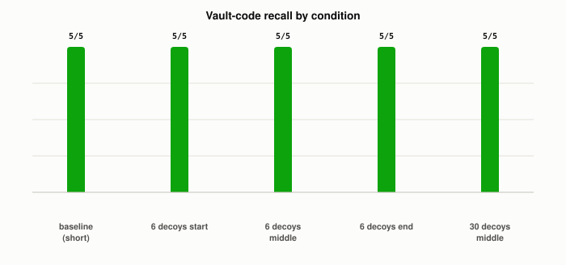

# Why Can Giving an LLM More Context Make It Worse, Not Better?

*~5 min read*

**One-line answer:** a bigger [context window](what-a-context-window-actually-limits.md) means a model *can* hold more tokens, not that it uses all of them equally well. Researchers who tested models on long inputs found "a U-shaped performance curve—models are better at using relevant information that occurs at the very beginning (primacy bias) or end of its input context (recency bias), and performance degrades significantly when models must access and use information located in the middle of its input context" [1], well before anything is actually dropped for lack of space.



*Every condition I tried locally still returned the exact code. The degradation this post is about didn't show up at the scale a quick local test can reach.*

## The problem

[What a context window actually limits](what-a-context-window-actually-limits.md) covers the hard wall: once total tokens exceed the model's fixed budget, something gets dropped or rejected. This is a quieter, separate failure, often called "lost in the middle" (after the paper below) or "context rot" (after Chroma's report on it [2]). The fact you need is still physically sitting in the prompt. Nothing got truncated, and the model still has plenty of room left. It can still fail to surface the one detail that matters, just because that detail is outnumbered by everything else around it.

## How it works

1. Liu et al.'s "Lost in the Middle" study tested models on multi-document question answering and key-value retrieval; as the paper puts it, "we make controlled changes to the length of the input context and the position of the relevant information" to see how each affects performance [1].
2. That's where the Figure 1 result quoted above comes from. It was seen across both open models (MPT-30B, LongChat-13B) and closed ones (GPT-3.5-Turbo, Claude-1.3) [1].
3. Nothing is missing from the model's input in this failure mode. Every token is still there to attend to. More surrounding material just means more competing signal for the same fixed attention mechanism to sort through.
4. It isn't only about position, either. Chroma's own controlled tests found "even a single distractor reduces performance relative to the baseline," an effect that "amplifies as input length grows" [2]. Separately, they found that "lower similarity needle-question pairs increases the rate of performance degradation" [2], meaning a fact that's clearly connected to your exact wording survives dilution much better than one you'd have to paraphrase your way to.
5. Engineers building long-running agents have named sub-patterns of this same family: "context distraction," when "a context grows so long that the model over-focuses on the context, neglecting what it learned during training," and "context confusion," when "superfluous content in the context is used by the model to generate a low-quality response" [3]. A close cousin, "context clash" (new, conflicting information competing with what's already there), and a related, separate failure mode called [context poisoning](what-is-context-poisoning.md) (an early error that keeps getting referenced), round out the same family, but aren't the focus here.

## Real example

I ran a "needle in a haystack" test against a local model (`llama3.1:8b`, Q4_K_M quantized, via Ollama): one checkable fact ("The secret access code for the vault is XQ-7491.") buried in a block of filler sentences, then asked the model to recall just that code (`uv run examples/why-more-context-can-make-an-llm-worse/needle_in_haystack_demo.py`). `num_ctx` was set to 32,768, far above every prompt's actual size (confirmed via Ollama's own `prompt_eval_count`), so a wrong answer couldn't be blamed on silently hitting the window limit. Five conditions, five independent trials each, haystack reshuffled fresh every trial:

```
short, no decoys, middle           (~222 tok):  5/5 correct
long, 6 decoys, start              (~3610 tok): 5/5 correct
long, 6 decoys, middle             (~3610 tok): 5/5 correct
long, 6 decoys, end                (~3610 tok): 5/5 correct
long, 30 competing decoys, middle  (~3082 tok): 5/5 correct
```

25 out of 25 correct. Even with thirty other fake "access codes" scattered through the text and the real one buried dead-center, `llama3.1:8b` picked out `XQ-7491` every single time. This is a real, honest null result, not a confirmed demonstration of the effect. At the scale a quick local test can reach, with this particular task shape, degradation simply didn't show up.

## When this picture isn't enough

My own test (above) didn't reproduce the degradation, and that's consistent with the literature's own nuance, not a contradiction of it. Chroma ran a similar needle test and reported "no notable variation in performance" across needle positions for their specific setup [2], even though Liu et al.'s multi-document and key-value tasks did show a strong position effect [1]. The failure mode clearly depends on task shape, not just "more tokens." My demo also kept things easy in the way Chroma's own finding predicts: the needle was a lexically distinctive code string, and my question shared a literal word ("vault") with the planted fact, likely the high-similarity case that degrades slowest [2]. The same quantized Llama 3.1 8B isn't immune to this in general, either: on a tool-calling benchmark it "failed" when handed all 46 candidate tools, "even though the context was well within the 16k context window," and only succeeded once cut down to 19 [3]. So the mechanism is real for this exact model family, even on a run where my specific test didn't manage to trigger it.

## Takeaway

A context window's stated size tells you what a model *can* hold, not how well it uses everything inside that limit. Dumping in more material, especially irrelevant or loosely-relevant material, can make recall worse long before you ever run out of room, so what you put in the window (and where) matters as much as how much fits.

## Sources

[1] Lost in the Middle: How Language Models Use Long Contexts, Liu, Lin, Hewitt, Paranjape, Bevilacqua, Petroni & Liang, arXiv:2307.03172, https://arxiv.org/abs/2307.03172
[2] Context Rot: How Increasing Input Tokens Impacts LLM Performance, Hong, Troynikov & Huber, Chroma (2025), https://www.trychroma.com/research/context-rot
[3] How Long Contexts Fail, Drew Breunig (2025), https://www.dbreunig.com/2025/06/22/how-contexts-fail-and-how-to-fix-them.html
