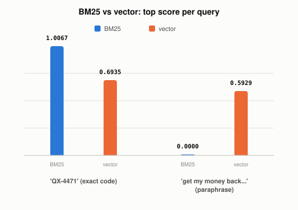

# Why Do RAG Systems Combine Keyword Search With Vector Search?

*~3 min read*

**One-line answer:** keyword search (BM25) and [vector search](why-you-cant-just-grep-your-way-to-semantic-search.md) fail in opposite situations: BM25 can't find a paraphrase with zero shared words, while vector search gives every document a fuzzy nonzero score even when it has no real match. So "hybrid search" runs both and combines the results, instead of betting everything on one [1].



*Same three documents. BM25 wins the exact-match query, vector search wins the paraphrase, and hybrid search is why you don't have to pick.*

```
query: "QX-4471" (an exact product code)
  BM25:    1.0067  vs  0.0000  vs  0.0000   <- decisive, clean separation
  vector:  0.6935  vs  0.3604  vs  0.3906   <- correct, but every doc gets some score

query: "How do I get my money back on something I bought?" (a paraphrase)
  BM25:    0.0000  vs  0.0000  vs  0.0000   <- total failure, no shared words at all
  vector:  0.4161  vs  0.3503  vs  0.5929   <- correctly finds the refund policy doc
```
*Same three documents, same two queries. Each method wins exactly where the other is blind.*

## The problem

[Vector search](why-you-cant-just-grep-your-way-to-semantic-search.md) is built to catch paraphrases, but that same flexibility means it can't guarantee an exact match either. A rare code, an exact product name, or a typo someone is searching for verbatim can all get buried under documents that are merely "semantically similar." Pure keyword search has the opposite problem: it's exact, but brittle. It has no idea "money back" and "refund" mean the same thing.

## How it works

1. **BM25** (the standard keyword-ranking algorithm) scores a document by how often the query's exact terms appear in it, weighted by how rare those terms are across the whole collection. A term that appears in every document barely counts; one that's rare and present scores heavily. It comes out of "the Probabilistic Relevance Framework," described as "a formal framework for document retrieval... which led to the development of one of the most successful text-retrieval algorithms, BM25" [1].
2. **Vector search** scores by [embedding](what-is-an-embedding.md) similarity, which has no concept of "exact" at all. It's always comparing directions in a continuous space, so there's always *some* nonzero similarity, relevant or not.
3. **Hybrid search** runs both rankings on the same query and merges them, commonly with reciprocal rank fusion, which combines two ranked lists by each document's rank position rather than trying to compare two differently-scaled scores directly.
4. This is a real, already-running design in production systems: the user's own local RAG build (AskTheDocs) runs BM25 alongside dense vector search for exactly this reason, rather than picking one.

## Real example

I ran a real BM25 implementation and real vector embeddings (same local model as [the embeddings post](what-is-an-embedding.md)) against the same three documents, with two very different queries (`uv run examples/why-rag-systems-combine-keyword-and-vector-search/hybrid_search_demo.py`):

```
"QX-4471" (exact term):
  BM25 gives the matching doc 1.0067 and the other two exactly 0.0000 -- a clean, decisive win.
  vector gives 0.6935 vs 0.3604/0.3906 -- correct, but "fuzzy": nothing scores a true zero.

"money back on something I bought" (paraphrase, zero word overlap with "refund"):
  BM25 gives all three documents 0.0000 -- no basis to rank anything at all.
  vector correctly ranks the refund-policy document highest, 0.5929 vs 0.4161/0.3503.
```

Neither method is simply "better." BM25 is unbeatable when the right term is present and rare; it's completely blind the moment the query is phrased differently. Vector search is the reverse: always gives *a* ranking, grounded in meaning rather than exact words, but never as clean-cut as an exact term match.

## When this picture isn't enough

Hybrid search adds real complexity. You now need to tune how the two rankings get merged, and a bad fusion weighting can make results worse than either method alone, not better. It also doesn't fix retrieval quality problems that happen earlier in the pipeline, like bad [chunking](why-chunking-strategy-matters-more-than-your-database.md) splitting the fact you needed before either search method ever gets a chance to find it.

## Takeaway

BM25 and vector search aren't competing solutions to the same problem. They're solutions to two different failure modes, exact-term blindness and total paraphrase blindness, which is exactly why real systems run both instead of choosing.

## Sources

[1] The Probabilistic Relevance Framework: BM25 and Beyond, Robertson & Zaragoza, Microsoft Research & Yahoo! Research (2009), https://doi.org/10.1561/1500000019

