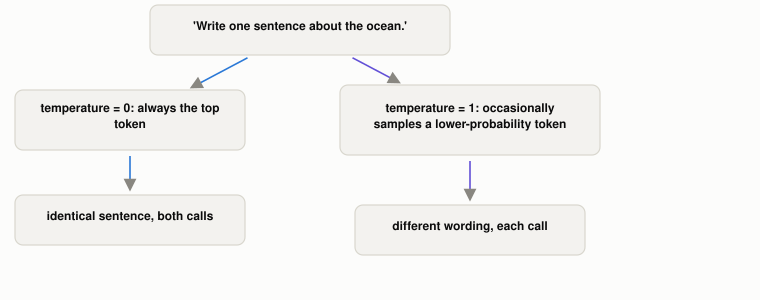

# Why Does the Same Prompt Give a Different Answer Each Time?

*~2 min read*

**One-line answer:** an LLM's output goes through a "temperature" setting that controls how randomly it samples from its predicted next-token probabilities. Temperature 0 always picks the single most likely token (so the same prompt gives the same answer every time). Higher temperatures let it occasionally pick a less-likely one, which is where the variation comes from [1].


*Same model, same prompt, same weights. Only the sampling knob changed between the two outcomes.*

```
--- temperature = 0 (two calls, same prompt) ---
"The ocean is a vast and mysterious body of water that covers over 70%
of the Earth's surface."
"The ocean is a vast and mysterious body of water that covers over 70%
of the Earth's surface."

--- temperature = 1 (two calls, same prompt) ---
"The ocean is a vast and complex ecosystem that covers over 70% of the
Earth's surface."
"The ocean is the largest body of water on Earth, covering over 70% of
the planet's surface."
```
*Identical prompt, identical model, identical weights. The only thing that changed between the two blocks is the temperature parameter.*

## The problem

[An LLM's final layer](what-is-an-llm.md) produces a probability for every possible next [token](what-is-a-token.md), not a single committed answer. Something has to decide which one actually gets picked, every single token, all the way through the response. Always picking the single highest-probability token (pure greedy decoding) sounds like it should give the "best" answer, but the research on decoding found the opposite: "using likelihood as a decoding objective leads to text that is bland and strangely repetitive" [1].

## How it works

1. For each next token, the model outputs a full probability distribution over its entire vocabulary: thousands of candidates, each with some likelihood.
2. **Temperature 0** (greedy decoding): always take the single highest-probability token. Deterministic: same input, same output, every time.
3. **Temperature > 0**: reshape that probability distribution to be flatter (more candidates become plausible) before sampling from it. Higher temperature means lower-probability tokens get picked more often, so outputs vary run to run.
4. Real systems rarely sample from the raw full vocabulary at high temperature, because that occasionally produces nonsense; the actual research behind this restricts sampling to "the dynamic nucleus of the probability distribution", which is only the most plausible subset of tokens, resized dynamically per step, rather than a fixed top-k cutoff [1].
5. The paper's core finding: "decoding strategies alone can dramatically [e]ffect the quality of machine text," independent of anything about the model's weights or training [1]. Temperature is a knob on *generation*, not on what the model knows.

## Real example

I called the same local model (`llama3.1:8b`) with the identical prompt, twice at each of two temperature settings (`uv run examples/why-the-same-prompt-gives-different-answers/sampling_demo.py`):

```
temperature=0: identical sentence, both times
temperature=1: "complex ecosystem... 70%..." vs "largest body of water... 70%..."
```

At temperature 0, both calls land on the exact same highest-probability token at every step, so the output is byte-for-byte identical. At temperature 1, the model occasionally samples a different, slightly-less-likely token partway through, and from that point on the rest of the sentence diverges, even with the same model, weights and prompt.

## When this picture isn't enough

Temperature isn't the only decoding knob. Top-k and top-p (nucleus) sampling restrict *which* tokens are even eligible before temperature reshapes their odds, and different APIs expose different combinations of these. Temperature also doesn't explain *why* a model says something false (that's [hallucination](why-llms-state-fake-facts-with-total-confidence.md)). It only explains why the exact wording of a true or false statement can change between runs.

## Takeaway

The randomness you see isn't the model "changing its mind". It's a deliberate sampling knob on top of a fixed probability distribution, turned up or down to trade determinism for variety.

## Sources

[1] The Curious Case of Neural Text Degeneration, Holtzman et al., University of Washington & Allen Institute for AI (2019), https://arxiv.org/abs/1904.09751
