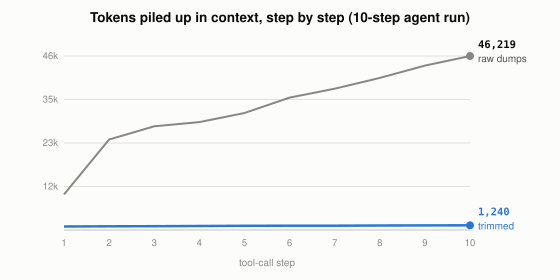

# Why Do Tool Results Quietly Fill Up an Agent's Context?

*~3 min read*

**One-line answer:** when an [agent](ai-agents-vs-agentic-ai.md) calls a tool, the raw output is added to its [context window](what-a-context-window-actually-limits.md) and stays there for later steps, so in this demo ten chatty tool calls add up to 46,219 tokens against 1,240 for trimmed results. Anthropic's suggested fixes are to return less from the tool, clear old results, or keep lightweight identifiers instead of the data [1][2].



*Same 10 tool calls, same answer in the data: one line keeps every raw dump, the other keeps only the fields the question needs.*

## The problem

Imagine you ask a colleague a yes/no question: "did the payments change go out today?" They don't say "yes." They hand you the entire 300-page deployment report and say "it's in there." You can find the answer, but now that report is on your desk for the rest of the day, and every next question you ask has to be answered with it sitting in the way.

The demo agent works the same way. It calls a tool (a log search, a file read, a database query), the tool returns everything it has, and the raw text is appended to the conversation. The demo sends the whole [context](what-context-engineering-is.md) on every step, so a big result rides along through every later step. Anthropic's engineers say that optimizing the quality of context is important, "But so is optimizing the quantity of context returned back to agents in tool responses" [1].

## How it works

1. The agent picks a tool and calls it. In the demo the raw tool ignores the question and returns everything: 80 deploy records with commit hashes and build hosts, 162 log lines with stack traces on the 12 error lines.
2. The demo pastes that raw result into the context, relevant or not.
3. The next step includes the question, every earlier tool call, and every earlier raw result again. Nothing is dropped.
4. The [window](what-a-context-window-actually-limits.md) total grows with each step: in the demo it reaches 9,468 tokens after step 1 and 46,219 after step 10.
5. Three fixes from Anthropic's articles, all about keeping the useful part:
   - **Return less.** Anthropic suggests "pagination, range selection, filtering, and/or truncation with sensible default parameter values", and notes that Claude Code restricts tool responses to 25,000 tokens by default [1].
   - **Clear stale results.** Anthropic asks why, "once a tool has been called deep in the message history", the agent would "need to see the raw result again", and calls tool result clearing one of the lightest-touch forms of compaction [2].
   - **Keep a pointer, not the payload.** Agents can hold "lightweight identifiers (file paths, stored queries, web links, etc.)" and use these references to "dynamically load data into context at runtime using tools" [2].

## Real example

The script simulates a 10-step incident investigation ("which deploy caused the checkout errors, and who wrote it?") with generated data and counts real tokens with `tiktoken` (`o200k_base`). Each tool either returns its full raw dump or just the fields the question needs (for example, 12 error lines collapsed to "12 errors, first at 14:12, PaymentTimeout").

```
step  1  list_deploys(last_3h)            full=  9468  trimmed=  932
step  2  search_logs(level=any)           full= 24033  trimmed=  982
step  5  read_file(payments_client.py)    full= 31072  trimmed= 1104
step 10  get_rollback_options(d-4812)     full= 46219  trimmed= 1240

after 10 steps: full=46219 tokens, trimmed=1240 tokens, ratio 37x
largest single raw result: 14553 tokens
```

Run it with `uv run examples/why-tool-results-bloat-context/tool_bloat_demo.py`. After 10 steps the raw run holds 46,219 tokens against 1,240 for the trimmed one, 37 times more.

## When this picture isn't enough

The data is generated, and the trimming was written by hand knowing the answer, so the demo does not show how a tool would choose which fields to keep. Anthropic says: "If you choose to truncate responses, be sure to steer agents with helpful instructions" [1].

For summarising a window that has already filled, see [compaction](what-context-compaction-is.md); for the pointer approach, see [just-in-time context](what-just-in-time-context-is.md).

## Takeaway

In this demo, the same 10 tool calls left 46,219 tokens in context as raw dumps and 1,240 as trimmed results, 37 times fewer.

## Sources

[1] Writing effective tools for agents, Anthropic Engineering, https://www.anthropic.com/engineering/writing-tools-for-agents
[2] Effective context engineering for AI agents, Anthropic Engineering, https://www.anthropic.com/engineering/effective-context-engineering-for-ai-agents
