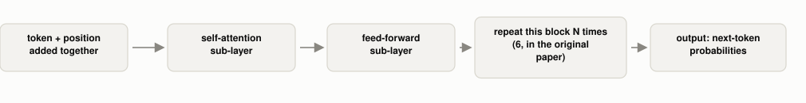

# Why Does a Transformer Need to Be Told Word Order, When Attention Doesn't See It?

*~3 min read*

**One-line answer:** a transformer is a stack of layers, each combining [self-attention](how-attention-weighs-words.md) with a simple feed-forward step. But self-attention alone treats its input as an unordered set, so the model has to be told each token's position separately, by adding position information directly into the input [1].



*Position gets added once, at the very bottom. Everything above it is the same two-step block, repeated.*

## The problem

[Attention](how-attention-weighs-words.md) computes a relevance score between every pair of tokens directly. There's no step in that calculation that looks at which token came first. Shuffle the input and attention, left alone, wouldn't notice. The paper that introduced the transformer says so directly: "since our model contains no recurrence and no convolution, in order for the model to make use of the order of the sequence, we must inject some information about the relative or absolute position of the tokens" [1].

## How it works

1. Before anything else, each token's [embedding](what-is-an-embedding.md) gets a "positional encoding" added to it. These are numbers that encode where in the sequence that token sits [1].
2. That combined vector enters a layer with two parts: a multi-head self-attention sub-layer (several attention calculations run in parallel), then a position-wise feed-forward sub-layer applied to each token separately [1].
3. Each sub-layer's output is added back to its own input and normalized (a "residual connection"), which is what keeps the signal usable after stacking many of these layers [1].
4. The whole two-part layer repeats: 6 times in the original paper, each layer building on the last [1].
5. Most modern LLMs use only half of this design: the "decoder" side (masked so a token can't look ahead) run on its own as the entire model. GPT's own paper describes this directly: "we use a multi-layer Transformer decoder for the language model, which is a variant of the transformer" [2].

## Real example

I ran the real self-attention calculation (dot product, softmax, weighted blend, the same three steps as the last post) on the same three token vectors in two different orders: `[A, B, C]` and `[C, A, B]` (`uv run examples/why-transformers-need-position/order_blind_demo.py`):

```
order1 output for A (position 0): [0.8446, 0.5777]
order2 output for A (position 1): [0.8446, 0.5777]
same values -> attention alone never noticed A moved
```

Token A gets the exact same output whether it's first or second, which shows that the attention calculation itself is blind to position. Positional encoding is the patch bolted on specifically to fix this.

## When this picture isn't enough

This covers one encoder-style block; the original paper's decoder has a third sub-layer (attention over the encoder's output) that a decoder-only LLM doesn't need, since it has no separate encoder. Multi-head attention also means several of these attention calculations run side by side per layer, each potentially picking up a different relationship. This post and the last one both showed only a single head's worth of math. And positional encoding is added once, at the bottom; it doesn't get recomputed at every layer, it just rides along through the residual connections.

## Takeaway

A transformer is attention plus a feed-forward step, stacked and repeated. Because attention alone can't tell order, order has to be injected before any of it runs.

## Sources

[1] Attention Is All You Need, Vaswani et al., Google Brain/Research & University of Toronto (2017), https://arxiv.org/abs/1706.03762
[2] Improving Language Understanding by Generative Pre-Training, Radford et al., OpenAI (2018), https://cdn.openai.com/research-covers/language-unsupervised/language_understanding_paper.pdf
