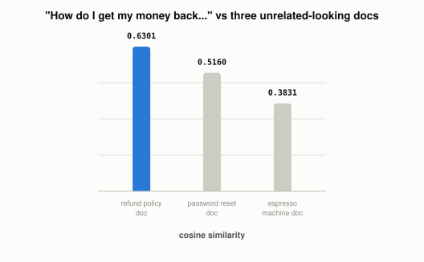

# Why Can't You Just Grep Your Way to Semantic Search?

*~4 min read*

**One-line answer:** a vector database stores every document as its [embedding](what-is-an-embedding.md) and finds matches by comparing vectors with cosine similarity, instead of comparing text. So it can find a document that means the same thing as your query even when it doesn't share a single word with it.



*Zero shared words with the winning document. The embeddings place "money back" and "refunds" close together anyway.*

| Query | Closest document (by meaning, not by shared words) | Score |
|---|---|---|
| "How do I get my money back on something I bought?" | "Our return policy allows refunds within 30 days of purchase." | 0.6301 |
| | "To reset your password, click the link in the email we sent you." | 0.5160 |
| | "The espresso machine needs to be descaled every three months." | 0.3831 |

*The query shares zero words with the winning document (no "money," "back," or "bought" appears in it), but it wins anyway, because the embeddings land close together.*

## The problem

Keyword search (`grep`, a SQL `LIKE`, a search index like Elasticsearch's default mode) matches on the literal words in your query. That works until someone phrases the same question differently, such as "get my money back" instead of "refund". A keyword matcher then sees no overlap at all, even though a human reading both sentences would call them the same request. This is exactly the gap [RAG](what-problem-does-rag-actually-solve.md) needs closed to retrieve the right document for a question, however it's phrased.

## How it works

1. Every document gets converted to an [embedding](what-is-an-embedding.md), a vector of numbers positioned so that documents used in similar ways sit close together, regardless of their literal wording.
2. The incoming query gets embedded the same way, with the same model.
3. The database compares the query's vector against every stored document's vector using cosine similarity, and returns whichever ones are closest.
4. At small scale this is just a loop; at large scale (millions of vectors) a plain loop gets too slow, which is the actual product problem a vector database (Pinecone, Weaviate, Chroma, pgvector, Qdrant, FAISS) solves: [approximate-nearest-neighbor indexing](what-different-vector-index-strategies-trade-off.md) that finds the closest vectors without comparing against every single one. The research behind this: "similarity search finds application in specialized database systems handling complex data such as images or videos," and the hard part at scale is that naive nearest-neighbor selection "exposes less parallelism" than the hardware can actually use [1].
5. The index algorithm and embedding model you pick directly decide retrieval quality. A bad match here can't be fixed downstream by a better LLM, because the LLM only ever sees what got retrieved.

## Real example

I embedded three short support documents and one differently-worded query with the same local embedding model used in [the embeddings post](what-is-an-embedding.md), then ranked the documents by real cosine similarity (`uv run examples/why-you-cant-just-grep-your-way-to-semantic-search/vector_search_demo.py`):

```
query: 'How do I get my money back on something I bought?'

0.6301  Our return policy allows refunds within 30 days of purchase.
0.5160  To reset your password, click the link in the email we sent you.
0.3831  The espresso machine needs to be descaled every three months.
```

The winning document and the query share no words in common at all. A keyword search would have returned nothing, or ranked all three documents as equally irrelevant. The embeddings place "money back" and "refunds" close together anyway, because that's how those phrases are actually used in text.

## When this picture isn't enough

Cosine similarity ranks by direction in embedding space, not by truth or usefulness. A document can be the closest match and still be outdated, wrong, or only tangentially related, which is one reason bad retrieval causes confidently wrong answers downstream. Real systems also usually [combine this "dense" vector search with traditional keyword search](why-rag-systems-combine-keyword-and-vector-search.md) (hybrid search) and a reranking step, since embeddings alone can struggle with exact-match terms like product codes or names that genuinely do need literal matching. And the documents being searched were split into chunks before any of this. [A bad chunking choice](why-chunking-strategy-matters-more-than-your-database.md) can mean the right answer was never retrievable in the first place.

## Takeaway

A vector database isn't a different kind of database so much as a different comparison: instead of "does this text contain these words," it asks "does this text's embedding point in the same direction as the query's", which is what lets it find matches a keyword search can't see.

## Sources

[1] Billion-Scale Similarity Search with GPUs, Johnson, Douze & Jégou, Facebook AI Research (2017), https://arxiv.org/abs/1702.08734
